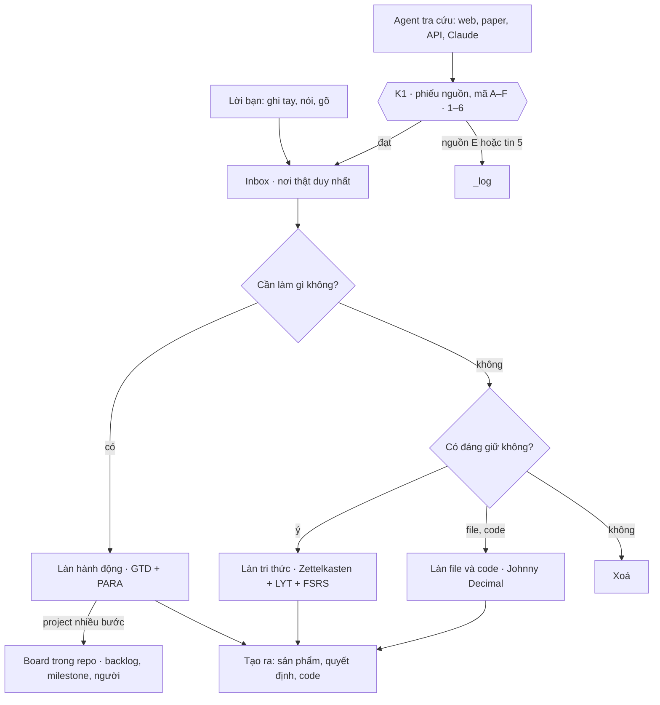

# Brain_Standard · Bộ não 2.2

Bộ chuẩn cho một bộ não thứ hai chạy bằng Markdown và git. Mọi thứ vào một Inbox, qua hai câu hỏi, rồi đi vào đúng một trong ba làn: hành động, tri thức, file và code. Bốn cổng kiểm duyệt K1–K4 giữ cho thông tin do agent mang về (kể cả Claude) có nguồn và được chấm độ tin trước khi thành ghi chú hay thẻ ôn.

Bản 2.2 bỏ giới hạn số project và next action, và thêm **tầng thực thi**: project nhiều bước giữ backlog, milestone và người phụ trách trên một board trong repo của nó. Bộ não giữ vai điều phối: kết quả muốn có, tiêu chí xong và dừng, quyết định và bài học.

**Phiên bản 2.2.0** · 20/10/2026 · [Change log](CHANGELOG.md)

**Mới tới đây? Đọc [Hướng dẫn dùng bộ não](docs/huong-dan.md)**: cài đặt, ngày đầu tiên trong 30 phút, nhịp ngày và tuần, dùng với Claude.

## Dòng chảy



Ba làn trao đổi với nhau qua 7 đường I1–I7, mô tả ở [docs/dong-chay.md](docs/dong-chay.md).

## Trong gói có gì

| Đường dẫn | Là gì |
| --- | --- |
| `docs/huong-dan.md` | Hướng dẫn từng bước cho người mới |
| `docs/dong-chay.md` | Inbox, hai câu hỏi, ba làn, 7 đường nối, nhịp ngày, tuần, tháng |
| `docs/ba-lan.md` | Luật, số đo và dấu hiệu hỏng của từng làn |
| `docs/kiem-duyet.md` | Cổng K1–K4, hệ mã Admiralty, phiếu nguồn, 10 bước tra cứu |
| `docs/tang-thuc-thi.md` | Tầng thực thi 2.2: board, milestone, người phụ trách |
| `docs/quy-uoc-claude.md` | Quy ước khi làm việc với Claude hoặc agent khác |
| `vault/` | Khung thư mục và mẫu file để bắt đầu một bộ não mới |
| `brain.toml` | Cấu hình chuẩn 2.2 |
| `tools/brain.py`, `bin/brain` | CLI: `ghi`, `nop`, `kiem`, `turn`, `weekly` |
| `tests/` | Test cho CLI |

## Bắt đầu nhanh

Cần Python 3.11 trở lên và git. Bộ não chứa ghi chú cá nhân, nên hãy tạo một repo **private** từ gói này. Các bước đầy đủ nằm trong [hướng dẫn](docs/huong-dan.md).

```sh
git clone https://github.com/DaveTran243/Brain_Standard.git bo-nao-cua-toi
cd bo-nao-cua-toi
bin/brain kiem                                   # Windows: bin\brain.cmd kiem
bin/brain ghi "Đọc chương 5 sách DDIA"
bin/brain turn y "ghi ý đầu tiên vào Inbox"
```

## Lệnh

| Lệnh | Việc |
| --- | --- |
| `brain ghi "…"` | Ghi lời bạn vào Inbox. Lời bạn không đi qua K1. |
| `brain nop file.md` | Nộp một mục do agent mang về qua cổng K1. Thiếu phiếu nguồn thì bị trả lại. |
| `brain kiem` | Rà vault theo luật 2.2 và các cổng K2–K4. |
| `brain turn <viec\|y\|file\|xoa> "tóm tắt"` | Đóng một lượt làm việc. Vault còn lỗi thì lượt không đóng được. |
| `brain weekly [--ghi]` | Tính số đo cho Weekly Review. |

## Luật cốt lõi

- Mọi thứ vào một Inbox trước khi phân loại. Mỗi mục đi vào đúng một làn.
- Permanent note chỉ chứa một ý, viết bằng lời của bạn, và nối tới ít nhất một note cũ.
- Mỗi project ghi tiêu chí xong và tiêu chí dừng ngay khi lập. Project nhiều bước có board riêng.
- Dữ kiện do agent mang về phải có phiếu nguồn và mã độ tin. Mã quyết định nó được đi xa tới đâu.
- Mỗi lượt làm việc kết thúc bằng `brain turn`.
- Không có giới hạn số project hay next action. Weekly Review đo để bạn tự nhìn thấy khi ôm quá nhiều.
