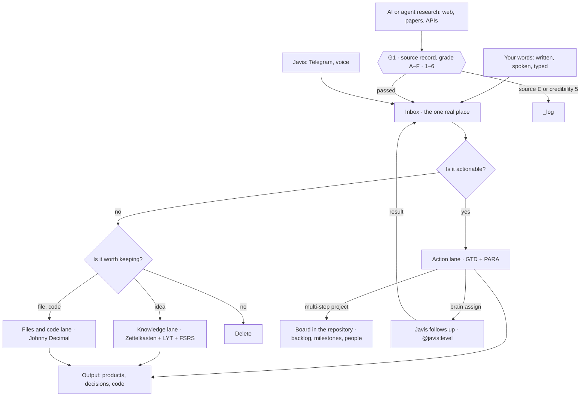

# Brain_Standard · Brain 4.0

A second brain you own: Markdown files in a git repository, a set of rules so everything has its place, and one rule set so any AI can work with it.

**Version 4.0.1** · 29/10/2026 · [Change log](CHANGELOG.md) · [Architecture (DAB 4.0)](docs/architecture.md) · [Glossary](docs/glossary.md) · [version 2.2.1](archive/2.2.1/README.md)

**New in 4.0:** everything is in English: commands, configuration, rule codes, file names and docs, with names chosen for what they mean. The CLI is a package of small reusable modules, and every parameter lives in a configuration file. Upgrading from 3.0 is one command: `brain migrate`. See [docs/migration.md](docs/migration.md).

**New here? Read [Getting started](docs/getting-started.md)**: install, your first day in 30 minutes, the daily and weekly rhythm. To use it with AI, read [Using the brain with AI](docs/using-with-ai.md).

## What the brain is for

Your head is for thinking, not for storing. The brain takes over the storing so your head is free to think. It solves five familiar problems:

| Problem | How the brain handles it |
| --- | --- |
| Tasks, ideas and links scattered everywhere: chats, phone notes, browser tabs, your head | Everything goes into **one Inbox**. Each item answers two questions, then goes to exactly one place. Nothing is forgotten. |
| Reading a lot without remembering, knowledge that never becomes yours | **The knowledge lane**: summarise sources in your own words, distil them into one-idea notes, link the notes, and review with flashcards to remember for longer. |
| Many half-finished projects, no clear next step, no idea when to stop | **The action lane**: every project has an outcome, a done condition and a stop condition; every task is one concrete step. A multi-step project has its own board with milestones and owners. |
| Files, scripts and logs all over the place, impossible to find again | **The files and code lane**: everything has a fixed numeric address, such as `51.03`; notes only need to point at the number. |
| Using AI a lot, but AI forgets between chats, sometimes makes things up, and every platform works differently | The brain is **durable memory that lives with you**, locked to no vendor. **Trust gates** make every fact an AI brings in carry a source and a grade. One rule set works for every AI. |

### Who it suits

- **Long-term self-learners**, studying a language or a field over years: read into literature notes, think into permanent notes, review with flashcards.
- **People running many personal or side projects**: see which projects are moving and which are stalled, and draw lessons when they finish.
- **Researchers who need verified information**: every claim has a source record, a grade, a valid-until date, and a monthly recheck.
- **People working with many AIs**, such as Claude, ChatGPT, Gemini or coding agents: one shared memory, and switching AI loses nothing.

### Not a fit when

- You need a notes space a whole team edits in real time. This brain is designed for one person; teamwork happens on each project's board.
- You don't want to touch git or the command line. The Markdown files still work by hand, but you lose the CLI's checks and turn closing.

### Principles

1. **You own the data.** It is just Markdown and git: open it in any editor, back it up anywhere.
2. **AI is an assistant, not the author.** AI helps clarify, research and draft. Permanent notes, where your thinking lives, are always written by you, in your own words.
3. **Never trust AI unconditionally.** Facts an AI brings in must pass gate G1. The grade decides how far they may go: a passing thought, a source summary, or solid enough to memorise.
4. **Measure, don't forbid.** No limit on projects or tasks. The Weekly Review measures, so you can see for yourself when you are carrying too much.

## Using it with AI

The brain has one shared rule block you can paste into any AI. From then on, the AI works the same way whichever platform you are on:

- Every request goes through the two questions, and every answer ends with a `Brain: …` line saying which lane the item goes to.
- A message starting with `capture:` is only captured; `today` runs the daily loop; `weekly` runs the Weekly Review.
- Facts the AI looked up or inferred carry a grade. The AI never invents a grade.

| Level | What the AI can do | Example platforms |
| --- | --- | --- |
| 1 · Chat | Answer and suggest; you copy into the brain | Claude, ChatGPT, Gemini, local models |
| 2 · Chat with documents | Answer from the notes you give it | Claude or ChatGPT Projects, Gemini Gems |
| 3 · Agent in the repository | Read and write files, run `brain` commands itself | Claude Code, Codex, Gemini CLI, Cursor, GitHub Copilot |

Setup per platform, sample workflows and prompts: [docs/using-with-ai.md](docs/using-with-ai.md). Running the brain in the self-hosted agent [Javis OS](https://github.com/blogminhquy/javis-os): [docs/using-with-javis-os.md](docs/using-with-javis-os.md).

## The flow



The three lanes exchange items through 7 links, I1–I7, described in [docs/flow.md](docs/flow.md).

## What's in the package

| Path | What it is |
| --- | --- |
| `docs/getting-started.md` | Step-by-step guide for newcomers |
| `docs/using-with-ai.md` | Using the brain with AI on any platform |
| `docs/using-with-javis-os.md` | Using the brain with Javis OS: setup, conflicts, sample workflows |
| `docs/flow.md` | The Inbox, the two questions, the three lanes, the 7 links, the assistant loop, the rhythm |
| `docs/lanes.md` | Rules, metrics and warning signs for each lane |
| `docs/trust-gates.md` | Gates G1–G4, Admiralty grades, the source record, the 10 research steps |
| `docs/execution-layer.md` | The execution layer: boards, milestones, owners |
| `docs/architecture.md` | DAB 4.0, the system architecture in arc42 form: modules, runtime, the assistant loop, decisions, risks, the 4.1 retrieval layer design |
| `docs/glossary.md` | Every term, command, key and rule code, with its 3.0 name |
| `docs/migration.md` | Upgrading a 3.0 brain to 4.0 |
| `vault/` | Folder layout and templates to start a new brain |
| `vault/AGENTS.md` | Rules for agents working in the repository |
| `brain.toml` | The brain's own settings; only what differs from the defaults |
| `tools/brain/` | The `brain` package: `config`, `notes`, `gates`, `intake`, `checks`, `metrics`, `assistant`, `guard`, `migrate`, `cli` |
| `tools/brain/defaults.toml` | Every parameter with its default value |
| `bin/brain`, `bin/brain.cmd` | Run the CLI without installing anything |
| `integrations/javis/` | Javis OS plugin, and a Claude Code hook that stops AI from writing permanent notes |
| `tests/` | Tests for the CLI, the plugin and the migration |
| `Dockerfile`, `.dockerignore` | The image that runs the CLI without installing Python; it holds only `tools/brain/` |
| `.github/workflows/` | CI on every push and pull request; publishing on a `vX.Y.Z` tag. Both run only in Brain_Standard itself, never in a brain made from it |
| `archive/` | Snapshots of older versions, from 2.2.1; kept as they were |

## Quick start

You need Python 3.11 or newer and git. The brain holds personal notes, so create a **private** repository from this package. The full steps are in [Getting started](docs/getting-started.md).

```sh
git clone https://github.com/DaveTran243/Brain_Standard.git my-brain
cd my-brain
bin/brain check                                   # Windows: bin\brain.cmd check
bin/brain capture "Read chapter 5 of DDIA"
bin/brain turn idea "captured my first idea"
```

### With Docker instead of Python

The image [`dfat243/brain_standard`](https://hub.docker.com/r/dfat243/brain_standard) runs the same CLI. Your brain stays on your disk: run the image from the brain's folder and mount it.

```sh
cd my-brain
docker run --rm -v "$PWD:/brain" dfat243/brain_standard check
docker run --rm -v "$PWD:/brain" --user "$(id -u):$(id -g)" dfat243/brain_standard capture "Read chapter 5 of DDIA"
```

`--user` keeps new files owned by you on Linux; Docker Desktop on Windows and macOS doesn't need it (in PowerShell write `${PWD}`). The image holds only `tools/brain/`, never a vault. Tags follow the versions: `4.0.1`, `4.0`, `latest`.

## Commands

| Command | What it does |
| --- | --- |
| `brain capture "…" [--channel …]` | Write your words to the Inbox. Your words don't go through G1. |
| `brain submit file.md` | Submit an item an AI or agent brought in through gate G1. Without a full source record it is returned. |
| `brain check` | Check the vault against the rules and gates G1–G3. Each finding starts with its rule code. |
| `brain turn <task\|idea\|file\|drop> "summary"` | Close a turn of work. While the vault has errors the turn does not close. |
| `brain weekly [--save]` | Metrics for the Weekly Review. |
| `brain assign "…" <suggest\|auto\|full>` | Assign a next action to Javis. Only you run this. |
| `brain assigned [--level …]` | List the tasks assigned to Javis, filtered by level. |
| `brain report <n> "result"` | Javis reports an assigned task done; the result goes to the Inbox. |
| `brain migrate [--dry-run]` | Convert a 3.0 brain to the 4.0 names, once. |

## Configuration

Every parameter, from folder paths and thresholds to the assistant's name, label and levels, has a default in `tools/brain/defaults.toml`. Your `brain.toml` lists only what you change:

```toml
[brain]
version = "4.0.0"
vault = "vault"

[clarify]
fleeting_max_days = 10       # keep passing thoughts a little longer

[assistant]
name = "Friday"
label = "@friday"
```

## Core rules

- Everything goes into one Inbox before it is sorted. Each item goes to exactly one lane.
- A permanent note holds one idea, in your own words, and links to at least one older note.
- Every project records its done and stop conditions when it is created. A multi-step project has its own board.
- Facts an AI or agent brings in need a source record and a grade. The grade decides how far they may go.
- Every turn of work ends with `brain turn`.
- Javis only follows up on tasks you assigned with `@javis:<level>`, never above that level, and sends the result back to the Inbox. Javis never assigns work to itself.
- There is no limit on projects or next actions. The Weekly Review measures, so you see for yourself when you are carrying too much.
