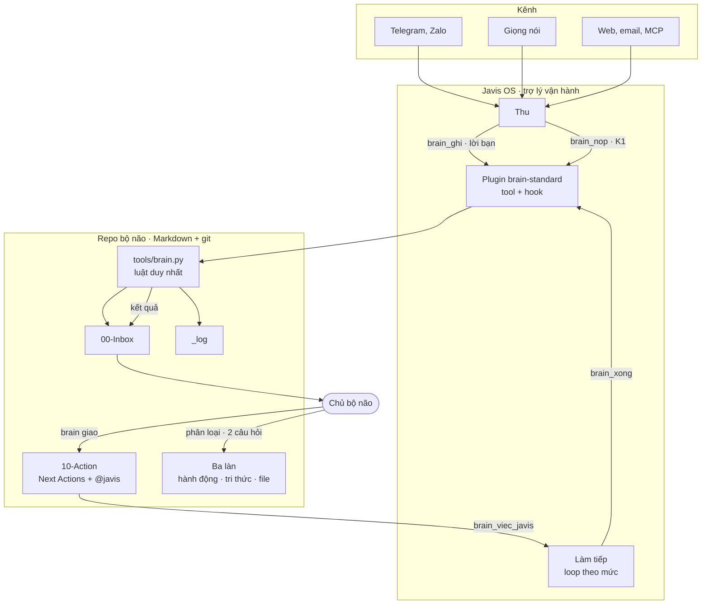
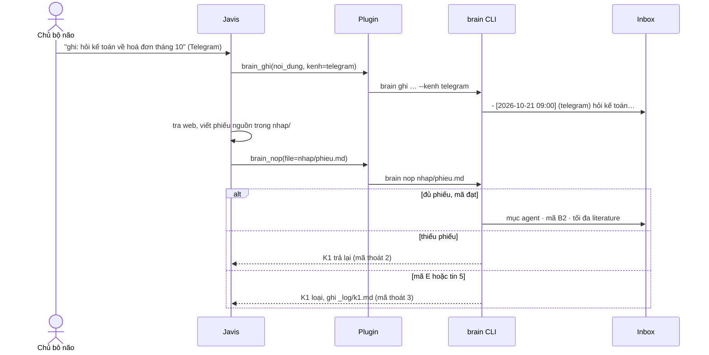
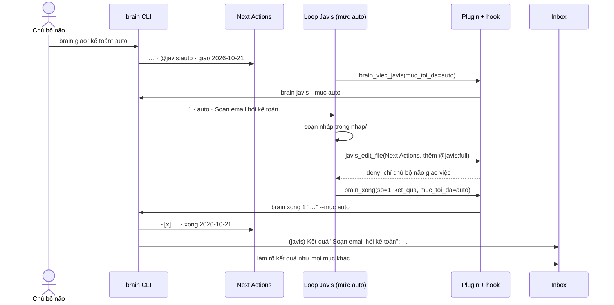
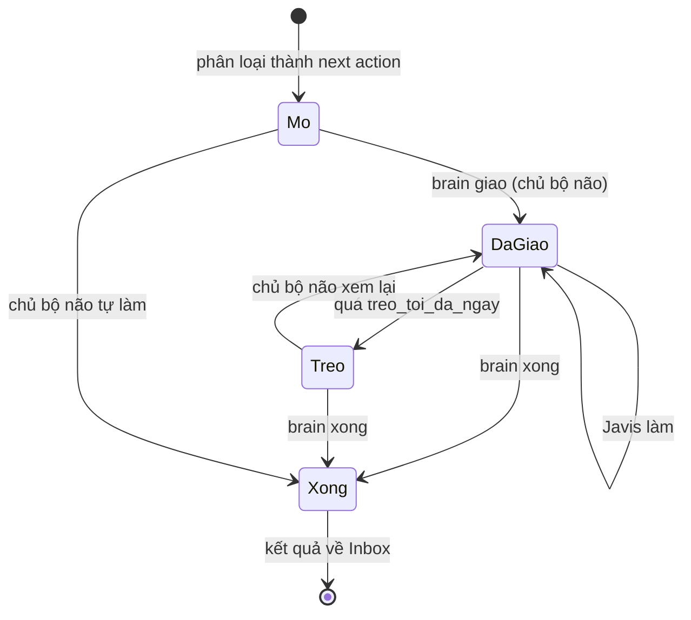

# DAB · Bộ não 3.0 (Brain_Standard)

21/10/2026 · Dave

Tài liệu này đề xuất Design Authority Board duyệt thiết kế Bộ não 3.0. Bản 3.0 thêm Javis, một trợ lý vận hành, vào hai đầu dòng chảy của bộ não: Javis **thu** thông tin vào Inbox và **làm tiếp** những việc chủ bộ não đã phân loại rồi giao cho nó. Phần phân loại ở giữa vẫn là của chủ bộ não. Mã đã chạy được trong repo và có test; Javis OS chưa chạy thật trên bộ não.

## 0 · Thông tin tài liệu

| Mục | Nội dung |
| --- | --- |
| Hệ thống | Brain_Standard · bộ chuẩn và CLI của bộ não thứ hai cá nhân |
| Phiên bản đề xuất | 3.0.0 |
| Bản trước | 2.2.1, chụp lại ở [`archive/2.2.1/`](../archive/2.2.1/README.md) |
| Kho mã | `github.com/DaveTran243/Brain_Standard`, nhánh `claude/dazzling-lovelace-2tlfyw` |
| Thành phần đổi | `tools/brain.py`, `brain.toml`, `vault/AGENTS.md`, `docs/`, `integrations/javis/`, `tests/` |
| Hệ thống liên quan | [Javis OS](https://github.com/blogminhquy/javis-os) 0.270.0, Claude Code |
| Trạng thái | Chờ DAB duyệt. Mã và test xong; chưa chạy với Javis OS thật |
| Tài liệu liên quan | [dong-chay.md](dong-chay.md#vòng-javis), [dung-voi-javis.md](dung-voi-javis.md), [dung-voi-ai.md](dung-voi-ai.md), [kiem-duyet.md](kiem-duyet.md), [CHANGELOG](../CHANGELOG.md) |

## 1 · Business context

### 1.1 Hiện trạng

Bản 2.2.1 là một repo git gồm các file Markdown (`vault/`), một bộ luật (hai câu hỏi, ba làn, bảy đường nối I1–I7, cổng kiểm duyệt K1–K4) và CLI `brain` với năm lệnh `ghi`, `nop`, `kiem`, `turn`, `weekly`. AI làm việc với bộ não ở ba mức: chat, chat có tài liệu, và agent trong repo. Chỉ agent có shell mới chạy được lệnh `brain`.

Ba việc vẫn làm tay: ghi khi xa máy tính, nhớ chạy nhịp ngày và Weekly Review, và làm những next action mà một agent làm được thay mình.

### 1.2 Vấn đề cần giải

1. **Thu rơi rớt.** Ý và việc nảy ra trên điện thoại, trong chat và email không vào được Inbox nếu không ngồi trước máy.
2. **Nhịp phụ thuộc trí nhớ.** Vòng ngày và Weekly Review chỉ chạy khi chủ bộ não nhớ.
3. **Không có chỗ giao việc cho AI.** Next action nào AI được làm, làm tới đâu, và kết quả đi về đâu đều chưa có luật. Cho AI tự làm thì phá nguyên tắc "AI là trợ lý, không phải tác giả"; không cho thì phải làm tay mọi thứ.
4. **AI tự phân loại là rủi ro.** Agent kiểu Javis OS mặc định tự chưng cất wiki, tự học và tự tạo việc, tức là đi vòng qua K1 và qua quyết định của chủ bộ não.

### 1.3 Người dùng

| Người dùng | Vai | Làm gì với bộ não |
| --- | --- | --- |
| Chủ bộ não | Người quyết | Ghi, phân loại, viết permanent note, giao việc, duyệt kết quả |
| Javis | Trợ lý vận hành | Thu vào Inbox, đề xuất lối ra, nhắc theo nhịp, làm việc được giao, trả kết quả |
| Agent khác (Claude Code, Codex…) | Trợ lý trong repo | Như Javis, theo cùng `AGENTS.md` và cùng hook |

### 1.4 Yêu cầu nghiệp vụ

| Mã | Yêu cầu |
| --- | --- |
| YC1 | Mọi thứ Javis thu vào đi qua Inbox. Lời chủ bộ não không qua K1; dữ kiện Javis tự tra phải qua K1 |
| YC2 | Chỉ chủ bộ não phân loại. Javis được đề xuất lối ra, không được chuyển mục vào làn |
| YC3 | Chỉ chủ bộ não giao việc cho Javis, kèm một mức quyền rõ ràng cho từng việc |
| YC4 | Javis chỉ làm việc được giao và không vượt mức quyền của việc đó |
| YC5 | Kết quả việc Javis làm quay về Inbox, để chủ bộ não làm rõ lại |
| YC6 | Javis không bao giờ viết permanent note, xoá dữ liệu, bỏ qua K1, hay chốt hoặc dừng project |
| YC7 | Việc giao bị treo phải hiện ra trong `brain kiem` và Weekly Review |
| YC8 | Luật nằm một chỗ (CLI và `brain.toml`); mọi engine AI, kể cả engine không có shell, dùng cùng luật đó |
| YC9 | Dữ liệu vẫn là Markdown và git của chủ bộ não; đổi Javis hay đổi model không mất gì |

### 1.5 Phạm vi

**Trong phạm vi 3.0**

- Nhãn `@javis:<mức>` và ba lệnh CLI `giao`, `javis`, `xong`.
- Kiểm tra và số đo cho việc giao trong `brain kiem`, `brain weekly`.
- Plugin Javis OS cho mọi engine, hook chặn cho Javis OS và Claude Code.
- Tài liệu: dòng chảy, quy tắc agent, cài đặt Javis OS, DAB này, ảnh chụp bản 2.2.1.

**Ngoài phạm vi**

- Javis tự phân loại Inbox (cân nhắc lại sau khi có số liệu thật, xem 5).
- Đồng bộ trạng thái issue trên board với Next Actions.
- Server MCP riêng của bộ não, chỉ mục vector, hỏi đáp trên đồ thị tri thức.
- Bộ não nhiều người dùng.

### 1.6 Ràng buộc

- Python 3.11 trở lên, chỉ thư viện chuẩn. Không có cơ sở dữ liệu, không có dịch vụ chạy nền riêng của bộ não.
- Định dạng file của 2.2 phải đọc được nguyên vẹn. Lên 3.0 không bắt sửa ghi chú.
- Javis OS là phần mềm bên thứ ba, ra bản rất nhanh. Tích hợp chỉ dựa vào hợp đồng plugin của nó (`register_tool`, `register_hook`, `pre_tool_call` trả `{"deny": …}`).
- Gói thuê bao Claude Pro/Max không dùng cho việc nền 24/7 (theo cảnh báo của chính Javis OS). Việc nền chạy bằng API key hoặc model khác.

### 1.7 Chỉ số thành công (đề xuất)

Đo sau 4 tuần dùng thật, bằng `brain weekly`:

| Chỉ số | Mục tiêu |
| --- | --- |
| Mục Inbox đến từ Javis (Telegram, giọng nói…) | ≥ 30% tổng mục mới |
| Việc giao Javis xong trong tuần / việc giao trong tuần | ≥ 70% |
| Việc giao đang treo quá 7 ngày | ≤ 2 |
| Lần hook chặn Javis ghi permanent hay tự gắn nhãn | Có ghi nhận, giảm dần theo tuần |
| Mục Inbox cũ nhất | ≤ 7 ngày, như 2.2 |

## 2 · Proposed Solution

### 2.1 Key design considerations

| # | Quyết định | Lý do | Phương án đã loại |
| --- | --- | --- | --- |
| D1 | Javis ở hai đầu, chủ bộ não ở giữa | Giữ nguyên tắc 2 ("AI là trợ lý") mà vẫn bỏ được phần làm tay ở hai đầu | Javis tự phân loại: nhanh hơn nhưng đi vòng qua quyết định của chủ bộ não |
| D2 | Giao việc bằng nhãn trên chính dòng next action | Không thêm file hay trạng thái mới; đọc được bằng mắt và bằng grep; đi theo git | Mục "Giao Javis" riêng: phải chuyển dòng qua lại, dễ mất liên kết với project |
| D3 | Ba mức `suggest`, `auto`, `full` | Trùng tên và nghĩa với ba mức quyền của Javis OS, nên mức của loop là trần tự nhiên | Hai mức có/không: không tách được "viết nháp" với "gửi thật" |
| D4 | Chỉ CLI `brain giao` gắn nhãn; không có tool cho Javis | Quyền giao việc nằm ở người, không nằm ở prompt | Tin vào prompt dặn "đừng tự gắn": prompt không phải chốt chặn |
| D5 | Hook chặn thêm hoặc nâng nhãn khi AI sửa Next Actions | Lớp thứ hai cho D4, phòng AI ghi file trực tiếp | Không chặn: một lời gọi sửa file là đủ để AI tự giao việc cho mình |
| D6 | Kết quả quay về Inbox bằng `brain xong` | Khép vòng: không có gì vào làn mà chưa qua tay chủ bộ não | Javis ghi thẳng vào làn đích: lại là tự phân loại |
| D7 | Plugin chỉ gọi lại `tools/brain.py` | Luật nằm một chỗ; plugin không phải cập nhật khi luật đổi | Viết lại luật trong plugin: hai nguồn sự thật |
| D8 | Brain của Javis trỏ vào gốc repo, không vào `vault/` | Thư mục Javis tự tạo nằm ngoài vùng `brain kiem`; plugin tìm được `brain.toml` | Trỏ vào `vault/`: Javis rải thư mục vào vault |
| D9 | Tự học, INGEST, Curator của Javis tắt hoặc để chế độ không ghi | Các tính năng này ghi tri thức mà không qua K1 | Để mặc định: AI viết wiki thay chủ bộ não |

### 2.2 High level architecture



Ba điểm chính:

- **CLI là nơi ghi duy nhất có luật.** Javis ghi vào bộ não qua tool, tool gọi CLI. Hook chặn các đường ghi tắt.
- **Javis không giữ tri thức.** Trí nhớ làm việc của Javis (`memory/`) nằm ngoài `vault/`; tri thức chỉ nằm trong vault.
- **Vòng khép kín qua Inbox.** Đầu vào và kết quả đều về Inbox.

### 2.3 Detail design

#### 2.3.1 Sequence diagrams

**Thu một tin nhắn và một dữ kiện tự tra**



**Giao, làm tiếp, trả kết quả**



#### 2.3.2 API design

**Ngữ pháp nhãn** trên một dòng next action:

```text
- [ ] <việc> · @<ngữ-cảnh> · ~<phút>' · [[project]] · #<issue> · @javis:<suggest|auto|full> · giao <YYYY-MM-DD> [· xong <YYYY-MM-DD>]
```

`@javis` không kèm mức, hoặc kèm mức lạ, là lỗi trong `brain kiem`. Tên nhãn đổi được bằng `javis.nhan`.

**Mức quyền**

| Mức | Được | Không được |
| --- | --- | --- |
| `suggest` | Đọc vault, tra cứu, nộp qua K1, đề xuất, báo xong | Ghi file khác |
| `auto` | Thêm: viết nháp, code trong khu 50–59, issue trên board | Hành động ra ngoài |
| `full` | Thêm: gửi tin, đăng bài, đặt hàng theo đúng việc được giao | Như mọi mức: permanent note, xoá dữ liệu, bỏ K1, chốt hay dừng project |

**CLI**

| Lệnh | Ai chạy | Ghi vào | Mã thoát |
| --- | --- | --- | --- |
| `brain ghi "…" [--kenh]` | Chủ bộ não, Javis | Inbox | 0 · 2 rỗng |
| `brain nop <file>` | Javis, agent | `00-Inbox/agent/`, Inbox, `_log/k1.md` | 0 đạt · 2 trả lại · 3 loại |
| `brain kiem` | Mọi người | Không ghi | 0 sạch · 1 có lỗi |
| `brain turn <loại> "…"` | Mọi người | `_log/turns.md` | 0 · 1 vault lỗi · 2 thiếu tóm tắt |
| `brain weekly [--ghi]` | Mọi người | `weekly/` nếu `--ghi` | 0 |
| `brain giao "<khớp>" <mức>` | **Chỉ chủ bộ não** | Next Actions | 0 · 2 không khớp đúng 1 việc, hoặc đã giao |
| `brain javis [--muc]` | Javis, agent | Không ghi | 0 |
| `brain xong <số> "…" [--muc]` | Javis, agent | Next Actions, Inbox | 0 · 2 số sai hoặc thiếu kết quả |

`<số>` là thứ tự trong `brain javis` với cùng `--muc`, đếm trên việc đang mở.

**Tool của plugin** (Javis OS, mọi engine)

| Tool | Gọi | `min_mode` |
| --- | --- | --- |
| `brain_ghi` | `brain ghi` | `safe` |
| `brain_nop` | `brain nop` | `safe` |
| `brain_turn` | `brain turn` | `safe` |
| `brain_kiem`, `brain_weekly` | `brain kiem`, `brain weekly` | `readonly` |
| `brain_viec_javis(muc_toi_da)` | `brain javis --muc` | `readonly` |
| `brain_xong(so, ket_qua, muc_toi_da)` | `brain xong` | `readonly`: chỗ ghi duy nhất là sổ sách của CLI, để loop mức `suggest` trả được kết quả |

Không có tool cho `brain giao` (D4).

**Hook** (`pre_tool_call` của Javis OS; PreToolUse của Claude Code qua `chan_ghi_claude.py`). Từ chối một lần ghi file khi:

| Đích | Điều kiện |
| --- | --- |
| `30-Knowledge/permanent/` | Luôn |
| `00-Inbox/agent/` | Luôn (phải qua `brain nop`) |
| File hay thư mục bắt đầu bằng `_` trong vault | Luôn (mẫu và `_log`) |
| Next Actions | Nội dung mới có thêm nhãn ở một mức nào đó so với nội dung cũ, tức là gắn mới hay nâng mức |

Bỏ nhãn, đánh dấu xong, sửa chữ khác đều được.

#### 2.3.3 Resilience

| Tình huống | Hệ thống làm gì |
| --- | --- |
| Next Actions đổi giữa lúc `brain javis` và `brain xong` | `<số>` có thể trỏ sai việc. `brain xong` in tên việc đã đánh dấu; kết quả về Inbox nên chủ bộ não thấy ngay. Git hoàn tác được. Ghi nhận ở rủi ro R2 |
| Loop gọi `brain xong` hai lần | Lần hai không thấy việc (đã xong), trả mã 2, không ghi gì |
| CLI treo hay lỗi | Plugin chặn sau 60 giây, trả lỗi cho model; không ghi dở vì mỗi lệnh ghi một lần |
| Brain trong Javis không phải repo bộ não | Tool trả lỗi rõ ràng; hook không chặn gì (không có luật để áp) |
| Hook của Javis OS ném lỗi | Javis OS cho tool chạy tiếp (fail-open, theo thiết kế của nó). `brain kiem` và review là cổng cuối |
| Javis ghi bằng shell thay vì tool | Hook không thấy. `brain kiem` bắt các lỗi luật; git cho thấy ai đổi gì |
| Việc giao bị bỏ quên | `brain kiem` cảnh báo sau `treo_toi_da_ngay`; Weekly đếm việc treo |
| Hỏng dữ liệu | Mọi thứ là text trong git: `git log`, `git revert`. Bản chuẩn cũ ở `archive/` |

### 2.4 Integration design

| Hệ thống | Cách nối | Hướng dữ liệu | Ghi chú |
| --- | --- | --- | --- |
| Javis OS | Plugin `integrations/javis/brain-standard/` trong `<repo>/plugins/` hoặc `<JAVIS_STATE_DIR>/plugins/`; brain trỏ vào gốc repo | Javis → CLI → vault; vault → Javis qua tool đọc | Cài đặt, `.gitignore`, tắt tự học: [dung-voi-javis.md](dung-voi-javis.md) |
| Kênh của Javis (Telegram, Zalo, Slack, giọng nói) | Có sẵn trong Javis OS | Một chiều vào Inbox qua `brain_ghi` | Kênh chính chờ chốt (5) |
| Claude Code | `CLAUDE.md`, `AGENTS.md` ở gốc; hook PreToolUse trong `.claude/settings.json` | Hai chiều trên file | Dùng được khi không có Javis |
| Codex, Gemini CLI, Cursor, Copilot | `AGENTS.md` ở gốc, chạy lệnh `brain` bằng shell | Hai chiều trên file | Không có hook; dựa vào `brain kiem` |
| Chat AI (Claude, ChatGPT, Gemini) | Khối quy tắc chung, quy tắc 8 | Chủ bộ não chép tay | Mức 1–2, như 2.2 |
| Board (GitHub Projects) | Như 2.2; Javis mức `auto` được tạo issue | Javis → board | Chưa đồng bộ trạng thái issue về Next Actions |

### 2.5 Deployment Design

**Lên 3.0 từ 2.2**

1. Lấy bản mới của `docs/`, `tools/`, `bin/`, `tests/`, `integrations/`, `CHANGELOG.md` như mục 11 của [hướng dẫn](huong-dan.md).
2. Thêm mục `[javis]` vào `brain.toml`. Không thêm thì CLI dùng mặc định `@javis`, 7 ngày.
3. Chép lại `vault/AGENTS.md` ra gốc repo (`AGENTS.md`, `CLAUDE.md`).
4. Chạy `python3 -m unittest discover -s tests` và `bin/brain kiem`.
5. Ghi chú cũ không phải sửa: chưa có nhãn `@javis` thì không có gì thay đổi.

**Bật Javis** theo 7 bước của [dung-voi-javis.md](dung-voi-javis.md), rồi tạo loop "Javis · suggest" trước. Chỉ thêm loop "Javis · auto" sau 2 tuần chạy ổn, và chỉ bật "Javis · full" khi có việc cần.

**Hoàn tác:** tắt plugin trên trang Plugins của Javis là Javis mất quyền ghi qua tool. Muốn về 2.2: `git revert` các commit 3.0, hoặc lấy tài liệu từ `archive/2.2.1/`. Nhãn `@javis` còn lại trong Next Actions là chữ thường, CLI 2.2 bỏ qua.

## 3 · Infrastructure design

| Thành phần | Chạy ở | Yêu cầu |
| --- | --- | --- |
| Repo bộ não | Máy của chủ bộ não; bản sao private trên GitHub | git, Python 3.11+ |
| CLI `brain` | Cùng máy với repo | Thư viện chuẩn, không mạng |
| Javis OS | Laptop, mini PC hay VPS chứa bản checkout của repo | Python 3.12 (Javis), cổng 7777 sau đăng nhập; xem tài liệu Javis |
| Model của Javis | Nhà cung cấp chủ bộ não chọn; model local cho việc rẻ | API key cho việc nền (không dùng gói Claude Pro/Max cho việc 24/7) |
| Kênh | Bot Telegram và các kênh khác do Javis quản lý | Token bot nằm trong kho bí mật của Javis, không nằm trong repo |

Bảo mật:

- Repo bộ não để private. Javis chạy AI với toàn quyền trên máy, nên máy chạy Javis phải là máy của chủ bộ não; khi ra internet thì đặt sau đăng nhập.
- Không có bí mật nào trong `vault/`. `memory/conversations/` (log thô của Javis) bị bỏ khỏi git.
- Sao lưu bằng git của repo; không cần sao lưu GitHub của Javis cho brain này.

## 4 · Database design

Bộ não không có cơ sở dữ liệu. Dữ liệu là file văn bản trong git; "lược đồ" là định dạng dòng và frontmatter mà CLI đọc.

| Thực thể | File | Định dạng | Mới ở 3.0 |
| --- | --- | --- | --- |
| Mục Inbox | `00-Inbox/Inbox.md` | `- [YYYY-MM-DD HH:MM] (<kênh>) <nội dung>` | Kênh `javis`; dòng kết quả `(javis) Kết quả "<việc>": <kết quả>` |
| Mục agent | `00-Inbox/agent/<thời điểm>-<slug>.md` | Frontmatter phiếu nguồn: `nguon`, `ngay_lay`, `luu_tru`, `ma`, `cach_kiem`, thêm `k1_toi_da`, `ngay_nop` | |
| Next action | `10-Action/11-next-actions.md` | Dòng checkbox, ngữ pháp ở 2.3.2 | Nhãn `@javis:<mức>`, `giao <ngày>`, `xong <ngày>` |
| Project | `10-Action/13-Projects/*.md` | Frontmatter `trang_thai`, `ket_qua`, `tieu_chi_xong`, `tieu_chi_dung`, `board`… | |
| Note tri thức | `30-Knowledge/{fleeting,literature,permanent}/` | Markdown, frontmatter `ma`, `id`, `han_dung` | |
| Nhật ký | `_log/turns.md`, `_log/k1.md` | Dòng có ngày | |
| Cấu hình | `brain.toml` | TOML | Mục `[javis]`: `nhan`, `treo_toi_da_ngay` |

**Vòng đời một việc giao**



## 5 · Rủi ro và việc cần DAB chốt

| Mã | Rủi ro | Mức | Giảm thiểu |
| --- | --- | --- | --- |
| R1 | Javis làm hành động thật sai ở mức `full` | Cao | `full` chỉ cho từng việc được giao; loop `full` chỉ bật khi cần; hook và `brain kiem` không bảo vệ được hành động bên ngoài, nên giao `full` cho việc đã duyệt nội dung |
| R2 | `<số>` trong `brain xong` trỏ sai việc khi Next Actions đổi giữa chừng | Thấp | `brain xong` in tên việc; kết quả về Inbox; git hoàn tác. Có thể đổi sang mã việc ổn định ở 3.1 |
| R3 | Javis ghi bằng shell, vòng qua hook | Trung bình | `brain kiem`, review git, chỉ cấp shell cho engine cần |
| R4 | Javis OS đổi hợp đồng plugin | Trung bình | Plugin nhỏ, có test với bộ nạp plugin thật; kiểm lại khi nâng bản Javis |
| R5 | Inbox đầy kết quả của Javis | Trung bình | Chỉ số 1.7; giao ít việc hơn nếu Inbox cũ quá 7 ngày |

**Cần chốt**

1. **Kênh chính** để nói chuyện với Javis. Đề xuất: Telegram.
2. **Model** cho việc nền. Đề xuất: API key cho suy luận và viết; model local cho việc rẻ.
3. **Bộ não của Cá Béo** có Javis riêng không. Đề xuất: riêng, cùng plugin, khác repo.
4. **Javis tự phân loại mục rõ ràng** (link đọc sau, việc dưới 2 phút). Đề xuất: không ở 3.0; xem lại sau 4 tuần số liệu.
5. **Mã việc ổn định** thay cho số thứ tự (R2). Đề xuất: để 3.1.
