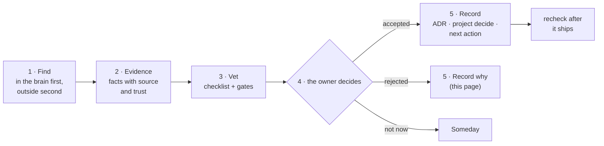

# Design suggestions · found through the brain, vetted before adopted

2026-11-07 · how suggestions for the brain's own design are found, vetted and decided, and the suggestions open today. Terms: [glossary.md](glossary.md).

## 1 · Why a separate process

Agents are good at proposing changes and bad at knowing when not to. A suggestion that skips vetting turns the brain into whatever the last agent liked, and design work is system work, which eats into the time left for content. So every design suggestion, wherever it comes from, goes through the same five steps, and nothing changes the design until the owner decides.



## 2 · Step 1 · Find, through the brain first

Look in the brain before looking outside: the brain's own data says where it hurts.

| Where | Command | What it shows |
| --- | --- | --- |
| The knowledge graph's gaps | `brain kg suggest` | islands not linked to the rest, hubs with no note of their own, topics that keep coming up in chats but live in no note, central facts that are only `unverified` or `agent` |
| What the graph already holds on the subject | `brain kg ask "<the design question>"` | the owner's earlier notes, decisions and lessons about it, so a suggestion does not repeat or contradict them unknowingly |
| Rules broken | `brain check` | errors and warnings that keep recurring point at a rule or a flow that does not fit |
| The Weekly Review's numbers | `brain weekly` | tasks done, notes written, Inbox age, assignments gone stale |
| Lessons | `## Lessons learned → I1` in projects, and the permanent notes they became | what finished work taught |
| Refuted claims | the monthly recheck of graded claims, and the fix tasks it made (I7) | where the brain believed something wrong |
| Project decisions | `## Decisions` in projects, the ADRs in `docs/architecture.md` | what was already decided, and why |

Only then look outside (other people's systems, papers, tools). Anything learned outside is a fact an agent brings in, so it goes through G1 with a source record before it can count as evidence (step 3).

## 3 · Step 2 · Evidence

A suggestion states its evidence the way the graph states facts: what, from where, how trusted.

- From the brain: the triples or notes, with their source and trust (`owner`, a grade, `unverified`, `agent`). `brain kg ask` output can be pasted as is.
- From outside: the claim, submitted with `brain submit … --grade … --verification …`, and its Inbox id.
- From an agent's own reasoning: say so. Reasoning is not evidence; it is the suggestion itself.

## 4 · Step 3 · Vet

Each suggestion is vetted against this checklist. The agent that proposes may fill it in; the owner checks it.

| # | Question | Fails when |
| --- | --- | --- |
| V1 | Is the evidence in the brain, or through G1? | it rests on an outside fact without a record, or on `unverified` or `agent` facts only |
| V2 | Is the outside evidence good enough? | the deciding fact is graded below C3, or credibility 4–6, or past its valid-until date |
| V3 | Does it contradict an ADR or a project decision? | it does, and it does not say which and why the old decision should change |
| V4 | Does it break a hard rule (R7, R9, G1–G4, AS-01) or the owner's "Never" list? | it does: such a suggestion is rejected, whatever its benefit |
| V5 | What does it cost? | it has no estimate in hours of system work |
| V6 | Can it be undone? | it cannot be reverted with `git revert` or `brain migrate`, and says nothing about data |
| V7 | How will we know it worked? | it has no measure the Weekly Review or `brain kg stats` can show |
| V8 | Who does it touch? | it changes a brain or data of someone other than the owner without their agreement |

A suggestion that fails V1, V2 or V4 does not go to the owner yet. One that fails the others goes to the owner with the failures marked.

## 5 · Step 4 and 5 · Decide and record

Only the owner decides, in the same spirit as only the owner assigns tasks. An agent never adopts its own suggestion.

| Decision | Recorded with |
| --- | --- |
| Accepted, architecture-level | a new ADR in `docs/architecture.md`, plus a line under `## Decisions` in the project it belongs to |
| Accepted, small | a next action in `10-Action/11-next-actions.md` (or a board issue for a project with a board) |
| Not now | a line in `10-Action/14-someday.md` |
| Rejected | a row in section 7 below, with the reason, so the same suggestion is not made again |

After an accepted suggestion ships, its measure (V7) is checked at the next Weekly Review, and a lesson is drawn into a note (I1).

**Template** for a suggestion (in a chat answer, a `brain_report` result, or a row in section 6):

```text
S<n> · <one-line change>
Evidence: <triples / notes with source and trust; Inbox ids of G1 submissions>
Vetting: V1 ✓ · V2 ✓ · V3 ✓ (no ADR touched) · V4 ✓ · V5 ~2 h system work · V6 git revert · V7 <measure> · V8 the owner only
Proposed by: <agent or the owner>, <date> · Decision: open
```

**ADR-19:** suggestions never write. `brain kg suggest` and the `brain_suggest` tool only print; an agent's suggestion is text until the owner records a decision. Every design suggestion goes through the five steps on this page.

## 6 · Open suggestions

Found on 2026-11-07 while building 4.2, from the design review of the knowledge graph and the integrations, and from running `brain kg suggest` and `brain kg stats` on the first brain to use them (a private brain of 35 documents). All proposed by Claude; none decided yet. Each brain built on this standard keeps its own list here or in its own docs.

| # | Suggestion | Evidence | Vetting | Decision |
| --- | --- | --- | --- | --- |
| S1 | Build the retrieval layer (ADR-08) with the knowledge graph in it, and an HTTP `recall` endpoint, so workflow tools and remote MCP clients can read the brain | `docs/knowledge-graph.md` phase 2; workflow tools cannot start a local process (`integrations/mcp/README.md`) | V1 ✓ · V3 ✓ (ADR-01, ADR-08 hold) · V4 ✓ · V5 ~1 day · V6 delete the index · V7 a workflow reads a fact · V8 the owner only | open |
| S2 | Try LLM extraction with a local model on literature notes only, and compare its triples with the rule triples before using them in context | on that brain: 87 triples, nearly all from links and tags; sentence rules found 3 in 35 documents | V1 ✓ · V3 ✓ (ADR-17 allows it) · V4 ✓ · V5 ~1 h + a local model · V6 `llm = "off"` and `brain kg build --full` · V7 triples per literature note; spot-check 20 for errors · V8 the owner only | open |
| S3 | Show `brain kg suggest` in the Weekly Review output | `brain weekly` does not mention the graph yet; the suggestions are only seen when asked for | V1–V4 ✓ · V5 ~30 min · V6 git revert · V7 suggestions handled per week · V8 every brain on the standard | open |
| S4 | Do not show both directions of a two-way link as separate facts in `[Brain KG]` | on that brain, permanent notes link both ways, so one relationship fills two of the 15 slots | V1–V4 ✓ · V5 ~30 min · V6 git revert · V7 distinct facts per prompt · V8 every brain | open |
| S5 | Wire "read first, remember after" as hooks on a second coding agent that offers turn hooks | only Claude Code's hooks are wired (`docs/integrations.md` 3.3) | V1 ✗: which agents offer turn hooks, and with what input, is not yet submitted through G1; do that first | not ready |

## 7 · Rejected suggestions

The three below were set aside by Claude while designing 4.2, before this process existed; the owner confirms or reopens them.

| # | Suggestion | Why rejected | Date |
| --- | --- | --- | --- |
| R-S1 | Store the agent's answers in the knowledge graph as memory | breaks G1: an agent's claims would become facts without a source record (ADR-16) | 2026-11-07, while designing 4.2 |
| R-S2 | Use a graph database (Neo4j) for the knowledge graph | breaks the standard-library rule (ADR-13) and ADR-01 for a few thousand triples; revisit only past the scale in `knowledge-graph.md` section 10 | 2026-11-07, while designing 4.2 |
| R-S3 | Transitive inference (A is part of B, B is part of C ⇒ A is part of C) | ai-knowledge-graph's own notes say it produced most edges and buried the real ones | 2026-11-07, while designing 4.2 |
