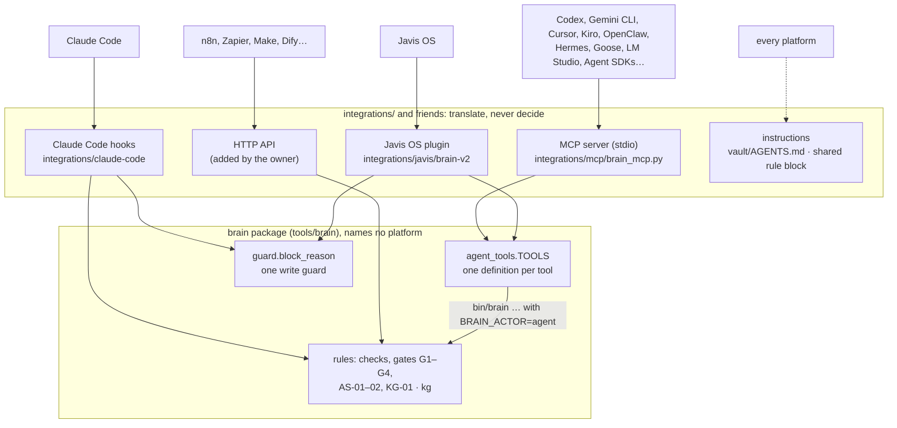

# Integrations · the brain on every agent platform

2026-11-07 · design of the integration layer in Brain_Standard 4.2. Terms: [glossary.md](glossary.md). The assistant loop these integrations serve: [flow.md](flow.md#the-assistant-loop). The knowledge graph they read and update: [knowledge-graph.md](knowledge-graph.md).

## 0 · About this document

| Item | Value |
| --- | --- |
| Code | `tools/brain/agent_tools.py` (the one tool definition), `tools/brain/guard.py` (the one write guard), `integrations/mcp/` (MCP server), `integrations/javis/` (Javis OS plugin), `integrations/claude-code/` (Claude Code hooks and write guard), `vault/AGENTS.md` (the rules every agent reads) |
| Tests | `tests/test_kg.py` (`MCPTest`: the MCP protocol end to end; the turn hooks), `tests/test_javis_plugin.py` (the Javis adapter and the Claude Code write guard) |
| Status | The core is platform-neutral. Tested: the hooks, the MCP protocol and the Javis adapter in unit tests; the Javis OS plugin loader with the 4.0 plugin (2026-10-21); in the first private brain built on it, the same design ran end to end with Claude Code (October 2026) and the Javis OS loader (2026-10-24). Every other platform below is reached through a documented standard (MCP, SKILL.md, AGENTS.md, HTTP) and has **not** been tried here yet |

## 1 · The problem

Until 4.0 the brain spoke to two platforms: Claude (a write hook, instructions) and Javis OS (a plugin), and the core carried Javis's name, label and tool names. The owner wants the brain on every agent and automation tool worth using, without the core knowing any of them. Each platform must still:

1. **read the brain first** (the knowledge graph) and **remember** each conversation;
2. capture the owner's words verbatim and submit outside facts through G1;
3. follow up only on tasks the owner assigned, never above their level, and never assign itself work;
4. never edit templates, logs or the graph by hand, never write permanent notes or agent items directly.

## 2 · The platforms

Six kinds, grouped by how they can reach the brain. The integration path is the standard each platform documents; "tested" means tried with this repository.

### 2.1 Personal agents (self-hosted, always on, reached through chat apps)

The kind Javis OS belongs to: an agent that runs on the owner's machine or a VPS, talks through Telegram, Slack, Discord or WhatsApp, keeps its own memory and runs scheduled work.

| Platform | What it is | Path to the brain | Status |
| --- | --- | --- | --- |
| **Javis OS** | Self-hosted agent with a dashboard, many model engines, plugins, loops, a second-brain feature | native plugin `integrations/javis/brain-standard/` (tools + the write guard on Javis's own file tools); its MCP hub also works | plugin tested |
| **OpenClaw** | Open-source, self-hosted personal agent reached through chat apps; skills as `SKILL.md` folders (registry ClawHub); MCP client and server | MCP server (`openclaw mcp add`) + `vault/AGENTS.md` as its rules | documented |
| **Hermes Agent** (Nous Research) | Open-source, self-hosted agent (MIT, 2026) with layered memory and self-written skills in agentskills.io format; MCP servers in `~/.hermes/config.yaml` | MCP server + `vault/AGENTS.md` as its rules; turn its self-learned skills off for brain work so it does not rewrite the protocol | documented |
| **Letta** (formerly MemGPT) | Agent server with long-term memory blocks | MCP server; let the brain, not Letta's memory, hold facts (the assistant keeps no knowledge memory of its own, flow.md) | documented |
| **Khoj** | Self-hosted "AI second brain" over your documents, with chat apps | point it at `vault/` read-only for search; capture back through the MCP server | documented |
| **Open Interpreter**, **Agent Zero** | Agents that run code on the machine | MCP server; never give them write access to `vault/` outside the brain's commands | documented |

### 2.2 Coding and terminal agents

| Platform | Path to the brain | Read first / remember after | Status |
| --- | --- | --- | --- |
| **Claude Code** | `vault/AGENTS.md` copied to `CLAUDE.md` + the hooks in `integrations/claude-code/`; the MCP server for other folders | **hooks**: the prompt hook reads the graph, the Stop hook remembers | unit-tested |
| **Codex CLI** (OpenAI) | `AGENTS.md` + MCP server (`~/.codex/config.toml`) | tools, by instruction | documented |
| **Gemini CLI** | `AGENTS.md` copied to `GEMINI.md` + MCP server (`~/.gemini/settings.json`) | tools, by instruction | documented |
| **Cursor**, **Windsurf** | `AGENTS.md` + MCP server (`.cursor/mcp.json`, `mcp_config.json`) | tools, by instruction | documented |
| **Kiro** | `AGENTS.md` (steering) + MCP server (`.kiro/settings/mcp.json`) | tools, by instruction | documented |
| **GitHub Copilot** (agent mode, coding agent) | `AGENTS.md` + MCP server | tools, by instruction | documented |
| **Cline**, **Roo Code**, **Continue**, **Zed**, **Amp** | `AGENTS.md` + MCP server | tools, by instruction | documented |
| **Aider** | `AGENTS.md` as a conventions file; no MCP: run `bin/brain` commands | commands, by instruction | documented |
| **OpenHands**, **Goose** (Block) | MCP server (Goose: a command-line extension) + `AGENTS.md` | tools, by instruction | documented |

### 2.3 Desktop and chat assistants

| Platform | Path to the brain | Status |
| --- | --- | --- |
| **Claude Desktop, Cowork** | MCP server in `claude_desktop_config.json`; Cowork with this repository open also gets the hooks | documented |
| **claude.ai** (web, phone) | the shared rule block of `docs/using-with-ai.md` in a Project; remote MCP once an HTTP endpoint exists | by instruction |
| **ChatGPT** (apps and connectors), **Gemini app**, **Microsoft Copilot** | remote MCP or HTTP only: an endpoint the owner adds, on a private network | later |
| **LM Studio**, **Msty**, **Jan** | local MCP hosts: the MCP server, with a local model | documented |

### 2.4 Workflow automation

These tools call HTTP, not local processes.

| Platform | Path to the brain | Status |
| --- | --- | --- |
| **n8n** | MCP Client Tool node on an AI Agent node, through an HTTP bridge to the MCP server; or HTTP Request nodes on an HTTP API in front of the package | documented |
| **Zapier**, **Make**, **Activepieces**, **Power Automate** | webhooks and HTTP steps on an HTTP API in front of the package | documented |
| **Dify**, **Flowise**, **Langflow** | MCP (HTTP) or HTTP tools on an HTTP API in front of the package | documented |

Automation is where most capture will come from (email, calendar, forms). It must use `capture` only for the owner's own words, and `submit` with a record for anything else.

### 2.5 Agent frameworks (agents the owner builds)

**Claude Agent SDK**, **OpenAI Agents SDK**, **Google ADK**, **LangGraph**, **CrewAI**, **Microsoft Agent Framework / AutoGen**, **Mastra**, **PydanticAI**, **smolagents**, **LlamaIndex**, **Semantic Kernel**: all of them can load MCP tools, so an agent the owner writes gets the brain by connecting to `brain_mcp.py`. In Python, an agent may also import `brain.agent_tools` and call `agent_tools.call(root, name, args)` directly, with the same rules.

### 2.6 Note apps and browser agents

| Platform | Path to the brain |
| --- | --- |
| **Obsidian**, **Logseq** | open `vault/` as a vault: it is plain Markdown with wiki links. AI plugins inside them (Smart Connections, Copilot) only read; writes go through `brain` commands, never by hand into list files |
| **Notion**, **Tana**, **Mem**, **Reflect** | not a store for the brain (ADR-01); export into the Inbox with `brain capture --channel export` (Fleeting only) |
| **Manus**, **ChatGPT agent**, **Claude in Chrome**, **browser-use** | browser agents: no direct access; their findings come in through a platform above, with G1 records |

## 3 · Design

### 3.1 Layers

1. **Core.** Rules, the knowledge graph, `agent_tools.TOOLS` and `guard.block_reason`. No platform name, no platform tool name. `[assistant]` holds the neutral name (`the assistant`), label (`@agent`), result channel (`assistant`).
2. **Tools.** Each tool is a name, a description, a JSON schema, a `min_mode` and a function that turns arguments into one `brain` command. `agent_tools.run` runs that command in a separate process with `BRAIN_ACTOR=agent`. So whatever the platform, the CLI is what decides: it refuses `brain assign`, returns a fact without a record, and applies G1–G4.
3. **Adapters.** Each one translates the tools into its platform's format and, where the platform has its own file-writing tools, passes their names to the guard (`write_tools`). An adapter decides nothing.
4. **Instructions.** `vault/AGENTS.md` and the shared rule block tell every platform the same protocol, including "recall first, remember after".

### 3.2 The tools

| Tool | Command | Mode |
| --- | --- | --- |
| `brain_recall` | `kg ask` | readonly |
| `brain_remember` | `kg remember` | safe |
| `brain_capture` | `capture [--channel]` | safe |
| `brain_submit` | `submit` on a record written to a temporary folder outside the vault | readonly (its only write is the CLI's own, after G1) |
| `brain_check` | `check` | readonly |
| `brain_suggest` | `kg suggest` | readonly |
| `brain_turn` | `turn` | safe |
| `brain_weekly` | `weekly` (not saved) | readonly |
| `brain_assigned` | `assigned [--level]` | readonly |
| `brain_report` | `report [--level]` | readonly (its only write is the CLI's bookkeeping) |

There is deliberately no tool for `brain assign`, labels, permanent notes or filing an item into a lane: those are the owner's.

### 3.3 Read first, remember after, by kind of platform

| Platform kind | Read first | Remember after | Strength |
| --- | --- | --- | --- |
| Claude Code in the brain repository | `brain hook prompt` | `brain hook stop` | hard: the hook runs whatever the model does |
| MCP clients | `brain_recall`, asked for by the server's `instructions` and `AGENTS.md` | `brain_remember` | by instruction: the model must call the tools |
| Javis OS | `brain_recall` in the project instructions and in each loop's prompt | `brain_remember` | by instruction, plus the plugin's guard on writes |
| Chat apps without tools | an attached `brain kg export` | the `Brain:` line, captured by the owner | by instruction |
| Automation (n8n…) | an explicit HTTP step before the agent node | an explicit HTTP step after it | hard inside the workflow, since the workflow is code |

Where a platform offers hooks around a turn (some coding agents now do), the same two calls can be made hard the way Claude Code's are: run `bin/brain hook prompt` before and `bin/brain hook stop` after, with the platform's turn data on stdin. Only Claude Code's hooks are wired today (`integrations/claude-code/`).

### 3.4 Security

- Every tool call runs the CLI as an agent (`BRAIN_ACTOR=agent`). The CLI, not the adapter, enforces the rules.
- `brain_mcp.py --read-only` lists only the tools a level-`suggest` run may use; use it for platforms the owner does not fully trust.
- The MCP server is stdio only: a local process for a local client. Nothing listens on the network. HTTP access needs an API or a stdio-to-HTTP bridge, on a private network with a token.
- The guard covers the platform's own file tools when the adapter can hook them (Javis OS and Claude Code today). Where a platform cannot be hooked, give it no write access to `vault/` beyond the MCP tools.
- A tool's text output is data for the model. Notes may contain text that looks like instructions; the facts are framed as data with their source.

### 3.5 Adding a platform

1. Prefer the MCP server. Write the client's configuration block into `integrations/mcp/README.md`.
2. If the platform has its own file tools that can be hooked, write a thin adapter in `integrations/<platform>/` that registers `agent_tools.TOOLS` and calls `guard.block_reason(..., write_tools=…)`; follow `integrations/javis/brain-standard/plugin.py`.
3. Point it at `vault/AGENTS.md`.
4. Add a test like `tests/test_javis_plugin.py`, and move the platform's row in section 2 from "documented" to "tested" only after trying it for real.

## 4 · Decisions

- **ADR-18:** the core is platform-neutral. One tool definition (`agent_tools.TOOLS`) and one write guard (`guard.block_reason`) serve every platform; each platform gets a thin adapter in `integrations/` that translates and never decides. MCP over stdio is the default adapter, because most platforms now load MCP servers; HTTP comes through an API or bridge the owner adds. Javis OS keeps a native plugin only because it lets the guard cover Javis's own file tools. Amends ADR-10: the assistant at both ends is any platform, not Javis by name.

## 5 · Sources

The platform facts in section 2 come from each project's documentation and, where noted, from secondary sources checked on 2026-11-07. They describe how a platform can connect, not how well it works; configuration paths change between versions. These are not facts in any brain: none was submitted through G1.

- OpenClaw skills and MCP (client and `openclaw mcp serve`): [developersdigest.tech guide](https://www.developersdigest.tech/blog/what-is-openclaw-guide-2026), [mcpbundles.com](https://mcpbundles.com/blog/openclaw-mcp-tools) (vendor blog).
- Hermes Agent MCP configuration: [hermes-agent.nousresearch.com · MCP](https://hermes-agent.nousresearch.com/docs/user-guide/features/mcp); overview: [lucaberton.com](https://lucaberton.com/blog/what-is-hermes-agent-nous-research/) (secondary).
- n8n MCP Client Tool node: [docs.n8n.io](https://docs.n8n.io/integrations/builtin/cluster-nodes/sub-nodes/n8n-nodes-langchain.toolmcp/).
- SKILL.md adoption across agents: [mdskills.ai](https://www.mdskills.ai/docs/what-are-skills), [atlan.com](https://atlan.com/know/ai-agent/ai-agent-skills/what-are-agent-skills/) (secondary; agentskills.io itself was not reachable).
- Javis OS plugins: [javis-os docs/en/20-plugins.md](https://github.com/blogminhquy/javis-os/blob/main/docs/en/20-plugins.md), read and tested on 2026-10-21 and 2026-10-24.
