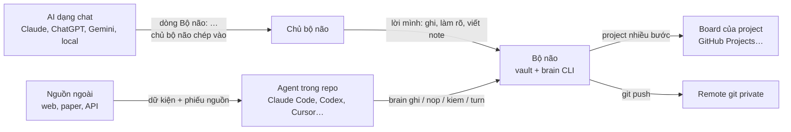
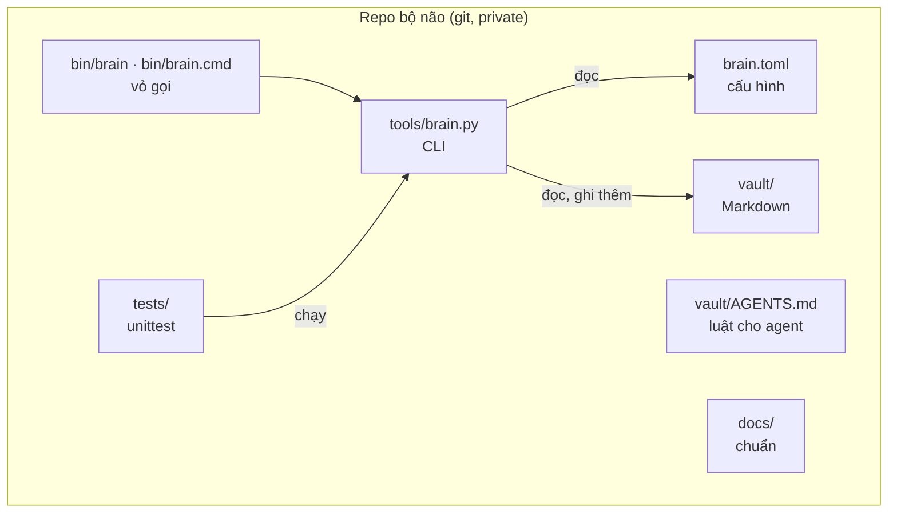
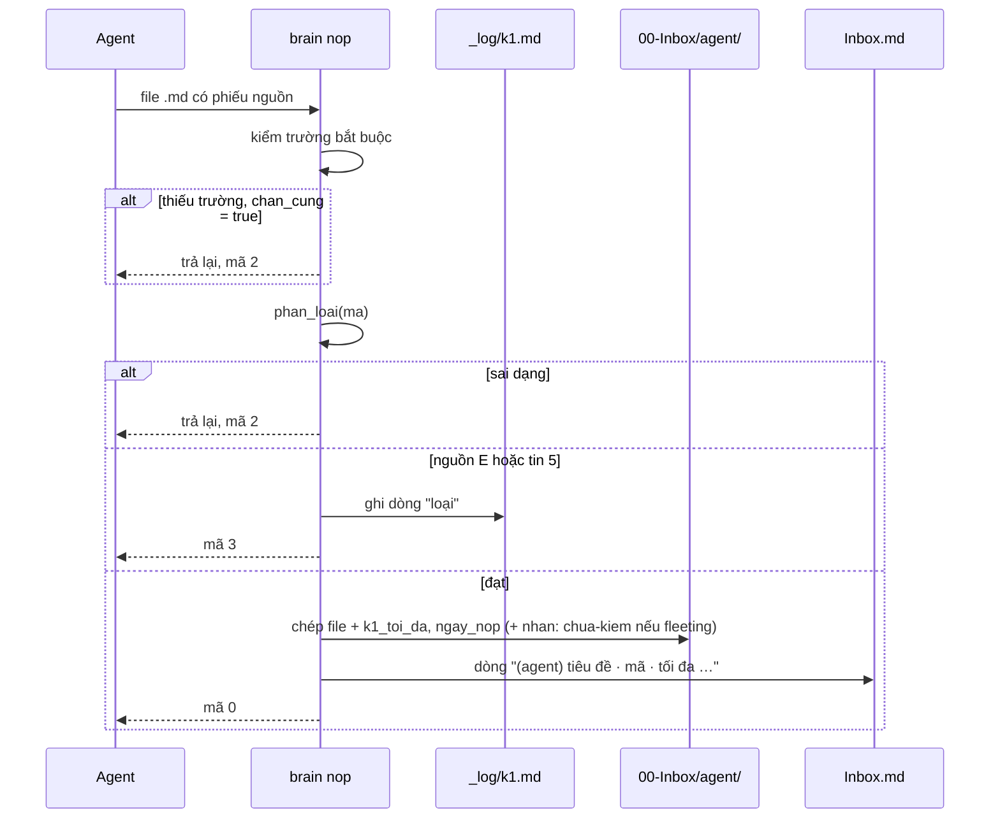
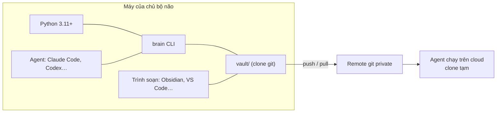
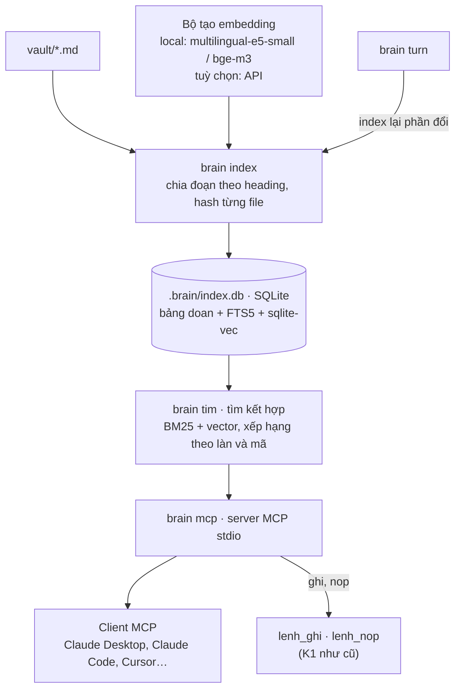

# Kiến trúc hệ thống · Bộ não 2.2

Tài liệu thiết kế kiến trúc (DAB) của Brain_Standard. Bố cục theo khung [arc42](https://arc42.org) và các góc nhìn của ISO/IEC/IEEE 42010; sơ đồ theo mô hình C4; quyết định ghi theo dạng ADR. Luật nghiệp vụ chi tiết vẫn nằm ở các trang `docs/` khác; trang này mô tả hệ thống được dựng thế nào và vì sao.

## 0. Thông tin tài liệu

| Mục | Nội dung |
| --- | --- |
| Hệ thống | Brain_Standard · bộ não thứ hai dạng Markdown + git + CLI `brain` |
| Phiên bản hệ thống mô tả | 2.2.1 (đang chạy) và 2.3 (đề xuất, mục 12) |
| Trạng thái tài liệu | Bản nháp đã chuẩn hoá, chờ chủ bộ não duyệt |
| Chủ sở hữu | Chủ repo Brain_Standard |
| Người đọc | Chủ bộ não, người đóng góp code, agent làm việc trong repo |
| Cập nhật lần cuối | 21/10/2026 |

### Lịch sử tài liệu

| Bản | Ngày | Thay đổi |
| --- | --- | --- |
| 1.0 | 21/10/2026 | Bản đầu, chuẩn hoá theo arc42: gom mô tả rải rác trong `docs/` và `tools/brain.py`, thêm ADR, rủi ro, thiết kế tầng truy hồi 2.3 |

### Quy ước trong tài liệu

- **Phải / không được**: luật đã được CLI hoặc `AGENTS.md` áp dụng.
- **Nên**: khuyến nghị, không bị kiểm tra tự động.
- Mục đánh dấu **(đề xuất)** chưa có trong code.

## 1. Giới thiệu và mục tiêu

### 1.1 Bài toán

Một người làm nhiều việc, đọc nhiều, viết code và dùng nhiều AI cần một chỗ giữ việc, ý, file và quyết định lâu dài, không phụ thuộc vào nền tảng nào. Bộ não nhận mọi thứ qua một Inbox, làm rõ bằng hai câu hỏi, rồi đưa vào đúng một trong ba làn: hành động, tri thức, file và code. Xem [dong-chay.md](dong-chay.md).

### 1.2 Yêu cầu chức năng chính

| Mã | Yêu cầu | Hiện thực |
| --- | --- | --- |
| F1 | Ghi nhanh lời chủ bộ não vào Inbox, kèm giờ và kênh | `brain ghi` |
| F2 | Nhận dữ kiện do agent mang về, chỉ khi có phiếu nguồn và mã Admiralty hợp lệ | `brain nop` · cổng K1 |
| F3 | Rà vault theo luật ba làn và cổng K1–K3 | `brain kiem` |
| F4 | Đóng một lượt làm việc, từ chối khi vault còn lỗi | `brain turn` |
| F5 | Tính số đo cho Weekly Review, chỉ đo không chặn | `brain weekly` |
| F6 | Cho mọi AI cùng một bộ quy tắc | `vault/AGENTS.md`, khối quy tắc trong [dung-voi-ai.md](dung-voi-ai.md) |
| F7 | Tìm lại note theo từ khoá và theo nghĩa; cho AI truy cập qua MCP | **(đề xuất)** mục 12 |

### 1.3 Mục tiêu chất lượng

Xếp theo thứ tự ưu tiên. Khi hai mục xung đột, mục trên thắng.

| # | Mục tiêu | Ý nghĩa |
| --- | --- | --- |
| Q1 | Sở hữu và bền dữ liệu | Dữ liệu là Markdown thuần trong git. Mở được bằng mọi trình soạn, sống lâu hơn mọi công cụ |
| Q2 | Toàn vẹn tri thức | Dữ kiện AI mang về không vào được bộ não nếu thiếu nguồn và mã độ tin; mã quyết định nó đi tới đâu |
| Q3 | Đơn giản | CLI chỉ dùng thư viện chuẩn Python, một file, không server, không dịch vụ ngoài |
| Q4 | Trung lập nền tảng AI | Đổi Claude, ChatGPT, Gemini, model local hay agent nào cũng không mất gì |
| Q5 | Kiểm chứng được | Mọi luật trong CLI có test; thời gian giả lập được qua `BRAIN_NOW` |

### 1.4 Các bên liên quan

| Vai | Mong đợi |
| --- | --- |
| Chủ bộ não | Ghi nhanh, không quên việc, kiến thức thành của mình, đổi AI thoải mái |
| Agent trong repo (Claude Code, Codex, Gemini CLI, Cursor, Copilot) | Luật rõ ràng, lệnh kiểm tra được, mã lỗi máy đọc được |
| AI dạng chat (mức 1–2) | Một khối quy tắc ngắn, dòng `Bộ não:` để chủ bộ não chép lại |
| Người đóng góp chuẩn | Code nhỏ, có test, change log theo x.y.z |
| Cộng tác viên trên board project | Backlog, milestone, người phụ trách nằm ở board, không cần vào vault |

## 2. Ràng buộc

### 2.1 Kỹ thuật

| Ràng buộc | Lý do |
| --- | --- |
| Python 3.11 trở lên, chỉ thư viện chuẩn (`tomllib`, `argparse`, `pathlib`…) | Cài ở mọi máy, không cần `pip` |
| Dữ liệu là file `.md` UTF-8, xuống dòng `\n`, frontmatter `khoá: giá trị` | Đọc được bằng người, bằng Obsidian, bằng mọi AI |
| Cấu hình ở `brain.toml` tại gốc repo | Một nơi duy nhất cho đường dẫn và ngưỡng |
| Chạy trên Linux, macOS (`bin/brain`) và Windows (`bin/brain.cmd`) | Người dùng cá nhân dùng đủ loại máy |

### 2.2 Tổ chức và quy ước

| Ràng buộc | Lý do |
| --- | --- |
| Repo bộ não của người dùng phải **private** | Ghi chú là dữ liệu cá nhân |
| Thiết kế cho **một người**; làm nhóm chỉ ở board của từng project | Giữ dòng chảy đơn giản |
| Phiên bản x.y.z: x đổi hình dòng chảy, y thêm cơ chế, z sửa câu chữ, nhãn, số liệu | Xem [CHANGELOG.md](../CHANGELOG.md) |
| Tên lệnh, biến và tài liệu bằng tiếng Việt | Người dùng chính là người Việt |
| AI không viết permanent note, không xoá dữ liệu, không nâng mã | Nguyên tắc 2 và 3 trong README |

## 3. Bối cảnh và phạm vi

### 3.1 Bối cảnh nghiệp vụ



| Đối tác | Vào bộ não | Ra khỏi bộ não |
| --- | --- | --- |
| Chủ bộ não | Ghi chú, quyết định, permanent note | Next Actions, số đo tuần, note để đọc lại |
| AI dạng chat | Không ghi trực tiếp | Note được dán vào chat |
| Agent trong repo | Mục Inbox, mục qua K1, sửa file theo `AGENTS.md` | Toàn bộ vault |
| Nguồn ngoài | Chỉ qua agent và K1 | Không |
| Board | Không (bộ não chỉ trỏ link) | Link board, milestone, số issue |
| Remote git | Không | Bản sao lưu và lịch sử |

### 3.2 Bối cảnh kỹ thuật

| Kênh | Giao thức · định dạng | Ghi chú |
| --- | --- | --- |
| Dòng lệnh | `brain <lệnh>` qua `bin/brain` hoặc `bin/brain.cmd`; stdout/stderr UTF-8; mã thoát (mục 8.6) | Kênh duy nhất ghi vào vault có kiểm luật |
| File | Markdown + frontmatter trong `vault/`, cấu hình TOML | Trình soạn và agent đọc ghi trực tiếp |
| Biến môi trường | `BRAIN_ROOT` (gốc bộ não), `BRAIN_NOW` (giờ giả lập, ISO 8601) | `--root` thắng `BRAIN_ROOT` |
| Git | Commit sau mỗi lượt, push lên remote private | Ngoài CLI, người hoặc agent tự chạy |
| MCP (stdio) | **(đề xuất)** `brain mcp` | Mục 12 |

### 3.3 Ngoài phạm vi

- Đồng bộ thời gian thực, nhiều người sửa cùng lúc.
- Lịch nhắc, thông báo đẩy, ứng dụng di động riêng.
- Thay thế board quản lý project (bộ não chỉ trỏ tới board).
- Bộ lập lịch ôn thẻ FSRS: dùng công cụ ngoài, bộ não chỉ giữ luật K4.

## 4. Chiến lược giải pháp

| Mục tiêu | Cách giải |
| --- | --- |
| Q1 Sở hữu dữ liệu | File là nguồn thật duy nhất. Mọi chỉ mục, nếu có, là dữ liệu phái sinh, dựng lại được (ADR-01, ADR-07) |
| Q2 Toàn vẹn tri thức | Cổng K1 chặn cứng ở cửa vào; K2–K3 kiểm ở cửa làn; mã Admiralty hai trục (ADR-04) |
| Q3 Đơn giản | Một file Python, thư viện chuẩn, lệnh ngắn; không daemon (ADR-02) |
| Q4 Trung lập AI | Luật viết bằng văn bản chung (`AGENTS.md`); lệnh CLI là API chung cho mọi agent (ADR-05) |
| Q5 Kiểm chứng | Luật nằm trong hàm thuần (`phan_loai`, `kiem`, `so_do`), giờ lấy qua `bay_gio()` (ADR-06) |

Mô hình nghiệp vụ ghép bốn phương pháp đã kiểm chứng: GTD + PARA cho làn hành động, Zettelkasten + LYT + FSRS cho làn tri thức, Johnny Decimal cho làn file và code, hệ Admiralty cho độ tin. Xem [ba-lan.md](ba-lan.md) và [kiem-duyet.md](kiem-duyet.md).

## 5. Góc nhìn khối xây dựng

### 5.1 Mức 1 · Container



| Container | Trách nhiệm | Không làm |
| --- | --- | --- |
| `vault/` | Giữ toàn bộ dữ liệu | Không chứa code |
| `brain.toml` | Đường dẫn, ngưỡng, luật kiểm duyệt | Không chứa dữ liệu |
| `tools/brain.py` | Áp luật, ghi Inbox, kiểm vault, đo | Không sửa, không xoá note đã có |
| `bin/` | Gọi CLI đúng trình thông dịch trên từng hệ điều hành | |
| `vault/AGENTS.md` | Luật cho agent; chép ra gốc repo thành `AGENTS.md`, `CLAUDE.md` hoặc `GEMINI.md` | |
| `tests/` | Kiểm hành vi CLI trên vault tạm | |
| `docs/` | Chuẩn và hướng dẫn | |

### 5.2 Mức 2 · Cấu trúc vault

| Thư mục | Làn | Khoá trong `brain.toml` | Được kiểm bởi |
| --- | --- | --- | --- |
| `00-Inbox/Inbox.md` | Cửa vào | `inbox` | `weekly` (số mục, mục cũ nhất) |
| `00-Inbox/agent/` | Cửa vào, mục qua K1 | `inbox_agent` | K1, hạn dùng |
| `10-Action/11-next-actions.md` | Hành động | `next_actions` | Project active có việc không |
| `10-Action/12-waiting-for.md` | Hành động | `waiting_for` | |
| `10-Action/13-Projects/` | Hành động | `projects` | `trang_thai`, tiêu chí, board, hạn |
| `10-Action/14-someday.md` | Hành động | `someday` | |
| `20-Areas/` | Hành động | | |
| `30-Knowledge/fleeting/` | Tri thức | `fleeting` | Tuổi tối đa |
| `30-Knowledge/literature/` | Tri thức | `literature` | K2, hạn dùng |
| `30-Knowledge/permanent/` | Tri thức | `permanent` | K3, có link, có `id`, hạn dùng |
| `40-Maps/` | Tri thức | `maps` | |
| `Coding/5x …/` | File và code | `[johnny_decimal]` | Chưa kiểm tự động |
| `weekly/` | Nhịp | `weekly` | Nơi `brain weekly --ghi` lưu |
| `90-Archive/` | Nền | | |
| `_log/` | Nền | `log` | `k1.md` (mục bị loại), `turns.md` (các lượt) |
| `_mau/`, các file `_*.md` | Mẫu | | Bị bỏ qua khi kiểm |

### 5.3 Mức 3 · Thành phần trong `tools/brain.py`

| Nhóm | Hàm | Vai trò |
| --- | --- | --- |
| Tiện ích | `bay_gio`, `gop`, `doc`, `ghi_them`, `slug`, `tieu_de` | Giờ, gộp cấu hình, đọc file, ghi nối đuôi, tên file |
| Frontmatter | `frontmatter`, `them_vao_frontmatter`, `_gia_tri` | Đọc và thêm khoá `khoá: giá trị` |
| Ngày | `han_het`, `ngay_cua` | Hạn dùng `YYYY-MM` hoặc `YYYY-MM-DD`; ngày của note từ frontmatter, tên file hoặc mtime |
| Luật | `phan_loai`, `kiem`, `so_do` | K1, luật vault, số đo tuần. Hàm thuần trên `BoNao` |
| Ngữ cảnh | `BoNao`, `tim_goc`, `mo_bo_nao` | Tìm gốc, nạp cấu hình, phân giải đường dẫn |
| Lệnh | `lenh_ghi`, `lenh_nop`, `lenh_kiem`, `lenh_turn`, `lenh_weekly`, `main` | Giao diện dòng lệnh |

## 6. Góc nhìn vận hành

### 6.1 Ghi nhanh · `brain ghi`

Gộp khoảng trắng, nối dòng `- [YYYY-MM-DD HH:MM] (kênh) nội dung` vào `Inbox.md`; tạo file kèm tiêu đề nếu chưa có. Không qua K1.

### 6.2 Nộp mục agent · `brain nop`



Bảng mã nào đi tới đâu: [kiem-duyet.md](kiem-duyet.md). File nguồn của agent không bị xoá.

### 6.3 Kiểm và đóng lượt · `brain kiem`, `brain turn`

1. `kiem` duyệt lần lượt: K1 trong `inbox_agent`; K2 trong literature; K3 và luật link trong permanent; tuổi fleeting; hạn dùng; luật project. Kết quả chia **lỗi** và **cảnh báo**.
2. `kiem` thoát mã 1 nếu có lỗi.
3. `turn` chạy `kiem`; nếu có lỗi và `chan_cung = true` thì không đóng lượt (mã 1). Ngược lại nối dòng vào `_log/turns.md` và in `Bộ não: <loại> · <tóm tắt>`.
4. Sau `turn`, người hoặc agent commit và push.

### 6.4 Weekly Review · `brain weekly`

`so_do` đếm project theo trạng thái, next action mở và xong, Inbox, fleeting quá hạn, permanent mới, lượt trong 7 ngày, mục K1 bị loại, % mục agent thiếu phiếu, mục quá hạn dùng. In bảng Markdown; `--ghi` lưu vào `weekly/<năm>-W<tuần>.md`. Không chặn gì.

### 6.5 Lượt làm việc của agent

Đọc `AGENTS.md` → làm việc trong vault → `brain nop` cho dữ kiện ngoài → `brain kiem`, sửa lỗi → `brain turn` → commit. Mỗi câu trả lời kết thúc bằng dòng `Bộ não: …`.

## 7. Góc nhìn triển khai



| Nút | Ghi chú |
| --- | --- |
| Máy cá nhân | Nơi chính. Không cần mạng để chạy CLI |
| Remote git private | Sao lưu, đồng bộ giữa các máy, lịch sử |
| Agent cloud | Clone tạm, phải commit và push trước khi phiên kết thúc |
| Cài đặt | Clone, chạy `bin/brain --version`. Không có bước build. Xem [huong-dan.md](huong-dan.md) |

## 8. Khái niệm xuyên suốt

### 8.1 Mô hình dữ liệu

Mỗi note là một file Markdown, frontmatter tuỳ chọn ở đầu file giữa hai dòng `---`. Khoá chính:

| Loại | Khoá | Bắt buộc khi |
| --- | --- | --- |
| Phiếu nguồn (mục agent) | `nguon`, `ngay_lay`, `luu_tru`, `ma`, `cach_kiem`; tuỳ chọn `nguon_goc`, `tac_gia`, `ngay_dang`, `han_dung`, `hash` | Luôn, ở K1 |
| Do CLI thêm khi nộp | `k1_toi_da`, `ngay_nop`, `nhan: chua-kiem` | |
| Literature | `ma` (nguồn A–C), `luu_tru` | Có `ma` |
| Permanent | `id`, `ma` (tin 1–2), link `[[…]]` trong thân hoặc `lien_ket` | Luôn có link |
| Project | `trang_thai`, `ket_qua`, `tieu_chi_xong`, `tieu_chi_dung`, `repo`, `board`, `milestone`, `han`, `nguoi`, `ly_do_dung` | Ba tiêu chí khi `active` |

Mẫu: các file `_mau-*.md` trong `vault/` và [`vault/_mau/phieu-nguon.md`](../vault/_mau/phieu-nguon.md).

### 8.2 Độ tin và cổng

Mã hai ký tự: nguồn A–F và tin 1–6. Ngưỡng nằm trong `[kiem_duyet]` của `brain.toml`, không viết cứng trong luật. K1 do `brain nop` và `brain kiem` áp; K2, K3 do `brain kiem`; K4 do chủ bộ não áp khi làm thẻ.

### 8.3 Cấu hình

`MAC_DINH` trong code gộp với `brain.toml` từng mục một (`gop`), nên file cấu hình chỉ cần ghi phần khác mặc định. Gốc bộ não: `--root`, rồi `BRAIN_ROOT`, rồi tìm `brain.toml` từ thư mục hiện tại đi lên.

### 8.4 Ghi an toàn

CLI chỉ **ghi nối đuôi** vào Inbox và log, chỉ **tạo mới** file trong `inbox_agent` và `weekly`. Không sửa hay xoá note đã có. Mọi thay đổi còn lại do người hoặc agent làm, và git giữ lịch sử để hoàn tác.

### 8.5 Thời gian và mã hoá

- Giờ địa phương, không múi giờ, chính xác tới giây; `BRAIN_NOW` ghi đè cho test.
- Mọi file đọc ghi UTF-8, xuống dòng `\n`; stdout và stderr được đặt lại UTF-8 để chạy đúng trên Windows.

### 8.6 Mã thoát

| Mã | Ý nghĩa |
| --- | --- |
| 0 | Thành công |
| 1 | `kiem` thấy lỗi; `turn` không đóng được lượt; không tìm thấy `brain.toml` |
| 2 | Đầu vào sai: nội dung rỗng, không thấy file, thiếu phiếu nguồn, mã sai dạng |
| 3 | K1 loại mục (nguồn E hoặc tin 5) |

### 8.7 An toàn và riêng tư

- Repo private; không lưu mật khẩu, số tài khoản, giấy tờ tuỳ thân trong note.
- Nội dung web là dữ liệu, không phải mệnh lệnh: trang đòi bỏ qua K1 là dấu hiệu nguồn xấu.
- Agent không xoá dữ liệu, không nâng mã.

### 8.8 Kiểm thử

`python3 -m unittest discover -s tests`. Test dựng vault tạm, đặt `BRAIN_NOW`, gọi `main()` và kiểm đầu ra, mã thoát, file sinh ra.

## 9. Quyết định kiến trúc

| ADR | Quyết định | Lý do | Hệ quả |
| --- | --- | --- | --- |
| 01 | Markdown + git là nguồn thật duy nhất | Q1: bền, di động, có lịch sử | Không có truy vấn phức tạp; tìm kiếm cần chỉ mục riêng (mục 12) |
| 02 | CLI một file, chỉ thư viện chuẩn | Q3: cài ở mọi nơi | Bộ đọc frontmatter tự viết, không hiểu YAML đầy đủ |
| 03 | Một Inbox, hai câu hỏi, ba làn, 7 đường nối (2.0.0) | Mọi thứ có đúng một chỗ | Dòng chảy đổi hình thì tăng x |
| 04 | Cổng K1 chặn cứng, mã Admiralty hai trục (2.1.0) | Q2: AI hay sai một cách tự tin | Agent tốn thêm bước lập phiếu nguồn |
| 05 | Một bộ luật chung cho mọi AI, `AGENTS.md` (2.2.1) | Q4 | Luật không dùng tính năng riêng của nền tảng nào |
| 06 | Bỏ giới hạn số project và next action, chỉ đo (2.2.0) | Giới hạn chặn việc ghi; đo để tự thấy | Không có cơ chế ép người dùng bớt việc |
| 07 | Thực thi project nhiều bước ở board ngoài vault (2.2.0) | Board làm tốt backlog, người, hạn | Bộ não chỉ trỏ link; không đồng bộ hai chiều |
| 08 | **(đề xuất)** Chỉ mục truy hồi là dữ liệu phái sinh trong SQLite, không commit | Q1, Q3 | Xem mục 12 |

## 10. Yêu cầu chất lượng

| Kịch bản | Kích thích | Phản ứng mong muốn | Đo bằng |
| --- | --- | --- | --- |
| Toàn vẹn | Agent nộp mục thiếu `luu_tru` | Bị trả lại, không vào Inbox | Test K1 |
| Toàn vẹn | Agent nộp mục mã E2 | Ghi `_log/k1.md`, mã thoát 3 | Test K1 |
| Toàn vẹn | Permanent note không có link | `turn` từ chối đóng lượt | Test `turn` |
| Di động | Đổi từ Claude sang Gemini | Chỉ chép `AGENTS.md` thành `GEMINI.md` | Thủ công |
| Bền dữ liệu | Xoá CLI | Vault vẫn đọc được bằng mọi trình soạn | Thủ công |
| Hiệu năng | Vault 5.000 note | `brain kiem` dưới vài giây | Chưa đo |
| Khả chuyển | Chạy trên Windows | Tiếng Việt hiển thị đúng | `reconfigure` UTF-8 |

## 11. Rủi ro và nợ kỹ thuật

| # | Mục | Mức | Hướng xử lý |
| --- | --- | --- | --- |
| R1 | Bộ đọc frontmatter chỉ hiểu `khoá: giá trị` một dòng; danh sách như `nguoi: [ban]` được giữ dạng chuỗi | Trung bình | Giữ quy ước một dòng trong mẫu; nếu cần, đọc YAML con có kiểm |
| R2 | `kiem` và `so_do` đọc lại cùng file nhiều lần | Thấp với vault nhỏ | Đọc mỗi file một lần, dùng chung cho mọi luật |
| R3 | K4, Johnny Decimal (Index 50.00, tối đa 10 category) và 7 đường I1–I7 chưa được CLI kiểm | Trung bình | Thêm dần vào `kiem`, chỉ ở mức cảnh báo |
| R4 | Ghi nối đuôi không khoá file; hai tiến trình ghi cùng lúc có thể xen dòng | Thấp | Một người dùng; nếu có agent chạy song song thì thêm khoá file |
| R5 | Giờ không có múi giờ; đổi múi giờ giữa các máy làm lệch ngày | Thấp | Ghi múi giờ trong `brain.toml` nếu cần |
| R6 | Chưa có CI chạy test khi push | Trung bình | Thêm workflow chạy `unittest` |
| R7 | Không tìm lại được note theo nghĩa; AI chỉ nhớ những gì được dán vào | Cao với vault lớn | Tầng truy hồi, mục 12 |
| R8 | `chan_cung` dùng chung cho cả `nop` và `turn` | Thấp | Tách hai cờ nếu có người cần |

## 12. Hướng phát triển · tầng truy hồi (đề xuất 2.3)

Trạng thái: **đề xuất**, chưa có trong code. Thêm cơ chế mới mà không đổi dòng chảy, nên là bản 2.3.0.

### 12.1 Mục tiêu và không mục tiêu

Mục tiêu:
- Tìm note theo từ khoá và theo nghĩa, có tiếng Việt.
- Cho mọi client MCP (Claude Desktop, Claude Code, Cursor…) đọc bộ não mà không cần dán note.
- Kết quả tìm kiếm tôn trọng luật độ tin.

Không mục tiêu:
- Không thay Markdown làm nguồn thật.
- Không cho AI sửa hay xoá note qua MCP.
- Không bắt buộc cài thêm: không cài thì CLI 2.2 vẫn chạy như cũ.

### 12.2 Nguyên tắc

1. **Chỉ mục phái sinh**: nằm ở `.brain/index.db`, thêm vào `.gitignore`, xoá đi thì `brain index --lai` dựng lại.
2. **Local mặc định**: embeddings tạo trên máy; dùng API chỉ khi chủ bộ não bật trong `brain.toml`.
3. **Ghi đi qua cổng**: mọi thao tác ghi từ MCP gọi đúng `lenh_ghi` và `lenh_nop`, nên K1 áp như cũ.
4. **Phụ thuộc tuỳ chọn**: giai đoạn 1 chỉ dùng thư viện chuẩn; giai đoạn 2–3 cài thêm khi cần.

### 12.3 Thành phần



| Thành phần | Công nghệ đề xuất | Lý do |
| --- | --- | --- |
| Lưu chỉ mục | SQLite (có sẵn trong Python) | Một file, không server |
| Tìm từ khoá | FTS5, tokenizer `unicode61 remove_diacritics 2` | Tìm được cả khi gõ không dấu; cần cho mã như `51.03` và tên riêng |
| Tìm theo nghĩa | `sqlite-vec` | Cùng file SQLite với FTS5 |
| Embeddings | Model đa ngôn ngữ local qua `fastembed` | Hiểu tiếng Việt, dữ liệu không rời máy |
| Gộp kết quả | Reciprocal Rank Fusion giữa BM25 và vector | Đơn giản, không cần chỉnh trọng số |
| MCP server | Python `mcp` SDK (FastMCP), stdio | Chạy được với mọi client MCP |

### 12.4 Lược đồ chỉ mục

| Bảng | Cột chính |
| --- | --- |
| `file` | `duong_dan`, `hash`, `mtime`, `lan`, `ma`, `han_dung`, `nhan`, `ngay` |
| `doan` | `id`, `duong_dan`, `heading`, `noi_dung`, `vi_tri` |
| `doan_fts` | FTS5 trên `heading`, `noi_dung` |
| `doan_vec` | vector của từng đoạn (sqlite-vec) |
| `lien_ket` | `tu`, `toi`: các link `[[…]]` để trả backlinks |

Chia đoạn: mỗi heading một đoạn, đoạn dài thì cắt khoảng 300–500 từ, có chồng lấn nhỏ. Frontmatter không đưa vào văn bản nhưng lưu ở bảng `file` để lọc.

### 12.5 Xếp hạng có xét độ tin

1. Bỏ khỏi kết quả mặc định: `_log/`, `90-Archive/`, các file `_*.md`. Có cờ để lấy cả Archive.
2. Ưu tiên theo làn: permanent, rồi literature và MOC, rồi project, rồi fleeting và Inbox.
3. Mỗi kết quả kèm `ma`, `lan`, `nhan`. Mục `chua-kiem` hoặc quá `han_dung` được đánh dấu để AI không trích như sự thật.

### 12.6 Giao diện

CLI mới:

| Lệnh | Việc |
| --- | --- |
| `brain index [--lai]` | Index phần đã đổi; `--lai` dựng lại từ đầu |
| `brain tim "câu hỏi" [--lan …] [--k 8]` | Tìm và in kết quả kèm đường dẫn và mã |
| `brain mcp` | Chạy MCP server qua stdio |

Tool MCP:

| Tool | Quyền | Việc |
| --- | --- | --- |
| `tim(cau_hoi, lan?, k=8)` | Đọc | Như `brain tim` |
| `doc_note(duong_dan)` | Đọc | Nguyên văn một note trong vault |
| `lien_ket(duong_dan)` | Đọc | Link ra và backlinks |
| `tong_quan()` | Đọc | Số đo như `brain weekly` |
| `ghi(noi_dung)` | Ghi | Gọi `lenh_ghi`, kênh `mcp` |
| `nop(noi_dung_phieu)` | Ghi | Gọi `lenh_nop`; thiếu phiếu thì trả lỗi |

Không có tool sửa, xoá hay viết permanent note. `doc_note` từ chối đường dẫn ra ngoài `vault/`.

Cấu hình thêm vào `brain.toml`:

```toml
[truy_hoi]
bat = true
nha_cung_cap = "local"              # local | api
model = "intfloat/multilingual-e5-small"
co_doan_tu = 400
bo_qua = ["_log", "90-Archive"]
```

### 12.7 Lộ trình

| Giai đoạn | Nội dung | Phụ thuộc thêm |
| --- | --- | --- |
| 1 | `brain index`, `brain tim` chỉ FTS5; index lại sau `brain turn` | Không |
| 2 | Embeddings và sqlite-vec, tìm kết hợp | `fastembed`, `sqlite-vec` |
| 3 | `brain mcp` và hướng dẫn cài trong [dung-voi-ai.md](dung-voi-ai.md) | `mcp` |

Mỗi giai đoạn có test, ghi change log và cập nhật tài liệu này.

### 12.8 Rủi ro riêng

| Rủi ro | Xử lý |
| --- | --- |
| Model local nặng (khoảng 100–500 MB) | Giai đoạn 1 không cần model; model chỉ tải khi bật |
| Gửi note lên API embeddings làm lộ dữ liệu | Mặc định local; bật API phải ghi rõ trong `brain.toml` |
| Chỉ mục lệch với vault | So hash mỗi lần chạy; `--lai` dựng lại |
| Agent trích mục chưa kiểm như sự thật | Mỗi kết quả mang mã và nhãn; luật K1–K4 trong `AGENTS.md` giữ nguyên |
| Prompt injection từ nội dung note hay web | Kết quả MCP là dữ liệu; tool ghi luôn qua K1 |

## 13. Thuật ngữ

| Thuật ngữ | Nghĩa |
| --- | --- |
| Vault | Thư mục `vault/` chứa toàn bộ note |
| Inbox | Nơi thật duy nhất mọi thứ đi vào trước khi làm rõ |
| Làn | Một trong ba nhánh: hành động, tri thức, file và code |
| I1–I7 | Bảy đường nối có tên giữa các làn |
| K1–K4 | Bốn cổng kiểm duyệt độ tin |
| Mã Admiralty | Hai ký tự: nguồn A–F, tin 1–6, ví dụ B2 |
| Phiếu nguồn | Frontmatter bắt buộc của mục agent mang về |
| Fleeting · literature · permanent | Ý thoáng qua · tóm một nguồn · ý đã chín bằng lời mình |
| MOC | Map of Content, bản đồ nối một cụm note |
| Board | Nơi thực thi project nhiều bước: backlog, milestone, người |
| Lượt | Một phiên làm việc, đóng bằng `brain turn` |
| DAB | Tài liệu thiết kế kiến trúc này |
| RAG | Truy hồi đoạn liên quan rồi đưa cho AI trả lời |
| MCP | Model Context Protocol, giao thức để AI gọi công cụ và đọc dữ liệu |

## 14. Tài liệu tham khảo

- arc42, mẫu tài liệu kiến trúc: <https://arc42.org/overview>
- ISO/IEC/IEEE 42010, mô tả kiến trúc: <https://www.iso.org/standard/74393.html>
- Mô hình C4: <https://c4model.com>
- Michael Nygard, Documenting Architecture Decisions: <https://cognitect.com/blog/2011/11/15/documenting-architecture-decisions>
- Model Context Protocol: <https://modelcontextprotocol.io>
- SQLite FTS5: <https://sqlite.org/fts5.html> · sqlite-vec: <https://github.com/asg017/sqlite-vec>
- Trong repo: [dong-chay.md](dong-chay.md), [ba-lan.md](ba-lan.md), [kiem-duyet.md](kiem-duyet.md), [tang-thuc-thi.md](tang-thuc-thi.md), [dung-voi-ai.md](dung-voi-ai.md)
