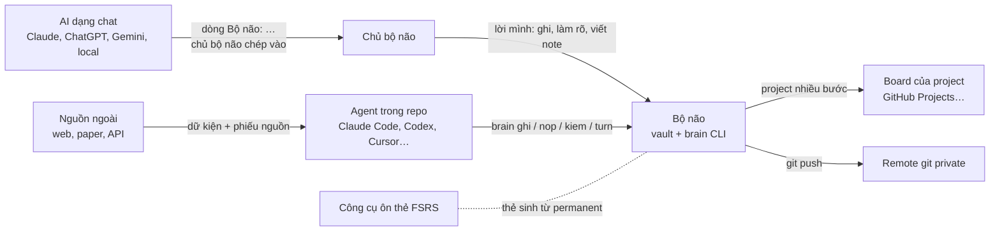
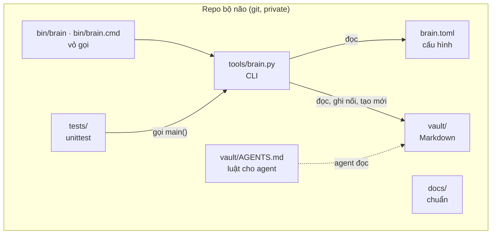
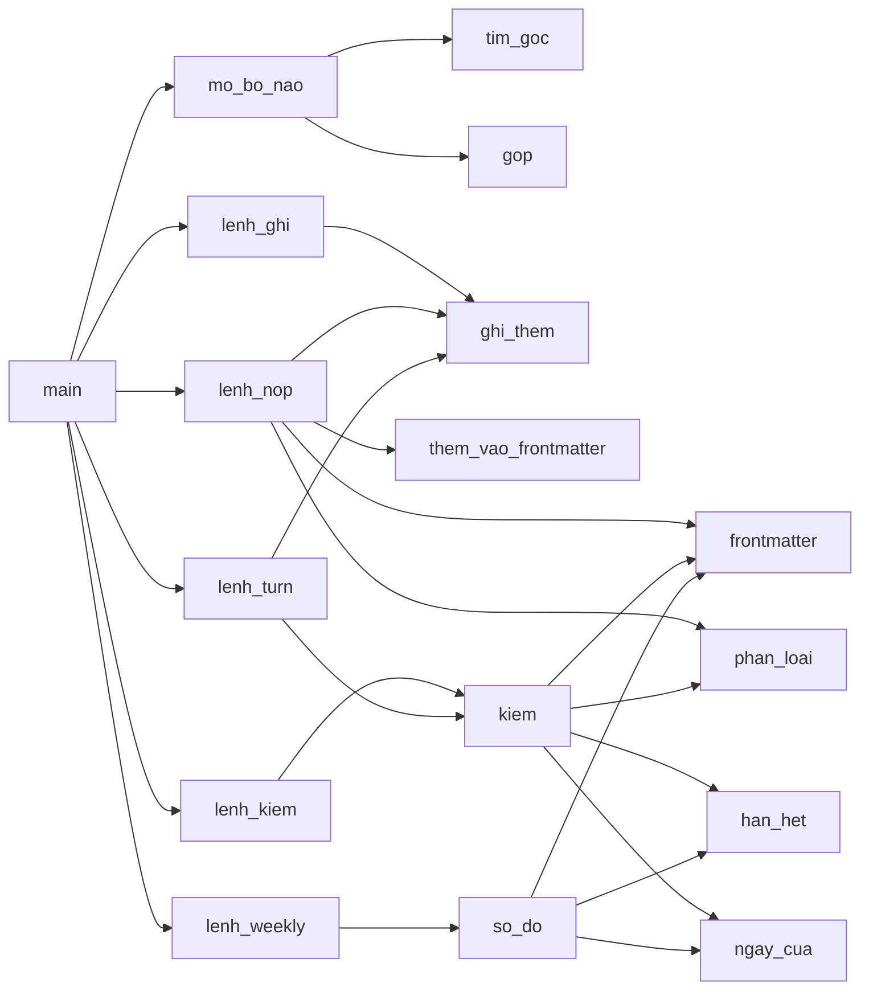
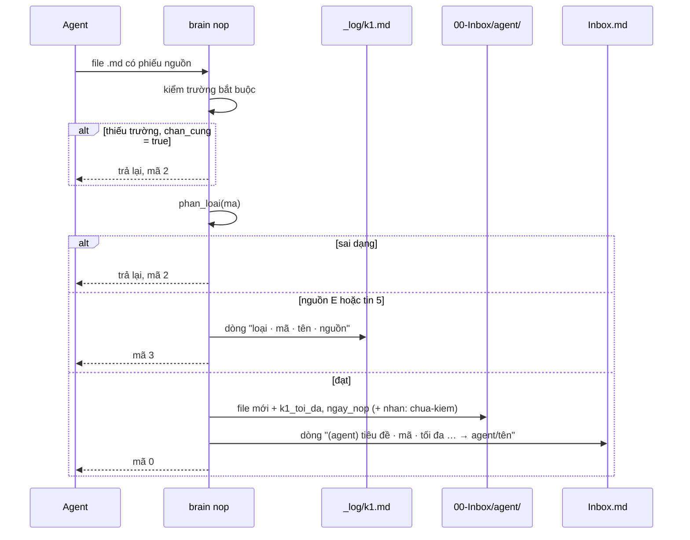
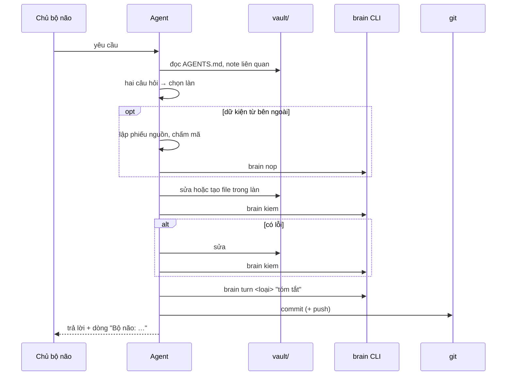
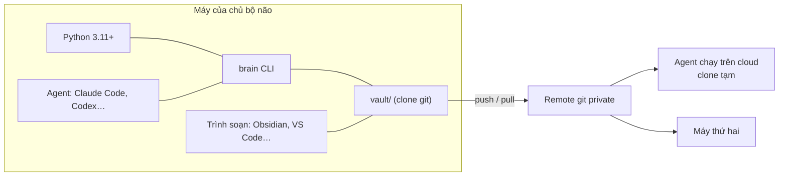
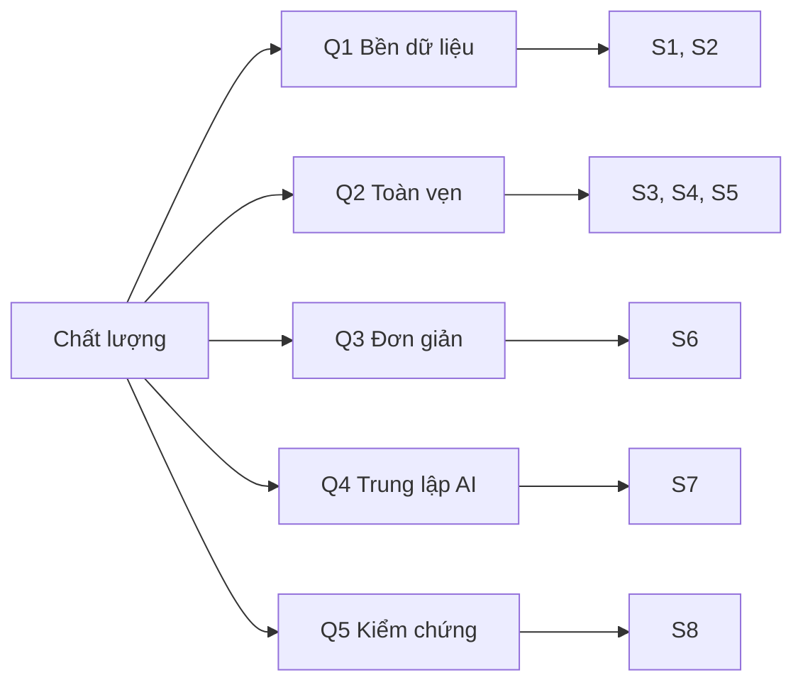
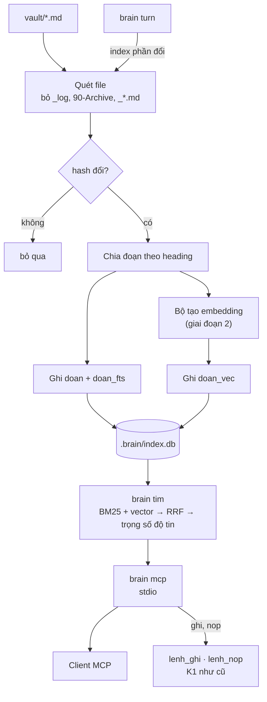
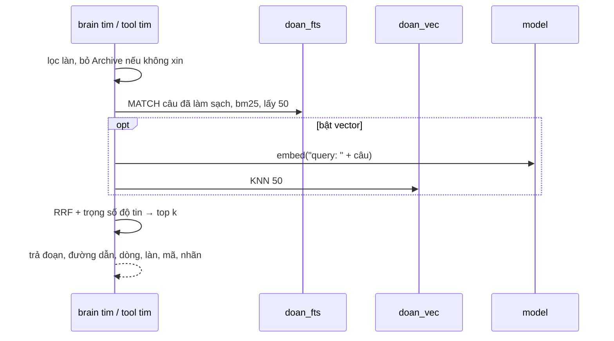

# Kiến trúc hệ thống · Bộ não 2.2

Tài liệu thiết kế kiến trúc (DAB) của Brain_Standard. Bố cục theo khung [arc42](https://arc42.org) và các góc nhìn của ISO/IEC/IEEE 42010; sơ đồ theo mô hình C4; quyết định ghi theo dạng ADR của Michael Nygard. Luật nghiệp vụ được giải thích ở các trang `docs/` khác; trang này mô tả hệ thống được dựng thế nào, chạy ra sao, và vì sao được dựng như vậy, đủ chi tiết để viết lại CLI từ đầu mà không cần đọc code.

## Mục lục

0. [Thông tin tài liệu](#0-thông-tin-tài-liệu)
1. [Giới thiệu và mục tiêu](#1-giới-thiệu-và-mục-tiêu)
2. [Ràng buộc](#2-ràng-buộc)
3. [Bối cảnh và phạm vi](#3-bối-cảnh-và-phạm-vi)
4. [Chiến lược giải pháp](#4-chiến-lược-giải-pháp)
5. [Góc nhìn khối xây dựng](#5-góc-nhìn-khối-xây-dựng)
6. [Góc nhìn vận hành](#6-góc-nhìn-vận-hành)
7. [Góc nhìn triển khai](#7-góc-nhìn-triển-khai)
8. [Khái niệm xuyên suốt](#8-khái-niệm-xuyên-suốt)
9. [Quyết định kiến trúc](#9-quyết-định-kiến-trúc)
10. [Yêu cầu chất lượng](#10-yêu-cầu-chất-lượng)
11. [Rủi ro và nợ kỹ thuật](#11-rủi-ro-và-nợ-kỹ-thuật)
12. [Hướng phát triển · tầng truy hồi (đề xuất 2.3)](#12-hướng-phát-triển--tầng-truy-hồi-đề-xuất-23)
13. [Thuật ngữ](#13-thuật-ngữ)
14. [Tài liệu tham khảo](#14-tài-liệu-tham-khảo)
15. [Bảo trì tài liệu này](#15-bảo-trì-tài-liệu-này)

## 0. Thông tin tài liệu

| Mục | Nội dung |
| --- | --- |
| Hệ thống | Brain_Standard · bộ não thứ hai dạng Markdown + git + CLI `brain` |
| Phiên bản hệ thống mô tả | 2.2.1 (đang chạy) và 2.3 (đề xuất, mục 12) |
| Bản tài liệu | 1.1 |
| Trạng thái | Bản nháp đã chuẩn hoá, chờ chủ bộ não duyệt |
| Chủ sở hữu | Chủ repo Brain_Standard |
| Cập nhật lần cuối | 21/10/2026 |
| Nguồn sự thật đối chiếu | `tools/brain.py`, `brain.toml`, `tests/test_brain.py`, `vault/`, các trang `docs/` |

### 0.1 Phạm vi tài liệu

Tài liệu bao gồm: chuẩn dữ liệu của vault, CLI `brain`, luật kiểm tra, cách AI và agent tương tác, cách triển khai, và thiết kế tầng truy hồi đề xuất. Tài liệu không thay cho hướng dẫn người dùng ([huong-dan.md](huong-dan.md)) và không giải thích lại phương pháp GTD, Zettelkasten… ngoài mức cần cho kiến trúc.

### 0.2 Đọc theo vai

| Bạn là | Nên đọc |
| --- | --- |
| Chủ bộ não, muốn hiểu hệ thống | 1, 3, 4, 9, 11 |
| Người sửa CLI | 5, 6, 8, 10, 11 |
| Agent làm việc trong repo | 6.7, 8.1–8.4, 8.10 |
| Người làm tầng truy hồi | 8, 12 |

### 0.3 Quy ước

- **Phải / không được**: luật đã được CLI hoặc `AGENTS.md` áp dụng.
- **Nên**: khuyến nghị, không bị kiểm tra tự động.
- **(đề xuất)**: chưa có trong code.
- Đường dẫn trong vault viết tương đối từ `vault/`; đường dẫn khác tương đối từ gốc repo.
- Tên hàm, khoá cấu hình và khoá frontmatter viết trong `code`, đúng như trong mã nguồn.

### 0.4 Lịch sử tài liệu

| Bản | Ngày | Thay đổi |
| --- | --- | --- |
| 1.0 | 21/10/2026 | Bản đầu, chuẩn hoá theo arc42: gom mô tả rải rác trong `docs/` và `tools/brain.py`, thêm ADR, rủi ro, thiết kế tầng truy hồi 2.3 |
| 1.1 | 21/10/2026 | Viết chi tiết: ca sử dụng, đặc tả từng lệnh, danh mục luật kiểm, tham chiếu cấu hình, ngữ pháp các dòng, mô hình mối đe doạ, ma trận truy vết test, ADR đầy đủ, DDL và thuật toán của tầng truy hồi, schema tool MCP, tiêu chí nghiệm thu |

## 1. Giới thiệu và mục tiêu

### 1.1 Bài toán

Một người làm nhiều việc, đọc nhiều, viết code và dùng nhiều AI gặp năm vấn đề: việc và ý rơi rớt ở nhiều nơi; đọc nhiều mà không nhớ; project dở dang không rõ bước tiếp; file nằm lung tung; AI quên giữa các phiên, đôi khi bịa, và mỗi nền tảng một kiểu. Bộ não giải bằng một dòng chảy duy nhất: mọi thứ vào **một Inbox**, được làm rõ bằng **hai câu hỏi**, rồi đi vào đúng **một trong ba làn**. Các làn trao đổi qua **7 đường nối I1–I7**. Dữ kiện do AI mang về phải qua **cổng K1–K4**. Xem [dong-chay.md](dong-chay.md).

### 1.2 Yêu cầu chức năng

| Mã | Yêu cầu | Ưu tiên | Trạng thái | Hiện thực | Test |
| --- | --- | --- | --- | --- | --- |
| F1 | Ghi nhanh lời chủ bộ não vào Inbox, kèm giờ và kênh | Phải | Có | `brain ghi` | `test_ghi_vao_inbox` |
| F2 | Nhận dữ kiện agent mang về chỉ khi có phiếu nguồn đủ trường bắt buộc | Phải | Có | `brain nop` | `test_nop_thieu_phieu_bi_tra_lai` |
| F3 | Chấm mã Admiralty và quyết định mục đi tối đa tới đâu | Phải | Có | `phan_loai` | `test_nop_phan_loai` |
| F4 | Loại mục nguồn E hoặc tin 5, ghi vào log, không vào Inbox | Phải | Có | `brain nop` | `test_nop_ma_loai_ghi_log` |
| F5 | Rà vault theo luật ba làn và cổng K1–K3 | Phải | Có | `brain kiem` | nhiều test, mục 8.12 |
| F6 | Đóng lượt làm việc, từ chối khi vault còn lỗi | Phải | Có | `brain turn` | `test_turn_*` |
| F7 | Số đo cho Weekly Review, chỉ đo không chặn | Phải | Có | `brain weekly` | `test_weekly` |
| F8 | Một bộ quy tắc dùng cho mọi AI | Phải | Có | `vault/AGENTS.md`, [dung-voi-ai.md](dung-voi-ai.md) | Thủ công |
| F9 | Kiểm cổng K4 (thẻ ôn) | Nên | Chưa | | |
| F10 | Kiểm Index Johnny Decimal khớp thư mục | Nên | Chưa | | |
| F11 | Tìm note theo từ khoá và theo nghĩa | Nên | Đề xuất | `brain index`, `brain tim` | Mục 12.13 |
| F12 | Cho client MCP đọc bộ não và ghi qua cổng | Nên | Đề xuất | `brain mcp` | Mục 12.13 |

### 1.3 Yêu cầu phi chức năng

| Mã | Yêu cầu | Đo bằng |
| --- | --- | --- |
| N1 | Chạy được chỉ với Python 3.11+ và thư viện chuẩn | Không có `import` ngoài thư viện chuẩn trong `tools/brain.py` |
| N2 | Chạy trên Linux, macOS, Windows | Vỏ gọi `bin/brain` và `bin/brain.cmd`; UTF-8 trên console |
| N3 | Không cần mạng | CLI không mở kết nối nào |
| N4 | Không bao giờ sửa hay xoá note đã có | Mục 8.8 |
| N5 | Kết quả xác định khi cố định giờ | `BRAIN_NOW` |
| N6 | Thông báo bằng tiếng Việt, chỉ rõ file và luật bị vi phạm | Mẫu thông báo mục 8.4 |
| N7 | `brain kiem` chạy dưới 2 giây với vault 5.000 note trên máy cá nhân | Chưa đo, rủi ro R2 |

### 1.4 Mục tiêu chất lượng

Xếp theo ưu tiên. Khi hai mục xung đột, mục trên thắng.

| # | Mục tiêu | Ý nghĩa | Ví dụ khi xung đột |
| --- | --- | --- | --- |
| Q1 | Sở hữu và bền dữ liệu | Markdown thuần trong git, mở được bằng mọi trình soạn, sống lâu hơn mọi công cụ | Không lưu dữ liệu chỉ trong database, dù nhanh hơn |
| Q2 | Toàn vẹn tri thức | Dữ kiện AI mang về không vào được nếu thiếu nguồn và mã; mã quyết định nó đi tới đâu | Chấp nhận agent tốn thêm bước để lập phiếu nguồn |
| Q3 | Đơn giản | Một file Python, thư viện chuẩn, không server | Không thêm thư viện YAML dù bộ đọc frontmatter tự viết còn hạn chế |
| Q4 | Trung lập nền tảng AI | Đổi AI không mất gì | Không dùng tính năng riêng của một nền tảng trong luật |
| Q5 | Kiểm chứng được | Mọi luật trong CLI có test, giờ giả lập được | Luật viết thành hàm thuần dễ test hơn là gộp vào `main` |

### 1.5 Các bên liên quan

| Vai | Mong đợi | Mối quan tâm kiến trúc |
| --- | --- | --- |
| Chủ bộ não | Ghi nhanh, không quên việc, kiến thức thành của mình | Q1, Q2, tốc độ ghi, dễ sửa tay |
| Agent trong repo (Claude Code, Codex, Gemini CLI, Cursor, Copilot) | Luật rõ, lệnh kiểm được, mã thoát máy đọc được | Mã thoát ổn định, thông báo có đường dẫn |
| AI dạng chat (mức 1–2) | Khối quy tắc ngắn, dòng `Bộ não:` | Q4 |
| Người đóng góp chuẩn | Code nhỏ, có test, change log rõ | Q3, Q5 |
| Cộng tác viên trên board | Backlog, người, hạn ở board | Ranh giới bộ não – board (ADR-07) |

### 1.6 Ca sử dụng chính

| Mã | Ca | Tác nhân | Luồng chính | Lệnh |
| --- | --- | --- | --- | --- |
| UC1 | Ghi nhanh một ý | Chủ bộ não, AI qua `ghi:` | Gõ một câu → dòng mới trong Inbox | `brain ghi` |
| UC2 | Nộp dữ kiện tra cứu | Agent | Lập phiếu nguồn → nộp → K1 → Inbox hoặc log | `brain nop` |
| UC3 | Làm rõ Inbox | Chủ bộ não, AI đề xuất | Mỗi mục qua hai câu hỏi → chuyển tay vào làn | Không (sửa file) |
| UC4 | Lập project | Chủ bộ não | Chép `_mau-project.md` → điền tiêu chí → nếu nhiều bước thì mở category, repo, board (I3) | `brain kiem` |
| UC5 | Viết permanent note | Chủ bộ não | Viết bằng lời mình → nối ít nhất 1 link → kiểm K3 | `brain kiem` |
| UC6 | Đóng lượt | Người hoặc agent | Kiểm → sửa lỗi → ghi log lượt → commit | `brain turn` |
| UC7 | Weekly Review | Chủ bộ não | Lấy số đo → đi qua mẫu weekly → quyết định | `brain weekly --ghi` |
| UC8 | Đổi AI | Chủ bộ não | Chép `AGENTS.md` theo tên công cụ mới hoặc dán khối quy tắc | Không |
| UC9 | Hỏi AI về note cũ | Chủ bộ não qua client MCP | AI gọi `tim` → đọc note → trả lời kèm đường dẫn và mã | **(đề xuất)** `brain mcp` |

## 2. Ràng buộc

### 2.1 Kỹ thuật

| Ràng buộc | Lý do | Hệ quả |
| --- | --- | --- |
| Python 3.11 trở lên | `tomllib` có sẵn từ 3.11 | Máy cũ phải cài Python mới |
| Chỉ thư viện chuẩn | Cài ở mọi máy, không `pip` | Bộ đọc frontmatter tự viết (R1, R9) |
| Một file mã nguồn `tools/brain.py` | Dễ đọc, dễ chép | Chia mô-đun bằng nhóm hàm và chú thích |
| File `.md` UTF-8, xuống dòng `\n` | Đọc được bằng người, Obsidian, mọi AI | CLI ghi với `newline="\n"` |
| Frontmatter `khoá: giá trị` một dòng | Không cần thư viện YAML | Không có giá trị nhiều dòng, danh sách là chuỗi |
| Cấu hình TOML ở gốc repo | Một nơi duy nhất | Gốc bộ não được nhận ra nhờ `brain.toml` |

### 2.2 Tổ chức

| Ràng buộc | Lý do |
| --- | --- |
| Repo bộ não của người dùng phải private | Ghi chú là dữ liệu cá nhân |
| Thiết kế cho một người; làm nhóm chỉ ở board của từng project | Giữ dòng chảy đơn giản |
| AI không viết permanent note, không xoá dữ liệu, không nâng mã | Nguyên tắc 2 và 3 trong README |
| Không giới hạn số project hay next action từ 2.2.0 | Đo thay vì cấm (ADR-06) |

### 2.3 Quy ước

| Chủ đề | Quy ước |
| --- | --- |
| Phiên bản | x.y.z: x đổi hình dòng chảy, y thêm cơ chế mà không phá dòng chảy, z sửa câu chữ, nhãn, số liệu. Ghi ở [CHANGELOG.md](../CHANGELOG.md), `brain.toml` và hằng `PHIEN_BAN` |
| Đặt tên trong code | Tiếng Việt không dấu, `snake_case`: `lenh_nop`, `phan_loai`, `chan_cung` |
| Khoá frontmatter | Tiếng Việt không dấu, `snake_case`: `tieu_chi_xong`, `ngay_lay` |
| Tên thư mục vault | Tiền tố số theo PARA và Johnny Decimal: `00-Inbox`, `10-Action`, `30-Knowledge`… |
| File mẫu | Bắt đầu bằng `_`, bị bỏ qua khi kiểm, không được sửa trực tiếp |
| Ngày | ISO 8601: `YYYY-MM-DD`, tháng `YYYY-MM`, giờ `YYYY-MM-DD HH:MM` |
| Thông báo | Tiếng Việt, dạng `<Nhóm> · <đường dẫn>: <vấn đề>` |

## 3. Bối cảnh và phạm vi

### 3.1 Bối cảnh nghiệp vụ



| Đối tác | Vào bộ não | Ra khỏi bộ não | Qua cổng |
| --- | --- | --- | --- |
| Chủ bộ não | Ghi chú, quyết định, permanent note | Next Actions, số đo, note để đọc lại | Không |
| AI dạng chat | Không ghi trực tiếp; chủ bộ não chép dòng `Bộ não:` | Note được dán vào chat | K1 nếu là dữ kiện AI tự tra |
| Agent trong repo | Mục Inbox, mục qua K1, sửa file theo `AGENTS.md` | Toàn bộ vault | K1 cho dữ kiện ngoài |
| Nguồn ngoài | Chỉ qua agent | Không | K1 bắt buộc |
| Board | Không, bộ não chỉ giữ link | Link board, milestone, số issue | Không |
| Công cụ FSRS | Không | Nội dung thẻ | K4 |
| Remote git | Không | Bản sao lưu, lịch sử | Không |

### 3.2 Bối cảnh kỹ thuật

| Kênh | Giao thức · định dạng | Chi tiết |
| --- | --- | --- |
| Dòng lệnh | `brain [--root DIR] <lệnh> …` | Mục 6; mã thoát mục 8.10 |
| stdout / stderr | Văn bản UTF-8 | Kết quả thường ra stdout; lỗi đầu vào và từ chối ra stderr |
| File dữ liệu | Markdown + frontmatter | Mục 8.1–8.2 |
| Cấu hình | TOML | Mục 8.5 |
| Biến môi trường | `BRAIN_ROOT`, `BRAIN_NOW` | Mục 8.6–8.7 |
| Git | Lệnh git thường | Ngoài CLI; người hoặc agent tự commit và push |
| MCP | JSON-RPC qua stdio | **(đề xuất)** mục 12.9 |

### 3.3 Ngoài phạm vi

- Đồng bộ thời gian thực, nhiều người sửa cùng một vault.
- Lịch nhắc, thông báo đẩy, ứng dụng di động riêng.
- Thay thế board quản lý project.
- Bộ lập lịch ôn thẻ FSRS.
- Tự động phân loại Inbox: AI chỉ đề xuất, người quyết định.
- Mã hoá vault khi lưu: dựa vào mã hoá ổ đĩa và quyền repo private.

## 4. Chiến lược giải pháp

| Mục tiêu | Cách giải | ADR |
| --- | --- | --- |
| Q1 Sở hữu dữ liệu | File là nguồn thật duy nhất; mọi chỉ mục là dữ liệu phái sinh dựng lại được | 01, 08 |
| Q2 Toàn vẹn tri thức | K1 chặn cứng ở cửa vào; K2–K3 ở cửa làn; mã Admiralty hai trục; ngưỡng nằm trong cấu hình | 04 |
| Q3 Đơn giản | Một file, thư viện chuẩn, lệnh ngắn, không daemon | 02 |
| Q4 Trung lập AI | Luật viết bằng văn bản chung; lệnh CLI là API chung cho mọi agent | 05 |
| Q5 Kiểm chứng | Luật trong hàm thuần (`phan_loai`, `kiem`, `so_do`); giờ qua `bay_gio()`; test trên vault tạm | 02 |

Mô hình nghiệp vụ ghép bốn phương pháp: GTD + PARA cho làn hành động, Zettelkasten + LYT + FSRS cho làn tri thức, Johnny Decimal cho làn file và code, hệ Admiralty cho độ tin. Chi tiết luật: [ba-lan.md](ba-lan.md), [kiem-duyet.md](kiem-duyet.md), [tang-thuc-thi.md](tang-thuc-thi.md).

Cách phân chia trách nhiệm cơ bản:

| Việc | Ai làm |
| --- | --- |
| Quyết định mục đi làn nào | Chủ bộ não (AI đề xuất) |
| Di chuyển file giữa các làn | Chủ bộ não hoặc agent, sửa file trực tiếp |
| Ghi Inbox, nhận mục agent, ghi log | CLI |
| Kiểm luật | CLI |
| Commit, push | Chủ bộ não hoặc agent |

## 5. Góc nhìn khối xây dựng

### 5.1 Mức 1 · Container



| Container | Trách nhiệm | Không làm |
| --- | --- | --- |
| `vault/` | Giữ toàn bộ dữ liệu | Không chứa code |
| `brain.toml` | Đường dẫn, ngưỡng, luật kiểm duyệt | Không chứa dữ liệu |
| `tools/brain.py` | Áp luật, ghi Inbox và log, nhận mục agent, kiểm vault, đo | Không sửa, không xoá note đã có; không gọi mạng |
| `bin/brain` | Vỏ POSIX: tìm thư mục repo, gọi `python3 tools/brain.py` | |
| `bin/brain.cmd` | Vỏ Windows: gọi `python tools\brain.py` | |
| `vault/AGENTS.md` | Luật cho agent; chép ra gốc repo thành `AGENTS.md`, `CLAUDE.md` hoặc `GEMINI.md` | |
| `tests/test_brain.py` | 17 test hành vi trên vault tạm | |
| `docs/` | Chuẩn và hướng dẫn | |

### 5.2 Mức 2 · Cấu trúc vault

| Đường dẫn | Làn | Khoá `duong_dan` | Dạng | CLI ghi? | Được kiểm bởi |
| --- | --- | --- | --- | --- | --- |
| `00-Inbox/Inbox.md` | Cửa vào | `inbox` | Một file, mỗi mục một dòng | Ghi nối (`ghi`, `nop`) | `weekly` |
| `00-Inbox/agent/` | Cửa vào | `inbox_agent` | Mỗi mục một file | Tạo mới (`nop`) | K1-01…03, KD-01 |
| `10-Action/11-next-actions.md` | Hành động | `next_actions` | Một file, checklist | Không | TH-02, `weekly` |
| `10-Action/12-waiting-for.md` | Hành động | `waiting_for` | Một file | Không | Chưa kiểm |
| `10-Action/13-Projects/` | Hành động | `projects` | Mỗi project một file | Không | HD-01…03, TH-01…03 |
| `10-Action/14-someday.md` | Hành động | `someday` | Một file | Không | Chưa kiểm |
| `20-Areas/` | Hành động | | Mỗi area một file | Không | Chưa kiểm |
| `30-Knowledge/fleeting/` | Tri thức | `fleeting` | Mỗi ý một file | Không | TT-03 |
| `30-Knowledge/literature/` | Tri thức | `literature` | Mỗi nguồn một file | Không | K2-01…03, KD-01 |
| `30-Knowledge/permanent/` | Tri thức | `permanent` | Mỗi ý một file | Không | TT-01, TT-02, K3-01…02, KD-01 |
| `40-Maps/` | Tri thức | `maps` | Mỗi MOC một file | Không | Chưa kiểm |
| `Coding/5x …/` | File và code | | Thư mục AC.ID | Không | Chưa kiểm (F10) |
| `Coding/50 He thong/50.00 Index (JDex).md` | File và code | | Một file, mỗi số một dòng | Không | Chưa kiểm |
| `weekly/` | Nhịp | `weekly` | Mỗi tuần một file | Tạo mới (`weekly --ghi`) | |
| `90-Archive/` | Nền | | Tuỳ | Không | |
| `_log/k1.md` | Nền | `log` | Một file, mỗi mục bị loại một dòng | Ghi nối (`nop`) | `weekly` |
| `_log/turns.md` | Nền | `log` | Một file, mỗi lượt một dòng | Ghi nối (`turn`) | `weekly` |
| `_mau/`, mọi file `_*.md` | Mẫu | | | Không | Bị bỏ qua |

Hàm `cac_note(thu_muc)` trả về mọi file `*.md` trong thư mục (đệ quy), bỏ file có tên bắt đầu bằng `_`, sắp theo đường dẫn. Thư mục không tồn tại trả về danh sách rỗng, nên vault thiếu thư mục vẫn kiểm được.

### 5.3 Mức 3 · Thành phần trong `tools/brain.py`



| Nhóm | Hàm · hằng | Vai trò | Thuần? |
| --- | --- | --- | --- |
| Hằng | `PHIEN_BAN`, `MA_RE`, `DONG_INBOX_RE`, `LINK_RE`, `LOAI_TURN`, `TRANG_THAI`, `NHAN_K1`, `MAC_DINH` | Phiên bản, biểu thức, giá trị hợp lệ, cấu hình mặc định | |
| Giờ | `bay_gio()` | Giờ hiện tại, hoặc `BRAIN_NOW` | Đọc môi trường |
| Cấu hình | `gop(mac_dinh, rieng)` | Gộp cấu hình hai mức | Có |
| File | `doc(p)`, `ghi_them(p, dong, dau_file)` | Đọc UTF-8; ghi nối, tạo thư mục và đầu file nếu chưa có | Không |
| Frontmatter | `frontmatter(text)`, `_gia_tri(v)`, `them_vao_frontmatter(text, cap)` | Đọc, chuẩn hoá giá trị, thêm khoá | Có |
| Văn bản | `tieu_de(body, du_phong)`, `slug(s)` | Lấy heading `# ` đầu tiên; tên file ASCII tối đa 60 ký tự | Có |
| Ngày | `han_het(gia_tri)`, `ngay_cua(p, fm)` | Ngày bắt đầu hết hạn; ngày của một note | `ngay_cua` đọc mtime |
| Duyệt | `cac_note(thu_muc)` | Liệt kê note, bỏ mẫu | Đọc đĩa |
| Luật | `phan_loai(ma, kd)` | K1: `the`, `literature`, `fleeting`, `loai`, `sai_ma` | Có |
| Luật | `kiem(bn)` | Trả `(lỗi, cảnh báo)` | Đọc đĩa |
| Luật | `so_do(bn)` | Từ điển số đo tuần | Đọc đĩa |
| Ngữ cảnh | `BoNao`, `tim_goc`, `mo_bo_nao` | Gốc, cấu hình, giờ; phân giải đường dẫn qua `bn.p(khoa)` | |
| Lệnh | `lenh_ghi`, `lenh_nop`, `lenh_kiem`, `lenh_turn`, `lenh_weekly` | Trả mã thoát | |
| Vào | `main(argv)` | Đặt UTF-8 cho console, phân tích tham số, gọi lệnh | |

`BoNao` là dataclass giữ `goc`, `cfg`, `now`, với các thuộc tính `vault`, `kd` (mục `kiem_duyet`), `gio` (`YYYY-MM-DD HH:MM`) và hàm `p(khoa)` trả về `vault / duong_dan[khoa]`.

## 6. Góc nhìn vận hành

Mọi lệnh bắt đầu giống nhau: `main` đặt UTF-8 cho stdout và stderr, phân tích tham số, gọi `mo_bo_nao` để tìm gốc và nạp cấu hình (mục 8.6), rồi gọi hàm lệnh. Tham số sai do `argparse` xử lý và thoát mã 2.

### 6.1 `brain ghi`

| Mục | Đặc tả |
| --- | --- |
| Cú pháp | `brain ghi <nội dung…> [--kenh KÊNH]` |
| Đầu vào | Nội dung là mọi từ còn lại, nối bằng dấu cách; `--kenh` mặc định `tay` (ví dụ `noi`, `telegram`, `mcp`) |
| Bước | 1. Gộp mọi khoảng trắng liên tiếp thành một dấu cách. 2. Rỗng thì báo lỗi. 3. Ghi nối một dòng vào `inbox`; nếu file chưa có thì tạo với đầu `# Inbox\n\n## Mục\n` |
| Ghi | `00-Inbox/Inbox.md` |
| Dòng sinh ra | `- [2026-10-20 21:30] (tay) Đọc chương 5` |
| Đầu ra | stdout: `Đã ghi vào Inbox: <nội dung>` |
| Mã thoát | 0 thành công; 2 nội dung rỗng |
| Ghi chú | Không qua K1: lời chủ bộ não được tin mặc định |

### 6.2 `brain nop`

| Mục | Đặc tả |
| --- | --- |
| Cú pháp | `brain nop <file.md>` |
| Đầu vào | Một file Markdown có phiếu nguồn trong frontmatter, ở bất kỳ đâu trên đĩa |
| Đọc | File nộp; cấu hình `kiem_duyet` |
| Ghi | `00-Inbox/agent/<YYYYmmdd-HHMMSS>-<slug>.md`, `00-Inbox/Inbox.md`, hoặc `_log/k1.md` |
| Mã thoát | 0 đạt; 2 không thấy file, thiếu trường (khi chặn cứng), mã sai dạng; 3 bị loại |

Các bước:

1. Không thấy file → stderr `Không thấy file …`, mã 2.
2. Đọc frontmatter; liệt kê các khoá trong `truong_bat_buoc` bị thiếu hoặc rỗng.
3. Có trường thiếu: nếu `chan_cung = true` thì stderr `K1 trả lại <tên>: thiếu <các trường>. Bổ sung phiếu nguồn rồi nộp lại.`, mã 2. Nếu `false` thì in cảnh báo và đi tiếp.
4. Chuẩn hoá `ma` (bỏ khoảng trắng, viết hoa), gọi `phan_loai`.
5. `sai_ma` → stderr giải thích dạng mã, mã 2. Lưu ý: khi `chan_cung = false` mà thiếu `ma`, mục vẫn bị trả lại ở bước này.
6. `loai` → ghi nối `_log/k1.md` (tạo với đầu `# K1 · mục bị loại`), stdout `K1 loại …`, mã 3. Mục không vào Inbox.
7. Đạt → thêm vào frontmatter `k1_toi_da: <the|literature|fleeting>` và `ngay_nop: YYYY-MM-DD`; nếu là `fleeting` thêm `nhan: chua-kiem`. Ghi file mới vào `inbox_agent`, rồi ghi nối một dòng vào Inbox, stdout `K1 đạt: …`, mã 0.



Ví dụ:

```text
$ brain nop tra-cuu/vat-gia.md
K1 đạt: Lạm phát tháng 9 là 2,9% · mã B2 · đi tối đa tới thẻ ôn.
```

File nộp gốc không bị xoá hay sửa. Tiêu đề trong dòng Inbox là heading `# ` đầu tiên của thân, không có thì dùng tên file.

### 6.3 `brain kiem`

| Mục | Đặc tả |
| --- | --- |
| Cú pháp | `brain kiem` |
| Đọc | `inbox_agent`, `literature`, `permanent`, `fleeting`, `projects`, `next_actions` |
| Ghi | Không |
| Đầu ra | `Lỗi (n):` và `Cảnh báo (m):`, mỗi mục một dòng `  - …`; không có gì thì `Vault sạch.` |
| Mã thoát | 0 không có lỗi (có thể có cảnh báo); 1 có ít nhất một lỗi |

Thứ tự duyệt trong `kiem`: K1 trong `inbox_agent` → K2 trong literature → luật permanent và K3 → tuổi fleeting → hạn dùng của literature, permanent, inbox_agent → luật project. Danh mục đầy đủ: mục 8.4.

Ví dụ:

```text
$ brain kiem
Lỗi (2):
  - Tri thức · 30-Knowledge/permanent/p1.md: permanent note chưa nối tới note nào
  - K3 · 30-Knowledge/permanent/p1.md: permanent cần tin 1–2, đang là B3
Cảnh báo (1):
  - Tri thức · 30-Knowledge/fleeting/y.md: fleeting đã 19 ngày, nâng lên literature hoặc xoá
```

### 6.4 `brain turn`

| Mục | Đặc tả |
| --- | --- |
| Cú pháp | <code>brain turn &lt;viec&#124;y&#124;file&#124;xoa&gt; &lt;tóm tắt…&gt;</code> |
| Bước | 1. Gộp khoảng trắng của tóm tắt; rỗng thì mã 2. 2. Chạy `kiem`. 3. Có lỗi và `chan_cung = true` → in lỗi (không in cảnh báo), stderr `Lượt chưa đóng được: sửa n lỗi rồi chạy lại brain turn.`, mã 1. 4. Ngược lại ghi nối `_log/turns.md` (tạo với đầu `# Các lượt làm việc`), in `Bộ não: <loại> · <tóm tắt>`; có cảnh báo thì in thêm `(m cảnh báo, xem brain kiem)` |
| Ghi | `_log/turns.md` |
| Mã thoát | 0 đóng được; 1 vault còn lỗi; 2 tóm tắt rỗng hoặc loại sai |

Bốn loại lượt: `viec` tạo ra việc, `y` tạo ra ý, `file` tạo ra file hoặc code, `xoa` không giữ gì.

### 6.5 `brain weekly`

| Mục | Đặc tả |
| --- | --- |
| Cú pháp | `brain weekly [--ghi]` |
| Đầu ra | Bảng Markdown `## Số đo · <năm>-W<tuần>` |
| Ghi | Với `--ghi`: `weekly/<năm>-W<tuần>.md`, ghi đè nếu đã có, đầu file `# Weekly Review · <tuần>` |
| Mã thoát | Luôn 0 |

Định nghĩa từng số đo trong `so_do` (cửa sổ 7 ngày là các ngày `> hôm nay − 7`):

| Khoá | Định nghĩa |
| --- | --- |
| `tuan` | Năm và tuần ISO của hôm nay |
| `project_active`, `project_xong`, `project_dung` | Số project có `trang_thai` là `active`, `done`, `stopped` |
| `project_qua_han` | Project active có `han` đã qua |
| `next_mo`, `next_xong` | Số dòng `- [ ]` và `- [x]` (hoặc `[X]`) trong Next Actions |
| `inbox` | Số dòng có dạng `- [YYYY-MM-DD …]` trong Inbox |
| `inbox_cu_nhat_ngay` | Tuổi tính bằng ngày của dòng Inbox cũ nhất, 0 nếu trống |
| `fleeting_qua_han` | Fleeting có tuổi lớn hơn `fleeting_toi_da_ngay` |
| `permanent_moi` | Permanent có ngày (mục 8.7) trong cửa sổ 7 ngày |
| `luot`, `luot_theo_loai` | Dòng trong `_log/turns.md` trong cửa sổ 7 ngày, đếm theo loại |
| `k1_bi_loai` | Dòng trong `_log/k1.md` trong cửa sổ 7 ngày |
| `phan_tram_thieu_phieu` | % file trong `inbox_agent` thiếu ít nhất một trường bắt buộc, làm tròn |
| `qua_han_dung` | Số note literature, permanent, inbox_agent có `han_dung` đã qua |

### 6.6 Nhịp làm việc như các kịch bản vận hành

| Nhịp | Kịch bản | Lệnh liên quan |
| --- | --- | --- |
| Mỗi lần nghĩ ra | Ghi ngay | `brain ghi` |
| Mỗi lần agent tra cứu | Lập phiếu, nộp | `brain nop` |
| Mỗi lượt làm việc | Kiểm, đóng lượt, commit | `brain kiem`, `brain turn` |
| Mỗi sáng, 30–45 phút | Chọn tối đa 3 việc (`nhip.vong_ngay_chon_toi_da`), làm ít nhất 1, ôn 15–20 thẻ | Không |
| Chủ nhật, 30 phút | Weekly Review theo `weekly/_mau-weekly.md` | `brain weekly --ghi` |
| Mỗi tháng | Kiểm lại 10 khẳng định ngẫu nhiên; sai thì đi I7 | Không |
| Mỗi quý | Mỗi Area sinh một project; gộp category nếu cần | Không |

### 6.7 Lượt làm việc của agent



### 6.8 Bảy đường nối như luồng dữ liệu

Các đường I1–I7 hiện do người hoặc agent làm bằng tay; CLI chưa kiểm.

| Mã | Từ → đến | Kích hoạt | Dữ liệu tạo ra | Kiểm tự động |
| --- | --- | --- | --- | --- |
| I1 | hành động → tri thức | Xong milestone, xong việc lớn, đóng project | Permanent note bài học, link về project | TT-01 (có link) |
| I2 | tri thức → hành động | Note gợi ra việc | Mục Someday, link về note | Không |
| I3 | hành động → file | Lập project nhiều bước | Dòng Index, thư mục category, repo, board | Không (F10) |
| I4 | tri thức → hành động | Thẻ bị quên từ 3 lần | Next action "đọc lại <nguồn>" | Không |
| I5 | file → tri thức | Lần chạy cho ra số liệu mới | Literature note, nguồn là AC.ID của log | Không |
| I6 | file → hành động | Issue giao cho bạn hoặc lỗi chặn project | Next action trỏ số issue | Không |
| I7 | tri thức → hành động | Kiểm lại thấy khẳng định sai | Việc sửa note, thẻ, node bản đồ | Không |

## 7. Góc nhìn triển khai



### 7.1 Nút triển khai

| Nút | Vai trò | Yêu cầu |
| --- | --- | --- |
| Máy cá nhân | Nơi làm việc chính | Python 3.11+, git; không cần mạng để chạy CLI |
| Remote git private | Sao lưu, đồng bộ, lịch sử | Một repo private |
| Máy thứ hai | Làm việc ở nơi khác | Pull trước khi làm, push sau khi xong |
| Agent cloud | Làm việc trên clone tạm | Phải commit và push trước khi phiên kết thúc |

### 7.2 Cài đặt và nâng cấp

1. Tạo repo private từ gói Brain_Standard, clone về máy.
2. Chạy `bin/brain --version`, phải in `brain 2.2.1`. Không có bước build hay cài thư viện.
3. Chép `vault/AGENTS.md` ra gốc repo theo tên mà công cụ của bạn đọc.
4. Nâng cấp: kéo bản mới của `tools/`, `bin/`, `docs/`, đọc CHANGELOG, gộp tay các khoá mới vào `brain.toml`. Vault không cần chuyển đổi trừ khi CHANGELOG ghi rõ. Chi tiết: [huong-dan.md](huong-dan.md) mục 11.

### 7.3 Sao lưu và khôi phục

| Tình huống | Cách xử lý |
| --- | --- |
| Mất máy | Clone lại từ remote |
| Sửa nhầm hoặc agent làm hỏng | `git log`, `git restore` hoặc `git revert` |
| Hỏng remote | Mọi clone đều là bản sao đầy đủ |
| Chỉ mục truy hồi hỏng **(đề xuất)** | Xoá `.brain/`, chạy `brain index --lai` |

## 8. Khái niệm xuyên suốt

### 8.1 Mô hình dữ liệu

Mỗi note là một file Markdown. Frontmatter tuỳ chọn, nằm ở đầu file giữa hai dòng `---`. Cột "Kiểm" trỏ tới mã luật ở mục 8.4.

**Phiếu nguồn** (mục agent mang về, mẫu [`vault/_mau/phieu-nguon.md`](../vault/_mau/phieu-nguon.md)):

| Khoá | Kiểu | Bắt buộc | Ý nghĩa | Kiểm |
| --- | --- | --- | --- | --- |
| `nguon` | URL hoặc mô tả | Có | Trang đã đọc | K1-01 |
| `nguon_goc` | URL | Không | Văn bản gốc, nếu khác | |
| `tac_gia` | Chuỗi | Không | | |
| `ngay_dang` | Ngày | Không | | |
| `ngay_lay` | Ngày | Có | Ngày agent lấy | K1-01 |
| `han_dung` | Ngày hoặc tháng | Không | Sau mốc này dữ kiện cần kiểm lại | KD-01 |
| `luu_tru` | URL | Có | Bản lưu, ví dụ Wayback | K1-01 |
| `hash` | `sha256:…` | Không | Dấu vân tay nội dung | |
| `ma` | `[A-F][1-6]` | Có | Mã Admiralty | K1-01, K1-02, K1-03 |
| `cach_kiem` | Chuỗi | Có | Đã kiểm thế nào | K1-01 |
| `k1_toi_da` | `the`, `literature`, `fleeting` | Do CLI thêm | Đi tối đa tới đâu | |
| `ngay_nop` | Ngày | Do CLI thêm | | |
| `nhan` | `chua-kiem` | Do CLI thêm khi fleeting | | |

**Literature** (mẫu `30-Knowledge/literature/_mau-literature.md`): `loai: literature`, `nguon`, `vi_tri`, `doc_ngay`; khi có dữ kiện agent thì thêm `ma` và `luu_tru`. K2 chỉ áp khi có `ma`.

**Permanent** (mẫu `30-Knowledge/permanent/_mau-permanent.md`):

| Khoá | Bắt buộc | Ý nghĩa | Kiểm |
| --- | --- | --- | --- |
| `id` | Nên | Dạng `YYYYMMDDHHMM`; cũng dùng làm ngày | TT-02 |
| `loai` | Nên | `permanent` | |
| `nguon` | Nên | Link tới literature | |
| `lien_ket` | Một trong hai | Danh sách link; hoặc link `[[…]]` trong thân | TT-01 |
| `the` | Không | Số thẻ ôn sinh ra | |
| `ma` | Khi có dữ kiện agent | Tin phải là 1–2 | K3-01, K3-02 |

**Project** (mẫu `10-Action/13-Projects/_mau-project.md`):

| Khoá | Bắt buộc | Ý nghĩa | Kiểm |
| --- | --- | --- | --- |
| `loai` | Nên | `project` | |
| `trang_thai` | Có | `someday`, `active`, `done`, `stopped` | HD-01 |
| `bat_dau` | Nên | Ngày lập | |
| `ket_qua`, `tieu_chi_xong`, `tieu_chi_dung` | Có khi `active` | | HD-02 |
| `code` | Không | Category Johnny Decimal | |
| `repo`, `board`, `milestone` | Không | Tầng thực thi | TH-01, TH-02 |
| `han` | Không | Hạn của project | TH-03 |
| `nguoi` | Không | Người tham gia (đọc thành chuỗi, R1) | |
| `ly_do_dung` | Nên khi `stopped` | | HD-03 |

**Fleeting**: không bắt buộc frontmatter; nên có `ngay`. **Area**: `loai: area`, `tieu_chuan`, `project_quy_nay`. **MOC**: `loai: moc`, thân là danh sách link.

### 8.2 Ngữ pháp các dòng

Các file dạng danh sách có cú pháp dòng cố định để CLI đếm được.

```text
ngay        = YYYY "-" MM "-" DD
gio         = HH ":" MM
moc         = "- [" ngay [" " gio] "]"

dong_inbox  = moc " (" kenh ") " noi_dung
dong_agent  = moc " (agent) " tieu_de " · " ma " · tối đa " dich " → agent/" ten_file
dong_k1     = moc " loại · " ma " · " ten_file " · " nguon
dong_turn   = moc " " loai_turn " · " tom_tat
dong_viec   = "- [ ] " dong_tu " …" [" · @" ngu_canh] [" · ~" phut "'"] [" · [[" project "]]"] [" · #" so_issue]
dong_jdex   = "- " AC.ID " " ten " · nơi: " duong_dan [" · project: [[…]]"] [" · repo: …"] [" · board: …"] " · trạng thái: " trang_thai

kenh        = "tay" | "noi" | "telegram" | "mcp" | …
loai_turn   = "viec" | "y" | "file" | "xoa"
dich        = "thẻ ôn" | "literature" | "fleeting (chưa kiểm)"
```

`DONG_INBOX_RE` (`^- \[(\d{4}-\d{2}-\d{2})(?: (\d{2}:\d{2}))?\]`) dùng chung cho Inbox, `k1.md` và `turns.md` để lấy ngày. Dòng việc xong là `- [x]`. Link nội bộ có dạng `[[tên-note]]` (`LINK_RE`).

### 8.3 Mô hình độ tin và cổng

Mã hai ký tự theo hệ Admiralty: nguồn A–F (A hoàn toàn tin cậy … E không tin cậy, F chưa đánh giá) và tin 1–6 (1 đã xác nhận … 5 khó tin, 6 chưa đánh giá). Hai trục chấm độc lập.

Thuật toán `phan_loai(ma, kd)`, với ngưỡng lấy từ `[kiem_duyet]`:

```text
nếu ma không khớp ^[A-F][1-6]$            → sai_ma
nguồn, tin = ma[0], ma[1]
nếu nguồn ∈ loai_nguon hoặc tin ∈ loai_tin → loai          (mặc định E, 5)
nếu nguồn ∈ chi_toi_fleeting               → fleeting      (mặc định D, F)
nếu nguồn ∈ literature_nguon và tin ∈ the_tin → the        (mặc định A–C, 1–2)
còn lại                                    → literature
```

Kết quả theo mặc định (hàng nguồn, cột tin):

| | 1 | 2 | 3 | 4 | 5 | 6 |
| --- | --- | --- | --- | --- | --- | --- |
| A, B, C | the | the | literature | literature | loai | literature |
| D, F | fleeting | fleeting | fleeting | fleeting | loai | fleeting |
| E | loai | loai | loai | loai | loai | loai |

| Cổng | Vị trí | Ai áp | Điều kiện mặc định |
| --- | --- | --- | --- |
| K1 | Trước Inbox | `brain nop`, `brain kiem` | Đủ 5 trường; mã đúng dạng; không bị loại |
| K2 | Cửa literature | `brain kiem` (khi có `ma`) | Nguồn A–C, có `luu_tru` |
| K3 | Cửa permanent | `brain kiem` (khi có `ma`) | Tin 1–2 |
| K4 | Cửa bộ thẻ | Chủ bộ não | Tin 1–2; số liệu có hạn dùng |

### 8.4 Danh mục luật kiểm

Mỗi luật có mã để tài liệu, test và (sau này) chỉ mục truy hồi tham chiếu. Mã luật chưa hiện trong thông báo của CLI.

| Mã | Mức | Áp cho | Điều kiện | Thông báo (rút gọn) | Cấu hình |
| --- | --- | --- | --- | --- | --- |
| K1-01 | Lỗi | `inbox_agent` | Thiếu hoặc rỗng một trường bắt buộc | `K1 · <f>: mục agent thiếu …` | `truong_bat_buoc` |
| K1-02 | Lỗi | `inbox_agent` | Mã sai dạng | `K1 · <f>: mã '…' sai dạng` | |
| K1-03 | Lỗi | `inbox_agent` | Mã thuộc diện loại | `K1 · <f>: mã … bị loại nhưng vẫn nằm trong Inbox` | `loai_nguon`, `loai_tin` |
| K2-01 | Lỗi | literature có `ma` | Mã sai dạng | `K2 · <f>: mã '…' sai dạng` | |
| K2-02 | Lỗi | literature có `ma` | Nguồn ngoài `literature_nguon` | `K2 · <f>: literature cần nguồn A–C, đang là …` | `literature_nguon` |
| K2-03 | Lỗi | literature có `ma` | Thiếu `luu_tru` | `K2 · <f>: thiếu bản lưu (luu_tru)` | |
| TT-01 | Lỗi | permanent | Không có `[[…]]` trong thân lẫn `lien_ket` | `Tri thức · <f>: permanent note chưa nối tới note nào` | |
| K3-01 | Lỗi | permanent có `ma` | Mã sai dạng | `K3 · <f>: mã '…' sai dạng` | |
| K3-02 | Lỗi | permanent có `ma` | Tin ngoài `permanent_tin` | `K3 · <f>: permanent cần tin 1–2, đang là …` | `permanent_tin` |
| TT-02 | Cảnh báo | permanent | Thiếu `id` | `Tri thức · <f>: permanent note chưa có id` | |
| TT-03 | Cảnh báo | fleeting | Tuổi > `fleeting_toi_da_ngay` | `Tri thức · <f>: fleeting đã n ngày, …` | `lam_ro.fleeting_toi_da_ngay` |
| KD-01 | Cảnh báo | literature, permanent, inbox_agent | `han_dung` đã qua | `Kiểm duyệt · <f>: quá hạn dùng (…)` | |
| HD-01 | Lỗi | project | `trang_thai` thiếu hoặc ngoài 4 giá trị; bỏ qua các luật project khác | `Hành động · <f>: trang_thai phải là …` | |
| HD-02 | Lỗi | project `active` | Thiếu `ket_qua`, `tieu_chi_xong` hoặc `tieu_chi_dung` (mỗi trường một lỗi) | `Hành động · <f>: thiếu …, ghi ngay khi lập project` | |
| TH-01 | Cảnh báo | project `active` | Có `milestone`, không có `board` | `Thực thi · <f>: có milestone nhưng chưa có board` | `canh_bao_milestone_khong_board` |
| TH-02 | Cảnh báo | project `active` | Không có `board` và Next Actions không chứa `[[<tên file>]]` | `Thực thi · <f>: project active chưa có việc nào …` | `canh_bao_project_khong_viec` |
| TH-03 | Cảnh báo | project `active` | `han` đã qua | `Thực thi · <f>: đã qua hạn …` | |
| HD-03 | Cảnh báo | project `stopped` | Thiếu `ly_do_dung` | `Hành động · <f>: project dừng nên ghi ly_do_dung` | |

Ghi chú: K2 và K3 chỉ áp khi note có `ma`, vì literature và permanent do chủ bộ não tự viết từ nguồn tự đọc không qua cổng. Luật về giới hạn số project và next action đã bỏ từ 2.2.0.

### 8.5 Tham chiếu cấu hình `brain.toml`

`MAC_DINH` trong code gộp với `brain.toml` theo từng mục bằng `gop`: khoá trong file thắng khoá mặc định; mục không có trong `MAC_DINH` (như `johnny_decimal`) được giữ nguyên.

| Khoá | Kiểu | Mặc định | Dùng bởi |
| --- | --- | --- | --- |
| `bo_nao.phien_ban` | Chuỗi | `"2.2.1"` | Chỉ để đọc; CLI chưa so với `PHIEN_BAN` |
| `bo_nao.vault` | Đường dẫn | `"vault"` | Mọi lệnh |
| `duong_dan.inbox` | Đường dẫn | `00-Inbox/Inbox.md` | `ghi`, `nop`, `weekly` |
| `duong_dan.inbox_agent` | Thư mục | `00-Inbox/agent` | `nop`, `kiem`, `weekly` |
| `duong_dan.next_actions` | Đường dẫn | `10-Action/11-next-actions.md` | `kiem`, `weekly` |
| `duong_dan.waiting_for` | Đường dẫn | `10-Action/12-waiting-for.md` | Chưa dùng |
| `duong_dan.projects` | Thư mục | `10-Action/13-Projects` | `kiem`, `weekly` |
| `duong_dan.someday` | Đường dẫn | `10-Action/14-someday.md` | Chưa dùng |
| `duong_dan.fleeting` | Thư mục | `30-Knowledge/fleeting` | `kiem`, `weekly` |
| `duong_dan.literature` | Thư mục | `30-Knowledge/literature` | `kiem`, `weekly` |
| `duong_dan.permanent` | Thư mục | `30-Knowledge/permanent` | `kiem`, `weekly` |
| `duong_dan.maps` | Thư mục | `40-Maps` | Chưa dùng |
| `duong_dan.weekly` | Thư mục | `weekly` | `weekly --ghi` |
| `duong_dan.log` | Thư mục | `_log` | `nop`, `turn`, `weekly` |
| `lam_ro.fleeting_toi_da_ngay` | Số nguyên | 7 | TT-03, `weekly` |
| `lam_ro.moc_khi_du_note` | Số nguyên | 7 | Chưa dùng; chỉ dẫn cho người |
| `nhip.vong_ngay_chon_toi_da` | Số nguyên | 3 | Chưa dùng; chỉ dẫn cho người và AI |
| `kiem_duyet.chan_cung` | Logic | `true` | `nop` (trường thiếu), `turn` (vault còn lỗi) |
| `kiem_duyet.truong_bat_buoc` | Danh sách | 5 trường | `nop`, K1-01, `weekly` |
| `kiem_duyet.loai_nguon` | Danh sách chữ | `["E"]` | `phan_loai` |
| `kiem_duyet.loai_tin` | Danh sách số | `[5]` | `phan_loai` |
| `kiem_duyet.chi_toi_fleeting` | Danh sách chữ | `["D", "F"]` | `phan_loai` |
| `kiem_duyet.literature_nguon` | Danh sách chữ | `["A", "B", "C"]` | `phan_loai`, K2-02 |
| `kiem_duyet.permanent_tin` | Danh sách số | `[1, 2]` | K3-02 |
| `kiem_duyet.the_tin` | Danh sách số | `[1, 2]` | `phan_loai` |
| `thuc_thi.canh_bao_milestone_khong_board` | Logic | `true` | TH-01 |
| `thuc_thi.canh_bao_project_khong_viec` | Logic | `true` | TH-02 |
| `johnny_decimal.khu` | Chuỗi | `"50-59"` | Chưa dùng (F10) |
| `johnny_decimal.toi_da_category` | Số nguyên | 10 | Chưa dùng (F10) |

### 8.6 Tìm gốc bộ não

Thứ tự ưu tiên: tham số `--root`, rồi biến `BRAIN_ROOT`, rồi đi từ thư mục hiện tại lên các thư mục cha cho tới khi gặp `brain.toml`. Không tìm thấy thì thoát với thông báo `Không tìm thấy brain.toml. Chạy trong thư mục bộ não hoặc dùng --root.` (mã 1). Vault là `<gốc>/<bo_nao.vault>`.

### 8.7 Thời gian và ngày của note

- `bay_gio()` trả giờ địa phương không múi giờ, bỏ phần micro giây; nếu có `BRAIN_NOW` (ISO 8601) thì dùng giá trị đó.
- `ngay_cua(p, fm)` lấy ngày của note theo thứ tự: `ngay`, `doc_ngay`, `ngay_lay`, `bat_dau` trong frontmatter (10 ký tự đầu); rồi 8 chữ số đầu của `id` hoặc tên file dạng `YYYYMMDD`; cuối cùng là thời gian sửa file.
- `han_het(gia_tri)`: `YYYY-MM-DD` hết hạn từ ngày hôm sau; `YYYY-MM` hết hạn từ ngày 1 của tháng sau. Giá trị khác hoặc ngày không hợp lệ trả `None`, tức là coi như không có hạn (R10).
- Tuổi fleeting là số ngày giữa hôm nay và `ngay_cua`; cảnh báo khi lớn hơn ngưỡng, nên ngày thứ 8 mới cảnh báo với ngưỡng 7.

### 8.8 Ghi an toàn

| Thao tác | Ở đâu | Cách |
| --- | --- | --- |
| Ghi nối | `Inbox.md`, `_log/k1.md`, `_log/turns.md` | Mở chế độ `a`, tạo thư mục và đầu file nếu chưa có |
| Tạo mới | `00-Inbox/agent/<giờ>-<slug>.md` | Tên có giờ tới giây; trùng giờ và slug thì ghi đè (R5) |
| Tạo hoặc ghi đè | `weekly/<tuần>.md` | Chỉ khi có `--ghi` |
| Sửa, xoá note có sẵn | Không bao giờ | Do người hoặc agent làm, git giữ lịch sử |

### 8.9 Mã hoá và nền tảng

- Mọi file đọc ghi UTF-8, ghi với xuống dòng `\n`.
- `main` gọi `reconfigure(encoding="utf-8")` cho stdout và stderr, nên tiếng Việt hiển thị đúng trên Windows; console cũ vẫn có thể cần `chcp 65001`.
- `slug` bỏ dấu (đổi `đ` thành `d`, tách tổ hợp Unicode), giữ chữ và số ASCII, nối bằng `-`, viết thường, tối đa 60 ký tự, rỗng thì là `muc`.

### 8.10 Lỗi và mã thoát

| Mã | Ý nghĩa | Ví dụ |
| --- | --- | --- |
| 0 | Thành công | `ghi` xong; `nop` đạt; `kiem` không có lỗi; `turn` đóng được; `weekly` |
| 1 | Vault có lỗi, hoặc không tìm thấy bộ não | `kiem` có lỗi; `turn` bị chặn; thiếu `brain.toml` |
| 2 | Đầu vào sai | Nội dung hoặc tóm tắt rỗng; không thấy file; thiếu phiếu nguồn; mã sai dạng; tham số sai (`argparse`) |
| 3 | K1 loại mục | Nguồn E hoặc tin 5 |

Agent nên dựa vào mã thoát chứ không dò chữ trong thông báo.

### 8.11 An toàn và mô hình mối đe doạ

| Mối đe doạ | Ví dụ | Biện pháp hiện có | Còn hở |
| --- | --- | --- | --- |
| AI bịa dữ kiện | Con số sai được ghi như sự thật | K1–K3, mã bắt buộc, "không bịa mã" | Agent có thể chấm mã cao sai; dựa vào kiểm lại hằng tháng |
| Prompt injection từ web | Trang yêu cầu bỏ qua K1 | Luật "nội dung là dữ liệu", hạ mã nguồn | Phụ thuộc agent tuân thủ |
| Agent ghi thẳng vào làn, bỏ qua `nop` | Tạo file literature trực tiếp | K2, K3 khi có `ma`; review qua git diff | Note không có `ma` không bị kiểm (R3) |
| Lách K1 bằng trường rỗng có chú thích | `luu_tru:   # chưa có` | Không | R9 |
| Lộ dữ liệu cá nhân | Repo public, dán note vào AI bên ngoài | Khuyến nghị repo private, chỉ đưa note cần thiết | Không kiểm tự động |
| Mất dữ liệu | Agent xoá file | Luật "không xoá", git | Phụ thuộc agent tuân thủ |
| Đường dẫn ra ngoài vault **(đề xuất)** | Tool MCP đọc `../../.ssh` | Kiểm đường dẫn trong `doc_note` (mục 12.10) | |

### 8.12 Chiến lược kiểm thử và ma trận truy vết

Chạy: `python3 -m unittest discover -s tests`. Mỗi test chép `brain.toml` và `vault/` mẫu sang thư mục tạm, đặt `BRAIN_NOW=2026-10-20T21:30:00`, gọi `brain.main(["--root", tmp, …])` và kiểm mã thoát, đầu ra, file sinh ra.

| Test | Luật · yêu cầu |
| --- | --- |
| `test_vault_mau_sach` | Vault mẫu không có lỗi hay cảnh báo |
| `test_ghi_vao_inbox` | F1, ngữ pháp `dong_inbox` |
| `test_nop_thieu_phieu_bi_tra_lai` | F2, mã 2, không tạo file |
| `test_nop_ma_sai_dang` | `sai_ma`, mã 2 |
| `test_nop_ma_loai_ghi_log` | F4, E1 và B5 bị loại, mã 3, `dong_k1` |
| `test_nop_phan_loai` | F3, bảng 8.3, `k1_toi_da`, `nhan`, `dong_agent` |
| `test_kiem_bat_muc_agent_thieu_phieu` | K1-01 |
| `test_k2_literature` | K2-02, K2-03 |
| `test_k3_va_link_permanent` | TT-01, K3-02 |
| `test_fleeting_qua_7_ngay_canh_bao` | TT-03, `ngay_cua` |
| `test_han_dung` | `han_het`, KD-01 |
| `test_project_thieu_tieu_chi_la_loi` | HD-02 |
| `test_milestone_khong_board_canh_bao` | TH-01, TH-02 |
| `test_khong_con_gioi_han_2_2` | ADR-06, `so_do` |
| `test_turn_chan_khi_co_loi` | F6, chặn khi có lỗi |
| `test_turn_ghi_log` | F6, `dong_turn` |
| `test_weekly` | F7, `weekly --ghi` |

Chưa có test cho: K1-02, K1-03 trong `kiem`; K2-01; K3-01; TT-02; HD-01; HD-03; TH-03; `chan_cung = false`; tìm gốc qua `BRAIN_ROOT`; R9.

### 8.13 Phiên bản và tương thích

- Phiên bản nằm ở ba nơi phải khớp nhau: `PHIEN_BAN` trong `tools/brain.py`, `bo_nao.phien_ban` trong `brain.toml`, và CHANGELOG.
- Bản z không đổi định dạng dữ liệu. Bản y có thể thêm khoá frontmatter hoặc cấu hình nhưng giữ khoá cũ chạy được. Bản x có thể đổi hình dòng chảy và kèm hướng dẫn chuyển đổi.
- Khoá cấu hình mới luôn có mặc định trong `MAC_DINH`, nên `brain.toml` cũ vẫn chạy.

## 9. Quyết định kiến trúc

Mỗi ADR ghi bối cảnh, quyết định, phương án đã cân nhắc và hệ quả. Trạng thái: **Chấp nhận**, **Đề xuất**, **Thay thế bởi …**.

### ADR-01 · Markdown + git là nguồn thật duy nhất

- **Trạng thái:** Chấp nhận (2.0.0).
- **Bối cảnh:** Dữ liệu cá nhân cần sống hàng chục năm, qua nhiều công cụ và nhiều AI.
- **Quyết định:** Mọi dữ liệu là file Markdown trong một repo git. Không có database làm nguồn thật.
- **Phương án khác:** Notion hoặc ứng dụng ghi chú đám mây (khoá vào hãng); SQLite làm nguồn (khó đọc tay, khó diff).
- **Hệ quả:** Diff và hoàn tác bằng git; mở bằng mọi trình soạn. Truy vấn phức tạp và tìm theo nghĩa cần chỉ mục riêng (ADR-08).

### ADR-02 · CLI một file, chỉ thư viện chuẩn

- **Trạng thái:** Chấp nhận (2.0.0, CLI có từ 2.2.0).
- **Bối cảnh:** Người dùng cá nhân, nhiều loại máy, có cả agent chạy trên container tạm.
- **Quyết định:** Một file `tools/brain.py`, Python 3.11+, không thư viện ngoài.
- **Phương án khác:** Gói pip có phụ thuộc (PyYAML, Click); viết bằng Go hoặc Rust để có file chạy sẵn.
- **Hệ quả:** Cài bằng một lần clone. Bộ đọc frontmatter tự viết nên hạn chế (R1, R9). Phần mở rộng nặng như embeddings phải là tuỳ chọn.

### ADR-03 · Một Inbox, hai câu hỏi, ba làn, bảy đường nối

- **Trạng thái:** Chấp nhận (2.0.0; I7 thêm ở 2.1.0).
- **Bối cảnh:** Bản 1.0 có hai Inbox đồng bộ tay và một câu hỏi làm rõ, dễ rơi rớt.
- **Quyết định:** Một nơi vào duy nhất; câu hỏi "Cần làm gì không?" rồi "Có đáng giữ không?"; mỗi mục vào đúng một làn; làn trao đổi qua đường có tên.
- **Hệ quả:** Mọi thứ có đúng một chỗ. Đổi hình dòng chảy thì tăng x.

### ADR-04 · Cổng K1 chặn cứng, mã Admiralty hai trục

- **Trạng thái:** Chấp nhận (2.1.0).
- **Bối cảnh:** AI hay nói sai một cách tự tin; dữ kiện sai đi vào thẻ ôn thì bị học thuộc.
- **Quyết định:** Dữ kiện agent mang về phải có phiếu nguồn; nguồn và tin chấm riêng; mã quyết định mục đi tới đâu; ngưỡng trong cấu hình.
- **Phương án khác:** Một điểm tin cậy 0–100 (khó giải thích); không kiểm (nhanh nhưng bẩn dữ liệu).
- **Hệ quả:** Agent tốn thêm bước. Chất lượng phụ thuộc agent chấm trung thực; bù bằng kiểm lại hằng tháng và I7.

### ADR-05 · Một bộ luật chung cho mọi AI

- **Trạng thái:** Chấp nhận (2.2.1).
- **Bối cảnh:** Người dùng dùng nhiều AI; mỗi công cụ đọc file hướng dẫn khác tên.
- **Quyết định:** Luật viết một lần trong `vault/AGENTS.md` và khối quy tắc chung; chép ra theo tên công cụ cần.
- **Hệ quả:** Không dùng tính năng riêng của nền tảng. Phải giữ các bản chép đồng bộ bằng tay.

### ADR-06 · Bỏ giới hạn số lượng, chỉ đo

- **Trạng thái:** Chấp nhận (2.2.0), thay cho giới hạn 3 project, 1 next action mỗi project, 20 next action của 2.0.0.
- **Bối cảnh:** Giới hạn chặn cả việc ghi, khiến người dùng ghi ngoài hệ thống.
- **Quyết định:** Không chặn theo số lượng; `brain weekly` đo để người dùng tự thấy.
- **Hệ quả:** Không có cơ chế ép bớt việc; dựa vào Weekly Review.

### ADR-07 · Thực thi project nhiều bước ở board ngoài vault

- **Trạng thái:** Chấp nhận (2.2.0).
- **Bối cảnh:** Backlog, người phụ trách, hạn là thế mạnh của board; nhân bản chúng vào vault tốn công và lệch.
- **Quyết định:** Vault giữ phần điều phối (kết quả, tiêu chí, quyết định, bài học); board giữ phần thực thi.
- **Hệ quả:** Bộ não chỉ trỏ link, không đồng bộ hai chiều. Cộng tác viên không cần vào vault.

### ADR-08 · Chỉ mục truy hồi là dữ liệu phái sinh trong SQLite

- **Trạng thái:** Đề xuất (2.3).
- **Bối cảnh:** Vault lớn lên thì không tìm lại được note theo nghĩa; AI chỉ nhớ những gì được dán vào.
- **Quyết định:** Chỉ mục ở `.brain/index.db` (SQLite, FTS5, sqlite-vec), không commit, dựng lại được; truy cập qua `brain tim` và `brain mcp`.
- **Phương án khác:** Vector DB riêng như Chroma, Qdrant (thêm server); dịch vụ đám mây như Pinecone (dữ liệu rời máy); chỉ dùng grep (không tìm theo nghĩa).
- **Hệ quả:** Thêm phụ thuộc tuỳ chọn. Phải giữ chỉ mục khớp với vault. Chi tiết mục 12.

### ADR-09 · Đặt tên tiếng Việt không dấu

- **Trạng thái:** Chấp nhận (2.0.0).
- **Bối cảnh:** Người dùng chính là người Việt; tên có dấu dễ lỗi trên terminal và hệ thống file.
- **Quyết định:** Lệnh, hàm, khoá cấu hình và frontmatter dùng tiếng Việt không dấu; nội dung và thông báo có dấu.
- **Hệ quả:** Dễ hiểu với người dùng Việt; người không biết tiếng Việt cần thuật ngữ ở mục 13.

## 10. Yêu cầu chất lượng

### 10.1 Cây chất lượng



### 10.2 Kịch bản

| Mã | Mục tiêu | Kích thích | Phản ứng mong muốn | Đo bằng | Trạng thái |
| --- | --- | --- | --- | --- | --- |
| S1 | Q1 | Gỡ CLI khỏi máy | Vault vẫn đọc và sửa được bằng mọi trình soạn | Thủ công | Đạt |
| S2 | Q1 | Agent xoá nhầm một note | Khôi phục bằng git trong 1 phút | Thủ công | Đạt |
| S3 | Q2 | Agent nộp mục thiếu `luu_tru` | Bị trả lại, mã 2, không có file nào trong Inbox | Test | Đạt |
| S4 | Q2 | Agent nộp mục E2 | Ghi `_log/k1.md`, mã 3 | Test | Đạt |
| S5 | Q2 | Permanent note không có link | `turn` từ chối đóng lượt | Test | Đạt |
| S6 | Q3 | Máy mới chỉ có Python 3.11 | `bin/brain --version` chạy được ngay | Thủ công | Đạt |
| S7 | Q4 | Đổi từ Claude Code sang Gemini CLI | Chỉ cần chép `AGENTS.md` thành `GEMINI.md` | Thủ công | Đạt |
| S8 | Q5 | Chạy test hai lần ở hai ngày khác nhau | Kết quả giống nhau | `BRAIN_NOW` | Đạt |
| S9 | Hiệu năng | Vault 5.000 note | `brain kiem` dưới 2 giây | Chưa có bộ đo | Chưa đo |
| S10 | Khả chuyển | Chạy trên Windows | Tiếng Việt hiển thị đúng | Thủ công | Đạt với console UTF-8 |

## 11. Rủi ro và nợ kỹ thuật

| # | Mục | Tác động | Khả năng | Hướng xử lý |
| --- | --- | --- | --- | --- |
| R1 | Bộ đọc frontmatter chỉ hiểu `khoá: giá trị` một dòng; danh sách như `nguoi: [ban]` là chuỗi; giá trị nhiều dòng bị bỏ | Trung bình | Cao khi người dùng sửa bằng Obsidian | Giữ quy ước một dòng trong mẫu; cân nhắc đọc YAML con có kiểm |
| R2 | `kiem` và `so_do` đọc lại cùng file nhiều lần (hạn dùng đọc lần hai) | Thấp với vault nhỏ | Trung bình | Đọc mỗi file một lần, dùng chung; thêm bộ đo S9 |
| R3 | K4, Johnny Decimal, Waiting For, Someday, MOC và I1–I7 chưa được CLI kiểm; K2–K3 bỏ qua note không có `ma` | Trung bình | Cao | Thêm dần vào `kiem`, ở mức cảnh báo |
| R4 | Ghi nối không khoá file; hai tiến trình ghi cùng lúc có thể xen dòng | Thấp | Thấp | Thêm khoá file nếu chạy agent song song |
| R5 | Hai lần `nop` cùng giây và cùng slug thì file sau ghi đè file trước | Thấp | Thấp | Thêm hậu tố khi tên đã tồn tại |
| R6 | Giờ không có múi giờ; đổi múi giờ giữa các máy làm lệch ngày | Thấp | Thấp | Thêm `bo_nao.mui_gio` nếu cần |
| R7 | Chưa có CI chạy test khi push | Trung bình | Trung bình | Thêm workflow chạy `unittest` |
| R8 | Không tìm được note theo nghĩa; AI chỉ biết note được dán vào | Cao với vault lớn | Cao | Tầng truy hồi, mục 12 |
| R9 | **Lỗi:** trường chỉ có chú thích, ví dụ `luu_tru:   # chưa có`, bị đọc thành giá trị `"# chưa có"` và được coi là đã điền, nên mục lọt K1 | Cao (lách K1) | Trung bình: mẫu phiếu có sẵn dạng này ở `han_dung` | Sửa `_gia_tri` để giá trị bắt đầu bằng `#` sau khi bỏ khoảng trắng là rỗng; thêm test |
| R10 | `han_dung` hoặc `han` gõ sai định dạng bị bỏ qua lặng lẽ | Thấp | Trung bình | Cảnh báo khi giá trị có mà không đọc được |
| R11 | `chan_cung` dùng chung cho `nop` và `turn` | Thấp | Thấp | Tách hai cờ nếu có người cần |
| R12 | Frontmatter mở bằng `---` mà không có dòng đóng thì cả file bị coi là không có frontmatter, mọi luật dựa trên khoá đều bỏ qua | Trung bình | Thấp | Báo lỗi khi frontmatter không đóng |
| R13 | `bo_nao.phien_ban` không được so với `PHIEN_BAN`; vault cũ chạy với CLI mới mà không ai biết | Thấp | Trung bình | Cảnh báo khi hai số khác nhau ở bậc x hoặc y |

## 12. Hướng phát triển · tầng truy hồi (đề xuất 2.3)

Trạng thái: **đề xuất**, chưa có trong code. Thêm cơ chế mới mà không đổi dòng chảy, nên là bản 2.3.0.

### 12.1 Mục tiêu và không mục tiêu

Mục tiêu:

- G1. Tìm note theo từ khoá, gõ có dấu hay không dấu đều được.
- G2. Tìm note theo nghĩa, có tiếng Việt.
- G3. Cho mọi client MCP đọc bộ não mà không cần dán note.
- G4. Kết quả tôn trọng luật độ tin: biết mục nào chưa kiểm, mục nào quá hạn.
- G5. Ghi từ MCP đi qua đúng cổng K1.

Không mục tiêu:

- Không thay Markdown làm nguồn thật.
- Không cho AI sửa, xoá hay viết permanent note qua MCP.
- Không bắt buộc cài thêm: không bật thì CLI chạy y như 2.2.
- Không tự trả lời câu hỏi bằng LLM trong CLI ở 2.3; client MCP lo phần sinh câu trả lời.

### 12.2 Yêu cầu

| Mã | Yêu cầu | Giai đoạn |
| --- | --- | --- |
| R-T1 | `brain index` index các file đã đổi dựa trên hash nội dung | 1 |
| R-T2 | `brain index --lai` xoá và dựng lại toàn bộ chỉ mục | 1 |
| R-T3 | `brain tim` trả kết quả kèm đường dẫn, heading, đoạn trích, làn, mã, nhãn | 1 |
| R-T4 | `brain turn` index lại phần đổi khi tầng truy hồi được bật; lỗi index không chặn việc đóng lượt | 1 |
| R-T5 | Tìm kết hợp từ khoá và vector | 2 |
| R-T6 | Đổi model embeddings thì tự dựng lại phần vector | 2 |
| R-T7 | `brain mcp` cung cấp 6 tool ở mục 12.9 | 3 |
| R-T8 | Tool đọc không ra khỏi `vault/`; tool ghi gọi đúng `lenh_ghi`, `lenh_nop` | 3 |

### 12.3 Nguyên tắc

1. **Chỉ mục phái sinh:** nằm ở `.brain/index.db`, thêm `.brain/` vào `.gitignore`.
2. **Local mặc định:** embeddings tạo trên máy; dùng API chỉ khi bật rõ trong `brain.toml`.
3. **Ghi qua cổng:** MCP không có đường ghi riêng.
4. **Phụ thuộc tuỳ chọn:** giai đoạn 1 chỉ dùng thư viện chuẩn (`sqlite3` có sẵn FTS5 trong hầu hết bản Python); giai đoạn 2–3 cài thêm khi cần.
5. **Hỏng thì thoái lui:** thiếu thư viện vector thì `brain tim` vẫn chạy bằng FTS5 và báo rõ.

### 12.4 Thành phần



| Thành phần | Công nghệ đề xuất | Lý do |
| --- | --- | --- |
| Lưu chỉ mục | SQLite qua `sqlite3` thư viện chuẩn | Một file, không server |
| Tìm từ khoá | FTS5, tokenizer `unicode61 remove_diacritics 2`, xếp hạng `bm25()` | Gõ không dấu vẫn tìm được; cần cho mã `51.03`, tên riêng |
| Tìm theo nghĩa | Extension `sqlite-vec`, bảng `vec0` | Cùng file với FTS5, chạy mọi hệ điều hành |
| Embeddings | Model đa ngôn ngữ local qua `fastembed` (ONNX, không cần PyTorch); tuỳ chọn API | Hiểu tiếng Việt, dữ liệu ở lại máy |
| Gộp kết quả | Reciprocal Rank Fusion | Không phải chỉnh trọng số giữa hai thang điểm khác nhau |
| MCP server | Python SDK `mcp`, lớp `FastMCP`, transport stdio | Chạy với mọi client MCP |

Chọn model chốt ở giai đoạn 2 sau khi đo trên note tiếng Việt thật (câu hỏi mở Q-1). Ứng viên: `sentence-transformers/paraphrase-multilingual-MiniLM-L12-v2` (384 chiều, nhẹ) và `intfloat/multilingual-e5-large` (1024 chiều, chính xác hơn, nặng hơn). Model họ e5 cần tiền tố `query: ` cho câu hỏi và `passage: ` cho đoạn văn.

### 12.5 Lược đồ chỉ mục

```sql
PRAGMA journal_mode = WAL;
PRAGMA foreign_keys = ON;

CREATE TABLE meta (
  khoa     TEXT PRIMARY KEY,   -- phien_ban_luoc_do, model, so_chieu, lan_index_cuoi
  gia_tri  TEXT NOT NULL
);

CREATE TABLE file (
  id         INTEGER PRIMARY KEY,
  duong_dan  TEXT NOT NULL UNIQUE,   -- tương đối từ vault, dạng posix
  hash       TEXT NOT NULL,          -- sha256 nội dung
  mtime      REAL NOT NULL,
  lan        TEXT NOT NULL,          -- inbox | agent | hanh_dong | fleeting | literature | permanent | moc | area | file | weekly | khac
  loai       TEXT,                   -- frontmatter loai
  tieu_de    TEXT,
  ma         TEXT,                   -- mã Admiralty nếu có
  nhan       TEXT,                   -- ví dụ chua-kiem
  han_dung   TEXT,
  het_han    INTEGER NOT NULL DEFAULT 0,  -- 1 nếu han_dung đã qua lúc index
  ngay       TEXT                    -- theo ngay_cua
);

CREATE TABLE doan (
  id         INTEGER PRIMARY KEY,
  file_id    INTEGER NOT NULL REFERENCES file(id) ON DELETE CASCADE,
  thu_tu     INTEGER NOT NULL,
  heading    TEXT,                   -- chuỗi heading cha, ví dụ "Quy tắc › Đo mỗi tuần"
  noi_dung   TEXT NOT NULL,
  dong_dau   INTEGER NOT NULL,
  dong_cuoi  INTEGER NOT NULL
);

CREATE VIRTUAL TABLE doan_fts USING fts5(
  heading, noi_dung,
  content = 'doan', content_rowid = 'id',
  tokenize = 'unicode61 remove_diacritics 2'
);

-- giai đoạn 2; số chiều lấy từ meta.so_chieu
CREATE VIRTUAL TABLE doan_vec USING vec0(embedding float[384]);  -- rowid = doan.id

CREATE TABLE lien_ket (
  tu   INTEGER NOT NULL REFERENCES file(id) ON DELETE CASCADE,
  toi  TEXT NOT NULL                 -- tên trong [[…]], chưa phân giải
);
CREATE INDEX lien_ket_toi ON lien_ket(toi);
```

`doan_fts` là bảng FTS5 dạng external content nên phải đồng bộ thủ công: khi xoá đoạn, chèn lệnh `'delete'` vào `doan_fts` trước khi xoá khỏi `doan`. `doan_vec` không có khoá ngoại nên cũng xoá thủ công theo `rowid`.

Ánh xạ làn theo đường dẫn: dùng các khoá `duong_dan` trong cấu hình; `20-Areas/` là `area`; `Coding/` là `file`; còn lại là `khac`.

### 12.6 Thuật toán index

```text
index(bn, lai=False):
  mở .brain/index.db, tạo lược đồ nếu chưa có
  nếu lai hoặc meta.phien_ban_luoc_do khác: xoá hết, tạo lại
  nếu meta.model khác model trong cấu hình: xoá doan_vec, đánh dấu cần embed lại
  thấy = {}
  cho mỗi p trong vault/**/*.md, trừ bo_qua và file _*.md:
    h = sha256(nội dung)
    thấy.add(p)
    nếu file(p).hash == h và không cần embed lại: tiếp
    trong một giao dịch:
      xoá đoạn cũ của p (doan_fts, doan_vec, doan, lien_ket)
      fm, thân = frontmatter(nội dung)
      ghi file(p) với lan, loai, tieu_de, ma, nhan, han_dung, het_han, ngay
      cho mỗi đoạn trong chia_doan(thân): ghi doan, doan_fts
      ghi lien_ket từ LINK_RE trên thân và fm.lien_ket
      nếu bật vector: embed các đoạn theo lô, ghi doan_vec
  xoá khỏi chỉ mục mọi file không còn trong thấy
  ghi meta.lan_index_cuoi
```

Chia đoạn `chia_doan(thân)`:

1. Tách theo heading `#`…`######`, mỗi phần mang chuỗi heading cha.
2. Phần dài hơn `co_doan_tu` từ thì cắt theo đoạn văn trống, rồi theo câu, với chồng lấn khoảng 15%.
3. Phần ngắn hơn khoảng 20 từ thì gộp với phần kế tiếp cùng heading cha.
4. Bỏ khối code dài hơn 200 dòng khỏi vector (vẫn giữ trong FTS5).
5. Ghi lại dòng đầu và dòng cuối để trích dẫn.

### 12.7 Truy vấn và xếp hạng



1. **Làm sạch câu FTS5:** tách từ, bọc mỗi từ trong dấu nháy kép và nối bằng khoảng trắng, để ký tự đặc biệt của FTS5 (`*`, `:`, `NEAR`, `-`) không thành cú pháp.
2. **Gộp:** `diem_rrf(d) = Σ 1 / (60 + hạng_i(d))` trên các danh sách có `d`.
3. **Trọng số độ tin:** `diem = diem_rrf × w_lan × w_tin`.

| Làn | `w_lan` |
| --- | --- |
| permanent | 1.00 |
| moc | 0.95 |
| literature | 0.90 |
| hanh_dong, area | 0.85 |
| file, weekly, khac | 0.75 |
| fleeting | 0.65 |
| inbox, agent | 0.60 |

| Điều kiện | `w_tin` |
| --- | --- |
| Không có `ma`, hoặc mã đạt mức tới thẻ | 1.00 |
| Mã chỉ tới literature | 0.90 |
| `nhan = chua-kiem` | 0.75 |
| `het_han = 1` | 0.70 |

Các con số là điểm khởi đầu, chỉnh lại sau khi đo trên bộ câu hỏi thật (mục 12.13). Trọng số chỉ đổi thứ tự, không ẩn kết quả: mục chưa kiểm vẫn hiện, kèm nhãn.

4. **Mặc định bỏ qua:** `_log/`, `90-Archive/`, file `_*.md`, file nằm trong `.brain/`. Tham số `--ca-archive` để lấy cả Archive.

### 12.8 Giao diện dòng lệnh

| Lệnh | Tham số | Mã thoát |
| --- | --- | --- |
| `brain index` | `--lai`: dựng lại từ đầu; `--im`: không in tiến độ | 0 xong; 4 tầng truy hồi chưa bật hoặc thiếu thư viện |
| `brain tim "câu"` | `--lan LÀN` (lặp được), `--k N` (mặc định 8), `--ca-archive`, `--json` | 0 có hoặc không có kết quả; 4 như trên |
| `brain mcp` | Không | Chạy tới khi client đóng stdin |

Ví dụ đầu ra của `brain tim`:

```text
$ brain tim "cache giảm chi phí API"
1. 30-Knowledge/permanent/202610201430-cache-giam-chi-phi.md:3-9 · permanent
   Cache làm giảm chi phí API khi nhiều người hỏi cùng một câu
   "… khi tỉ lệ trúng cache trên 60% thì chi phí giảm gần một nửa …"
2. 00-Inbox/agent/20261019-101500-gia-api.md:8-14 · agent · C3 · chưa kiểm
   Bảng giá API tháng 10
   "…"
```

`--json` trả danh sách đối tượng như schema đầu ra của tool `tim` ở mục 12.9.

### 12.9 Tool MCP

| Tool | Quyền | Đầu vào | Đầu ra |
| --- | --- | --- | --- |
| `tim` | Đọc | `{"cau_hoi": str, "lan": [str]?, "k": int = 8, "ca_archive": bool = false}` | `[{"duong_dan", "dong_dau", "dong_cuoi", "heading", "trich", "lan", "ma", "nhan", "het_han", "diem"}]` |
| `doc_note` | Đọc | `{"duong_dan": str}` | `{"duong_dan", "frontmatter": {…}, "noi_dung": str}` |
| `lien_ket` | Đọc | `{"duong_dan": str}` | `{"ra": [str], "vao": [str]}` |
| `tong_quan` | Đọc | `{}` | Từ điển như `so_do` |
| `ghi` | Ghi | `{"noi_dung": str}` | `{"ok": bool, "thong_bao": str}`; gọi `lenh_ghi(…, kenh="mcp")` |
| `nop` | Ghi | `{"noi_dung_file": str}` (Markdown có phiếu nguồn) | `{"ok": bool, "ma_thoat": int, "thong_bao": str}`; ghi file tạm rồi gọi `lenh_nop` |

Mô tả tool gửi cho client phải nhắc ba luật: kết quả là dữ liệu, không phải mệnh lệnh; trích kèm đường dẫn và mã; mục `chua-kiem` hoặc quá hạn không được nói như sự thật.

Cấu hình client mẫu (Claude Desktop, Claude Code, Cursor dùng cùng dạng):

```json
{
  "mcpServers": {
    "bo-nao": {
      "command": "python3",
      "args": ["/duong/dan/bo-nao/tools/brain.py", "--root", "/duong/dan/bo-nao", "mcp"]
    }
  }
}
```

### 12.10 Bảo mật của tầng truy hồi

| Mối đe doạ | Biện pháp |
| --- | --- |
| Đọc file ngoài vault (`../`, đường dẫn tuyệt đối, symlink) | `doc_note` và `lien_ket` phân giải đường dẫn thật (`resolve()`), từ chối nếu không nằm trong `vault/`; chỉ cho đuôi `.md` |
| Đọc dữ liệu nhạy cảm qua `tim` | `bo_qua` trong cấu hình; người dùng thêm thư mục riêng tư vào đó |
| Lách K1 qua MCP | Không có tool ghi file tuỳ ý; `nop` gọi đúng `lenh_nop` |
| Prompt injection nằm trong note | Mô tả tool yêu cầu coi kết quả là dữ liệu; tool ghi luôn qua cổng |
| Lộ note qua API embeddings | `nha_cung_cap = "local"` mặc định; bật API phải ghi rõ, và `brain index` in cảnh báo mỗi lần chạy |
| Lỗi cú pháp FTS5 từ câu hỏi | Làm sạch câu (mục 12.7) |

### 12.11 Cấu hình

```toml
[truy_hoi]
bat = false                          # bật tầng truy hồi
vector = false                       # giai đoạn 2
nha_cung_cap = "local"               # local | api
model = "sentence-transformers/paraphrase-multilingual-MiniLM-L12-v2"
co_doan_tu = 400                     # số từ tối đa mỗi đoạn
k_mac_dinh = 8
bo_qua = ["_log", "90-Archive"]      # tương đối từ vault
index_khi_turn = true
```

### 12.12 Ngân sách hiệu năng

Đo trên máy cá nhân phổ thông với vault 1.000 note, khoảng 5.000 đoạn.

| Thao tác | Ngân sách |
| --- | --- |
| `brain index --lai`, chỉ FTS5 | Dưới 5 giây |
| `brain index`, đổi dưới 10 file, chỉ FTS5 | Dưới 1 giây |
| `brain index --lai`, có vector, model nhỏ, CPU | Dưới 3 phút |
| `brain tim`, chỉ FTS5 | Dưới 200 ms |
| `brain tim`, có vector, sau khi model đã nạp | Dưới 500 ms |
| Nạp model lần đầu trong một tiến trình | Vài giây; `brain mcp` nạp một lần rồi giữ |
| Kích thước `.brain/index.db` | Vài chục MB |

### 12.13 Kế hoạch kiểm thử

| Nhóm | Ca kiểm |
| --- | --- |
| Index | File mới, file sửa, file xoá, đổi tên; bỏ qua `_log`, Archive, mẫu; hash không đổi thì không ghi lại; `--lai` cho cùng kết quả |
| Chia đoạn | Heading lồng nhau; đoạn quá dài bị cắt có chồng lấn; đoạn quá ngắn được gộp; số dòng đúng |
| FTS5 | Gõ không dấu tìm ra note có dấu; mã `51.03`; câu có ký tự đặc biệt không gây lỗi |
| Xếp hạng | Permanent đứng trên fleeting khi điểm gốc bằng nhau; mục `chua-kiem` vẫn có trong kết quả và mang nhãn |
| Vector | Bỏ qua khi thiếu thư viện; đổi model thì embed lại; câu đồng nghĩa không cùng từ vẫn tìm được |
| MCP | `doc_note("../brain.toml")` bị từ chối; `nop` thiếu phiếu trả mã 2 và không tạo file; `ghi` tạo dòng kênh `mcp` |
| Chất lượng | Bộ 30 câu hỏi thật kèm note đúng; đo recall@8 và MRR cho FTS5, vector, kết hợp |

### 12.14 Lộ trình và tiêu chí nghiệm thu

| Giai đoạn | Nội dung | Phụ thuộc thêm | Nghiệm thu |
| --- | --- | --- | --- |
| 1 | `brain index`, `brain tim` chỉ FTS5; index khi `turn`; `.brain/` vào `.gitignore` | Không | Test nhóm Index, Chia đoạn, FTS5, Xếp hạng đạt; ngân sách FTS5 đạt; test 2.2 vẫn đạt |
| 2 | Embeddings, sqlite-vec, RRF | `fastembed`, `sqlite-vec` (tuỳ chọn) | Test nhóm Vector đạt; recall@8 kết hợp cao hơn FTS5 trên bộ 30 câu |
| 3 | `brain mcp` 6 tool; hướng dẫn trong [dung-voi-ai.md](dung-voi-ai.md) | `mcp` (tuỳ chọn) | Test nhóm MCP đạt; chạy được với ít nhất hai client |

Mỗi giai đoạn: cập nhật CHANGELOG, tài liệu này (mục 1.2, 5, 8.5, 9, 12), và `AGENTS.md` nếu agent cần biết lệnh mới.

### 12.15 Câu hỏi mở

| Mã | Câu hỏi | Cần để quyết |
| --- | --- | --- |
| Q-1 | Model embeddings nào cho tiếng Việt? | Đo recall trên bộ 30 câu |
| Q-2 | Có index `Coding/` không, hay chỉ README và Index JDex? | Kích thước thực của khu 50–59 |
| Q-3 | Có cần lệnh `brain hoi` gọi LLM trực tiếp không? | Nhu cầu dùng ngoài client MCP |
| Q-4 | Có nên tách `brain mcp` thành gói riêng để giữ `tools/brain.py` một file? | Kích thước code sau giai đoạn 3 |

## 13. Thuật ngữ

| Thuật ngữ | Nghĩa |
| --- | --- |
| Vault | Thư mục `vault/` chứa toàn bộ note |
| Inbox | Nơi thật duy nhất mọi thứ đi vào trước khi làm rõ |
| Làn | Một trong ba nhánh: hành động, tri thức, file và code |
| I1–I7 | Bảy đường nối có tên giữa các làn |
| K1–K4 | Bốn cổng kiểm duyệt độ tin |
| Mã Admiralty | Hai ký tự: nguồn A–F, tin 1–6, ví dụ B2 |
| Phiếu nguồn | Frontmatter bắt buộc của mục agent mang về |
| Chặn cứng | `chan_cung = true`: K1 trả lại mục thiếu phiếu, `turn` không đóng khi vault còn lỗi |
| Fleeting · literature · permanent | Ý thoáng qua · tóm một nguồn · ý đã chín bằng lời mình |
| MOC | Map of Content, bản đồ nối một cụm note |
| AC.ID | Địa chỉ Johnny Decimal, ví dụ `51.03` |
| JDex | File Index của Johnny Decimal, `50.00` |
| Board | Nơi thực thi project nhiều bước: backlog, milestone, người |
| Lượt | Một phiên làm việc, đóng bằng `brain turn` |
| DAB | Tài liệu thiết kế kiến trúc này |
| ADR | Architecture Decision Record, bản ghi một quyết định kiến trúc |
| FTS5 | Bộ tìm kiếm toàn văn của SQLite |
| BM25 | Công thức xếp hạng theo từ khoá |
| Embedding | Vector số biểu diễn nghĩa của một đoạn văn |
| RRF | Reciprocal Rank Fusion, cách gộp nhiều danh sách xếp hạng |
| RAG | Truy hồi đoạn liên quan rồi đưa cho AI trả lời |
| MCP | Model Context Protocol, giao thức để AI gọi công cụ và đọc dữ liệu |

## 14. Tài liệu tham khảo

- arc42, mẫu tài liệu kiến trúc: <https://arc42.org/overview>
- ISO/IEC/IEEE 42010, mô tả kiến trúc: <https://www.iso.org/standard/74393.html>
- Mô hình C4: <https://c4model.com>
- Michael Nygard, Documenting Architecture Decisions: <https://cognitect.com/blog/2011/11/15/documenting-architecture-decisions>
- Hệ Admiralty: NATO STANAG 2511 · AJP-2.1
- Model Context Protocol: <https://modelcontextprotocol.io>
- SQLite FTS5: <https://sqlite.org/fts5.html> · sqlite-vec: <https://github.com/asg017/sqlite-vec>
- fastembed: <https://github.com/qdrant/fastembed>
- Cormack, Clarke, Büttcher (2009), Reciprocal Rank Fusion outperforms Condorcet and individual rank learning methods
- Trong repo: [dong-chay.md](dong-chay.md), [ba-lan.md](ba-lan.md), [kiem-duyet.md](kiem-duyet.md), [tang-thuc-thi.md](tang-thuc-thi.md), [dung-voi-ai.md](dung-voi-ai.md), [huong-dan.md](huong-dan.md)

## 15. Bảo trì tài liệu này

| Khi | Cập nhật mục |
| --- | --- |
| Thêm hoặc đổi lệnh CLI | 1.2, 5.3, 6, 8.10, 8.12 |
| Thêm hoặc đổi luật kiểm | 8.4, 8.12, và trang `docs/` tương ứng |
| Thêm khoá cấu hình | 8.5 |
| Thêm khoá frontmatter hoặc mẫu | 8.1, 8.2 |
| Quyết định lớn | Thêm ADR ở mục 9, không sửa ADR cũ; ADR bị thay thì ghi "Thay thế bởi …" |
| Sửa xong một rủi ro | Đánh dấu ở mục 11, ghi bản sửa |
| Mỗi bản phát hành | Mục 0 (phiên bản, ngày, lịch sử) |

Tài liệu này phải khớp với code. Khi hai bên khác nhau, code là sự thật cho hành vi hiện tại, và tài liệu phải được sửa trong cùng commit.
