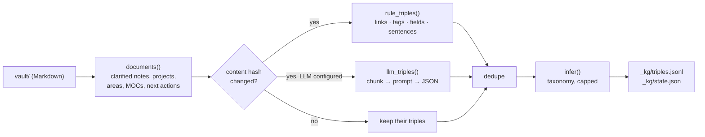
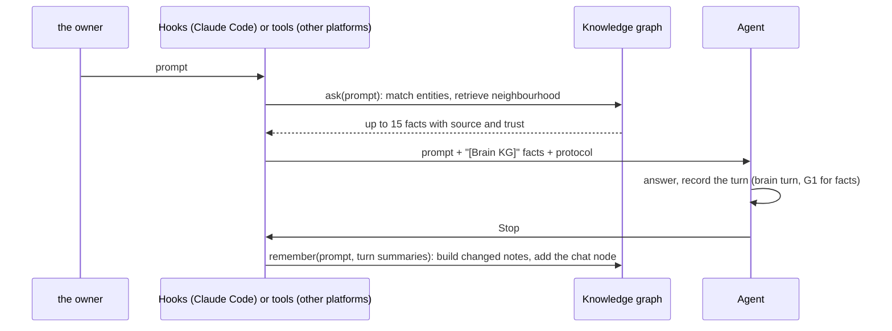

# The knowledge graph

2026-11-07 · design of the knowledge graph in Brain_Standard 4.2. Terms: [glossary.md](glossary.md). Where it sits in the whole system: [architecture.md](architecture.md), sections 5.5, 6.14 and ADR-15 to ADR-19.

## 0 · About this document

| Item | Value |
| --- | --- |
| System | `Brain_Standard` · `brain` 4.2.0 |
| Code | `tools/brain/kgcore.py` (the graph, knows nothing of the vault; the same file in every brain), `tools/brain/kg.py` (the vault, storage), `brain hook prompt|stop` in `tools/brain/cli.py` (read before, remember after), `tools/brain/agent_tools.py` (`brain_recall`, `brain_remember`, `brain_suggest`) |
| Data | `vault/_kg/triples.jsonl`, `vault/_kg/state.json` |
| Configuration | `[kg]` in `tools/brain/defaults.toml` |
| Tests | `tests/test_kg.py` |
| Based on | [robert-mcdermott/ai-knowledge-graph](https://github.com/robert-mcdermott/ai-knowledge-graph) (Apache License 2.0); attribution in [NOTICE.md](../NOTICE.md) |
| Status | Phase 1 done: the graph is built from the vault, read by the prompt hook, updated by the Stop hook, and available to every platform through the MCP server. First used in a private brain built on this design, where it was measured (section 9) |

## 1 · What it is for

Two requirements:

1. **Read first.** Every time there is a chat message or a request for data the brain already holds, the agent reads the knowledge graph before it answers.
2. **Remember after.** Every time a chat ends, what it was about goes into the graph.

Without the graph, an agent sees the brain only through whatever files it happens to open. With it, the agent starts each answer with the brain's own facts about the subject, and each conversation leaves a trace the next one can find.

**Constraints the design keeps.**

| Constraint | From | What it means for the graph |
| --- | --- | --- |
| Markdown + git is the only source of truth | ADR-01 | The graph is derived from the vault and can be rebuilt from it at any time (`brain kg build --full`). It is never the only copy of anything the owner wrote |
| Only commands write logs and derived data | ADR-05, 8.8 | Only `brain` commands and hooks write `_kg/`; its name starts with `_`, so the write guard blocks hand edits by any AI |
| Trust gates G1–G4 | 2.1 | Every triple carries its source and trust. An agent's own claims never enter the graph as facts |
| Standard library only, works offline | 2.0 | The graph builds without any LLM. An LLM is an optional extra reader |
| Many owners write in Vietnamese | — | Matching and extraction must work on Vietnamese text: Unicode words, Vietnamese stop words, head-first compounds |
| Hooks must be fast | Claude Code | The prompt hook adds about 0.1 s on the owner's vault (measured below) |

## 2 · What was taken from ai-knowledge-graph, and what changed

ai-knowledge-graph turns a text document into an interactive graph: it chunks the text, asks an LLM for subject-predicate-object triples, standardises entity names, infers missing relationships, and answers questions from the neighbourhood of the entities a question mentions ("graph chat").

| Part | ai-knowledge-graph | The brain | Why |
| --- | --- | --- | --- |
| Input | one text document per run | every clarified document in the vault, incrementally | the brain changes a little every day |
| Extraction | LLM only | rules (links, tags, fields, short "X is Y" sentences) always; the LLM on top when configured | works offline and with no model; the rules already capture what the owner linked by hand |
| Prompt | `MAIN_USER_PROMPT` | the same rules, shortened, plus "keep the language of the text" and "never add outside knowledge" | Many owners write in Vietnamese; an extractor must not import facts |
| Chunking | words with overlap | the same (`chunk_words`, `chunk_overlap`) | |
| Standardisation | lower case, singularise, LLM entity resolution | lower case, singularise English words only, strip wrapping punctuation and articles | no LLM call per build; singularising Vietnamese is wrong |
| Inference | transitive, taxonomy, lexical, LLM bridges and hubs | taxonomy only, head-last for English and head-first for Vietnamese, short concepts only, capped at `max_inferred_ratio` | the project's own notes say transitive edges buried the real ones; every inferred triple is marked |
| Provenance | the source sentence | the source document id, the kind (note, memory, inferred), the method (rule or LLM), the trust and the grade | the brain's gates need to know where a fact came from and how far it may go |
| Retrieval | match entities, shortest paths between seeds, then by hop distance | the same, plus ranking by trust (the owner's notes first, inferred last) | |
| Output | an HTML graph and an LLM answer | facts as lines in the agent's context; JSON in ai-knowledge-graph's shape for its viewer (`brain kg export`) | the agent that answers is already an LLM; no second model call per prompt |
| Dependencies | networkx, pyvis, requests | none | the brain's rule since 2.0 |

## 3 · Data model

One triple per line in `vault/_kg/triples.jsonl`, sorted by kind, source, subject, predicate and object so that git diffs stay small:

```json
{"s": "kv cache", "p": "decides", "o": "inference bill", "st": "concept", "ot": "concept",
 "src": "permanent:202611010900-kv-cache", "kind": "note", "method": "rule:sentence",
 "trust": "owner", "grade": "", "quote": "The KV cache decides the inference bill."}
```

| Field | Values | Meaning |
| --- | --- | --- |
| `s`, `o` | normalised names | lower case, single spaces, balanced brackets, English plurals folded |
| `p` | 1–3 words | the relationship |
| `st`, `ot` | `note`, `task`, `project`, `area`, `map`, `conversation`, `topic`, `concept`, or an LLM type | what kind of entity; titles are never used for inference |
| `src` | `<kind>:<file stem>`, `next:<id>`, `chat:<date>#<session>`, `rule` | where it came from |
| `kind` | `note` · `memory` · `inferred` | from a document · from a conversation · added by a rule |
| `method` | `rule:link`, `rule:tag`, `rule:field`, `rule:sentence`, `rule:chat`, `rule:match`, `rule:turn`, `rule:taxonomy`, `llm` | how it was read |
| `trust` | `owner` · `graded` · `unverified` · `agent` | see section 7 |
| `grade` | e.g. `B2` | the Admiralty grade when trust is `graded` |
| `quote` | the sentence | for sentence rules, so a person can check the triple |

`vault/_kg/state.json` keeps a content hash per document, the documents the LLM has read, and when the graph was built. Both files live under `_kg/`: the write guard's `_` rule stops every AI tool from editing them by hand.

## 4 · Sources

| Document | Triples | Trust |
| --- | --- | --- |
| Permanent note | title → `links to` → linked titles; title → `tagged` → tag; short sentences | `owner`, or `graded` when the note inherited a grade |
| Literature note | the same, plus title → `cites` → source, `written by` → author | `graded` with its grade; `unverified` for source D/F |
| Fleeting note | short sentences | `owner`; `unverified` when G1 has not checked it or it came from an export; `agent` for an assistant result |
| Project | title → `aims at` → outcome, `in area` → area, links | `owner` |
| Area, MOC | links, tags, sentences | `owner` |
| Next action | task → `advances` → project, `context` → `@ctx` | `owner` |
| Conversation | `chat <date> <session>` → `mentions` → entities in the owner's message; → `about` → entities in the turn summaries; short sentences in the owner's message | `owner` for the owner's words, `agent` for summaries |

**Never read:** the Inbox and its agent items (not clarified yet), templates and logs (names starting with `_`), the weekly reviews. `[kg] kinds` chooses the document kinds.

## 5 · Building the graph



1. `documents(v)` reads every clarified document into `{id, kind, title, text, links, tags, relations, trust, grade}`. Wiki links are resolved to note titles.
2. A document whose hash matches `state.json` keeps its triples. A changed one is read again; a deleted one loses its `note` triples. `memory` triples are never touched by a build.
3. Rules always run. When `[kg] llm` is `auto` and `llm_base_url` and `llm_model` are set (or `--llm` is given), the LLM reads the document too, chunk by chunk. A failed call keeps the rule triples, counts an error and is retried on the next build.
4. Duplicates go; inferred triples are recomputed from scratch on every build.

The LLM endpoint is any OpenAI-compatible chat completions URL: Ollama, LM Studio, vLLM, LiteLLM, OpenRouter. The key, if any, is read from the environment variable named in `llm_api_key_env`, never from the configuration file. **Privacy:** the LLM receives the full text of the owner's notes. Prefer a model on the owner's own machine (Ollama); a cloud endpoint sends personal notes outside the house, which the owner must decide on knowingly (NFR privacy, 1.3).

## 6 · Reading before an answer, remembering after



**Read (prompt hook, `brain_recall`, `brain kg ask`).**

1. Match entities: whole names in the prompt first (the longest wins), then names that share content words with it. Vietnamese and English stop words are ignored. At most `max_seeds` (6).
2. Retrieve: the triples on shortest paths between the matched entities first (they answer "how does A relate to B"), then the rest within `hops` (2), nearest first, the owner's own facts before graded ones before unverified ones, inferred last. At most `max_facts` (15).
3. Format each fact with its source and trust: `kv cache → decides → inference bill  [permanent:… · owner]`. The block starts with a line telling the agent how to treat each trust level.

If the graph is empty, broken or slow, the hook says nothing and writes the error to stderr: the conversation never stops because of the graph.

**Remember (Stop hook, `brain_remember`, `brain kg remember`).**

1. `brain hook stop` reads what `brain hook prompt` saved for the session (`[paths] hook_state`).
2. Bring the graph up to date with the notes the turn changed (rules only in hooks unless `llm_in_hooks`).
3. Add a conversation node `chat <date> <session>` with `mentions` edges to the entities in the owner's message (trust `owner`), `about` edges to the entities in the turn summaries recorded with `brain turn` (trust `agent`), and the short sentences of the owner's message (trust `owner`). At most `max_memory_facts` edges of each kind.
4. Mark the turn as remembered, so a second Stop event adds nothing.

**What is never remembered:** the agent's answer. An answer can be wrong, and the brain's rule since 2.1 is that facts an agent brings in enter only through G1 with a source record. Those facts then come back into the graph from their notes, with their grade. The graph remembers *that* a conversation was about something, and what the owner said, not what the agent claimed.

## 7 · Trust

| Trust | Comes from | How an agent treats it |
| --- | --- | --- |
| `owner` | the owner's own notes, projects and words | a fact about the owner's thinking; still the owner's view, not a verified fact about the world |
| `graded` (with a grade) | a note an agent submitted through G1 | a fact as good as its grade: `B2` is usable, `C3` needs care |
| `unverified` | source D or F, a chat export, a note G1 has not checked | a lead to check, never quoted as fact |
| `agent` | an assistant result, a turn summary, an inferred triple | a pointer, never a fact |

The graph never raises trust: an LLM reading a `graded B2` note produces `graded B2` triples, marked `llm` so a person can tell how they were read. Suggestions to verify (`brain kg suggest`) point at central entities whose facts are mostly `unverified` or `agent`.

**Rules.** KG-01 (warning): no graph yet, or more than `max_stale_documents` documents changed since the last build (for example after editing notes by hand or a fresh clone). The hooks keep it current in normal use.

## 8 · Interfaces

| Interface | Read | Write |
| --- | --- | --- |
| Claude Code in the brain repository | `brain hook prompt` (UserPromptSubmit) | `brain hook stop` (Stop); setup in `integrations/claude-code/` |
| Any MCP client (`integrations/mcp/brain_mcp.py`) | `brain_recall` | `brain_remember` |
| Javis OS plugin | `brain_recall` | `brain_remember` |
| A person | `brain kg ask`, `brain kg stats`, `brain kg suggest`, `brain kg export` | `brain kg build`, `brain kg remember` |
| A chat app without tools | the exported JSON or `kg ask` output attached as a document (by instruction) | none: the owner captures what matters |

**Configuration** (`[kg]`, every key has a default):

| Key | Default | |
| --- | --- | --- |
| `enabled`, `read_on_prompt`, `update_on_stop` | true | switch the parts off one by one |
| `kinds` | all clarified kinds | the documents read |
| `max_facts`, `hops`, `max_seeds` | 15, 2, 6 | how much the prompt hook adds |
| `max_memory_facts` | 8 | memory edges per turn and kind |
| `sentence_rules`, `sentence_verbs`, `sentence_max_subject_words`, `sentence_max_object_words` | on, English and Vietnamese verbs, 6, 8 | the "X is Y" reader |
| `infer_taxonomy`, `infer_min_chars`, `infer_max_words`, `max_inferred_ratio` | on, 4, 4, 0.5 | inference |
| `llm`, `llm_base_url`, `llm_model`, `llm_api_key_env`, `llm_temperature`, `llm_timeout`, `llm_in_hooks` | auto, empty, empty, empty, 0.2, 120, false | the optional LLM |
| `chunk_words`, `chunk_overlap`, `max_predicate_words` | 100, 20, 3 | LLM extraction |
| `suggest_min_degree`, `suggest_hubs`, `suggest_min_chats` | 4, 25, 3 | suggestions |
| `stopwords`, `max_stale_documents` | empty, 20 | matching, KG-01 |

## 9 · Measured on the first brain to use it (2026-11-07)

| Measure | Value |
| --- | --- |
| Documents | 35: 7 permanent, 5 literature, 5 MOCs, 8 areas, 3 projects, 7 next actions |
| Triples | 87 from rules, 0 inferred, 6 islands |
| Full build | 0.12 s |
| `brain kg ask` | 0.11 s |
| Prompt hook, including logging | 0.11 s, about 3.7 KB added to the context |

Most triples today come from links and tags, because that owner's notes link by hand. Sentence rules found 3 triples; an LLM would find far more in the literature notes. The 6 islands are real: the projects and their next actions are not linked to any note yet, which `brain kg suggest` reports.

## 10 · Risks

| Risk | Consequence | Mitigation |
| --- | --- | --- |
| An LLM invents a relationship | a wrong fact in the agent's context | method `llm` on every such triple; the prompt forbids outside knowledge; the triple keeps the note's trust, never more; `brain recheck` covers the notes |
| Sentence rules misread a sentence | a noisy triple | bounded lengths; the quote is stored; few triples in practice; `sentence_rules = false` switches them off |
| The graph lags the vault | stale facts | incremental build in every Stop hook; KG-01 |
| Notes sent to a cloud LLM | personal data leaves the house | LLM off by default; recommend a local model; the key never in the configuration |
| Text in a note tries to instruct the agent | prompt injection through the context | facts are shown as data lines with a source, never as instructions; the protocol line says what they are |
| Merge conflict in `triples.jsonl` | a broken file after pulling | the file is derived: resolve by taking either side, then `brain kg build --full` |
| The graph grows large | slower hooks | at thousands of documents, index it with the retrieval layer (ADR-08, phase 2 below) |

## 11 · Phases

| Phase | What | Status |
| --- | --- | --- |
| 1 | File graph in the vault, rules + optional LLM, hooks read and remember, MCP and Javis tools, suggestions, export | done in 4.2 |
| 2 | The retrieval layer (ADR-08, section 4.1 of the DAB) indexes `triples.jsonl` next to the notes in SQLite, and an HTTP `recall` endpoint serves it to workflow tools and remote MCP clients | with the retrieval layer |
| 3 | Hybrid retrieval: embeddings of notes from a local model, merged with the graph neighbourhood; community detection and naming as in ai-knowledge-graph | later |
| 4 | A graph view built from the JSON `brain kg export` writes (ai-knowledge-graph's viewer reads it today) | later |

## 12 · Decisions

- **ADR-15:** the knowledge graph is a derived file in the vault, built from Markdown by the `brain` core with the standard library, and rebuildable at any time. Not a graph database.
- **ADR-16:** every triple carries its source, kind, method and trust. The graph never raises trust, and an agent's own answers are never stored as facts: only the owner's words and turn summaries are remembered, and outside facts enter through G1.
- **ADR-17:** the LLM is optional and off until configured; rules always run; a local model is recommended.
- **ADR-18** and **ADR-19** (integrations and suggestions) are in [integrations.md](integrations.md) and [design-suggestions.md](design-suggestions.md). All five are in [architecture.md](architecture.md), section 9.
